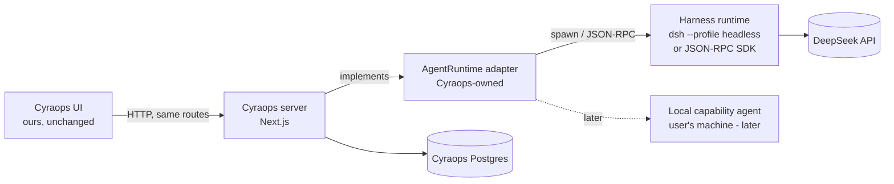

# Cyraops × DeepSeek Harness — Architecture Decision

## Decision (ADR-001): process boundary, hybrid reuse

Run the Harness **headlessly as a managed runtime behind a Cyraops-owned
adapter**. Start with per-turn CLI spawning (proven today); move to one
long-lived runtime via the shipped JSON-RPC SDK (`dsh-sdk-jsonrpc-server`) once
concurrency requires it. The Harness UI is never mounted, never rendered, never
branded.

### Why not vendor the source?

1. **No source ships.** The package contains compiled, content-hashed bundles
   (`lib/bin.js`, `lib/plugin-*.js`) — there is no `src/` to fork meaningfully.
2. **MIT permits vendoring, maintenance doesn't.** Living inside compiled bundle
   internals is exactly the cost the prompt says to avoid.
3. **A supported interface exists.** `dsh --profile headless --json` and the
   JSON-RPC SDK are the published, documented surfaces.

So we reuse at the **runtime boundary**, not the source tree. There is one
bridge, owned by Cyraops, invisible to customers.

## Target shape



## The Cyraops-owned interface (ADR-002)

```ts
interface AgentRuntime {
  createSession(input: { tenantId: string; conversationId: string }): Promise<Session>;
  executeTurn(input: { sessionId: string; task: string }): AsyncIterable<AgentEvent>;
  getSession(sessionId: string): Promise<Session | null>;
  cancelTurn(input: { sessionId: string }): Promise<void>;
  closeSession(sessionId: string): Promise<void>;
  healthCheck(): Promise<RuntimeHealth>;
}
```

The adapter maps this onto the harness CLI/SDK; nothing else in the codebase
imports `dsh`. Sessions: **Cyraops owns identity** — our `AiConversation.id` is
the tenant-scoped key; the harness `sessionId` is stored against it, never
exposed to the client.

## What Cyraops keeps owning (never delegates)

Users, orgs, tenants, roles, CRM records, email/calendar/company modules,
subscriptions, usage metering, conversation ownership, tool allowlists,
approval UI, and the CRM's own tools (tickets, schedule, routines, contacts).
The harness supplies: agent loop, tool lifecycle, sessions, compaction,
subagents, permissions engine, and model connectivity.

## Alternatives considered

| Option | Verdict |
| --- | --- |
| Import harness as a library | impossible — no main/exports, `require()` fails |
| Copy compiled internals (vendor) | legal but brittle; rejected for now, revisit only with a concrete limitation |
| Run `dsh web` embedded | violates "one UI"; rejected |
| Rewrite agent loop in-house | duplicates the harness; rejected |
| **CLI/SDK process boundary** | **chosen** — proven, supported, upgradable |

## Upgrade path

The harness is resolved at runtime (`HARNESS_BIN` / PATH), pinned by version in
`package.json` as metadata only. Upgrades = install new `@deepseek-ai/dsh`,
re-run the POC suite, bump the pin. Rollback = restore previous install.
