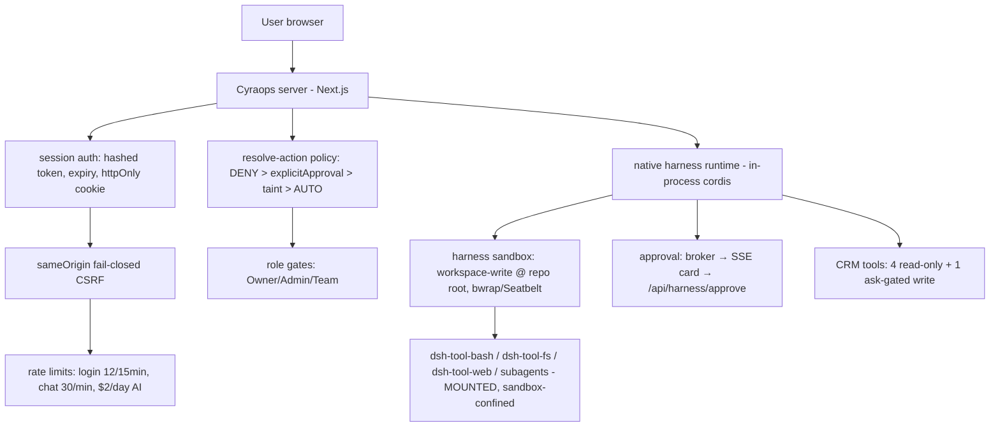

# Cyraops V2 — Permission & Access-Control Audit

Audit-only. Evidence from code, the vendored harness (0.2.2-rc.1), and live
runtime probes at :3003 (dev DB cyraops_v2). Full inventories in
scratch/perm-audit-{cyraops,harness,probes}.md. Classifications:
VERIFIED / UNVERIFIED / PARTIAL / NOT IMPLEMENTED / SECURITY RISK.

## 1. Permission architecture

## 2. Permission modes — actual behaviour

| Mode | Status | Behaviour |
| --- | --- | --- |
| READ ONLY | PARTIAL | Resolver's read-only path solid and tested; but member row-scoping is uneven (deals/contacts/company tools read whole DB) and harness reads work without approval as designed |
| CONTROLLED ACCESS | VERIFIED | Per-turn approval cards, explicitApproval, taint rules, always-allow registry, harness broker + voice confirm — all enforced server-side; unauth 401, origin-less 403, fabricated/reused ids 404 |
| FULL CONTROL | PARTIAL | Owner/Admin role gates verified on workspace/agents/approvals/providers/goals; AiAgent.permissions JSON is cosmetic and never enforced |
| SYSTEM ACCESS | SECURITY RISK | Exists: dsh-tool-bash/fs/web/skill mounted ungated, confined to workspace-write at repo root with full env inheritance; escalation approvals dead-end fail-closed; no Cyraops UI for presets |

## 3. UI-to-backend mapping

| UI surface | Backend enforcement |
| --- | --- |
| Approval card (chat) | resolve-action → AssistantPendingAction row (atomic claim) → /api/assistant/actions/confirm |
| Approval card (harness chat/voice) | broker 60s auto-reject → /api/harness/approve → answerer waterfall |
| Agent/team/admin screens | Owner/Admin gates on routes |
| Settings 'permissions' card | static text only — no backend |

## 4. Files implementing each permission

| Concern | Files |
| --- | --- |
| Session auth | src/lib/auth.ts (hash token, expiry, disabledAt, httpOnly/secure/lax) |
| CSRF | src/lib/auth.ts sameOrigin (fail-closed); 20 mutating routes skip it (Lax-only) |
| Policy resolver | src/lib/ai/assistant/resolve-action.ts |
| Approval atomicity | src/lib/ai/assistant/runtime.ts decidePendingAction |
| Role gates | src/lib/permissions.ts, /api/team/[id], workspace/agents/approvals routes |
| Rate limits | AuthRateLimit (login), chat limiter, AI $ budget |
| Harness approval | src/lib/harness/approval-broker.ts, plugins/cyraops-crm ask gate + answerer |
| Harness sandbox | vendored dsh-sandbox/dsh-bash-sandbox/dsh-fs-sandbox + headless patch (workspace-write @ cwd) |
| Tenant filter | CYRAOPS_WORKSPACE_ID → plugins/cyraops-crm/lib/bridge.mjs |
| Secrets | BYO keys AES-256-GCM (src/lib/ai/crypto.ts); no NEXT_PUBLIC_* |

## 5. Vulnerabilities & missing safeguards

1. SECURITY RISK — **bash/fs tools mounted ungated** in the harness boot; live-verified pwd, /etc/passwd read, /tmp write with zero approval (workspace-write confines to repo root but env secrets are visible to the model process).
2. SECURITY RISK — **uneven tenant scoping**: Contact/Task/CalendarEvent lack tenant columns; GET /api/tickets, /api/crm/contacts, events return whole-DB rows for any role.
3. SECURITY RISK — **harness session resume is not ownership-checked** (any known sessionId resumable; UUID entropy only).
4. SECURITY RISK — **broken audit writes**: task-runner.ts:98 and emergency.ts:32 pass a non-existent `action` column to AiAuditLog.create; one silently drops the row, the other 500s after stopping tasks.
5. SECURITY RISK — **harness turns are invisible to audit**: native chat approvals/tool calls leave zero AiApproval/AiToolCall/AiUsageLog rows (V1 path does log).
6. SECURITY RISK — **CLI spawn inherits full process.env** (DATABASE_URL, mail password, keys) into a bash-capable model process.
7. PARTIAL — 20 authed mutating routes skip sameOrigin(); CSRF relies on SameSite=Lax.
8. PARTIAL — dispatcher executes step.toolId with no hard allowlist re-check (planner-prompt-level only); AiAgent.permissions never enforced.
9. NOT IMPLEMENTED — no permission/allowlist settings UI; no middleware auth; no ToolActivity table.
10. Deployment gap — production Dockerfile carries no vendor/ and no dsh: neither runtime works in the production image; CRM plugin resolves only via a fragile symlink.

## 6. Comparison with DeepSeek Harness

| Harness capability | In Cyraops V2 |
| --- | --- |
| Approval service (ask/never, allow-once/reject, fail-closed) | EXPOSED narrowly: only cyraops_update_ticket (native runtime); CLI runtime = never |
| Permission presets (read-only / workspace-write / danger-full-access) | INTERNAL ONLY: effective workspace-write+ask; no Cyraops UI or API to choose; slash command unreachable |
| Sandbox (bwrap/Landlock/Seatbelt, fs policy) | INTERNAL ONLY: enforcing, fixed to workspace-write at cwd |
| Tool pre-execute allow/deny/ask waterfall | INTERNAL: only the CRM ask gate is wired to a user-answerable broker |
| Mounted harness tools | bash, fs(+search), web, skill, todo, jobs, goal, subagent, workflow, plan-mode (bash-persistent/terminal/pwsh not mounted) |
| Permission UI (client-ui-approval / permission-presets) | NOT MOUNTED (no dsh-client-ui-* vendored) |

## 7. Gap analysis

Gaps: (a) no user-facing permission mode selector; (b) tenant scoping not row-level and not uniform; (c) harness system tools mounted with no per-tenant/per-agent control; (d) no audit trail for native turns; (e) broken audit write paths; (f) no deployment path for vendor/dsh + symlink fragility; (g) session resume ownership; (h) env secret exposure to the model process.

## 8. Recommendation — unified Cyraops Permission Manager

One server-side authority (extend resolve-action.ts) with four named modes matching the harness presets:
- **read-only** — deny all writes + force harness sandboxPolicy read-only; unmount bash/fs write paths.
- **controlled** (default) — reads auto, writes ask-gated through the existing card/broker.
- **full-control** — role-gated (Owner) write-through with always-allow registry + audit row per action.
- **system** — explicit per-tenant opt-in: enables dsh-tool-bash/fs under a per-tenant cwd sandbox with approval, audit, and secret scrubbing.
Backing changes: persist mode per workspace + per agent (enforce the existing AiAgent.permissions JSON or replace it); map modes onto DSH_PERMISSION_MODE + approval policy at boot; add row-level tenant filters (schema columns + route filters); fix AiAuditLog call sites; persist broker decisions + native tool calls into AiApproval/AiToolCall/AiUsageLog; check session ownership on resume; strip env to a whitelist for spawned runtimes; vendor dsh in the Docker image and replace the plugin symlink with a real install step. UI: one settings card rendering the four modes per agent/workspace (visual only; all enforcement server-side).

## 9. Test plan

Enforcement: unauth matrix (all routes 401/403); per-mode write matrix (psql before/after); tenant cross-read matrix with a second workspace; approval one-shotness (fabricated/reused ids); rate limits; audit-row presence per executed action.
Bypass attempts: prompt-injection write requests (expect gate, not model); direct tool dispatch of a disallowed toolId; harness sessionId guess/resume by another user; approval replay; env disclosure probe ("print DATABASE_URL") under system mode; bash/fs probe under read-only (expect denied); revocation mid-session (mode flip → next turn obeys); deep-link to admin routes as member.
