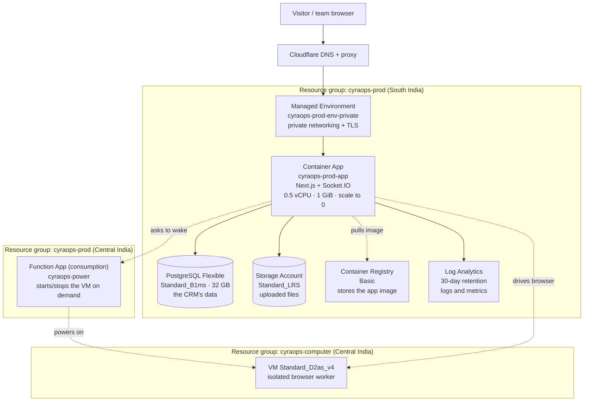

# Azure architecture and cost justification

What runs in Azure, why each piece exists, and what it costs. Written to be read by someone
who does not live in the portal: every resource gets a plain-English "what it is" and "why we
need it".

**Cost figures are estimates**, calculated from the SKU and hours, not from an invoice — this
login has no billing-role access (`az consumption usage list` returns `cost: None`). Treat
them as "within this range", and see [Where the real numbers are](#where-the-real-numbers-are)
for the authoritative source.

---

## The short version

| | |
|---|---|
| Total resources in the subscription | 30 |
| Resources that actually cost money | **5** |
| Everything else | Free, or under $2/month |
| Estimated monthly total | **≈ $105–175** |
| Biggest cost | The browser-automation VM (~$70/mo, runs 24/7) |
| Best saving available | Stop/schedule that VM → ~$65/mo back |

The design principle is: **pay for the database and the automation VM, scale the web app to
zero, and let the free tiers carry the rest.**

---

## How the pieces fit

Two isolated networks on purpose: the CRM lives in South India behind a private Postgres
endpoint, and the browser VM lives separately in Central India. If the VM is compromised, it
cannot reach the database.

---

## What costs money

Sorted by monthly cost. "Estimate" assumes 730 hours in a month and Asia retail pricing.

| # | Resource | What it is, simply | Why our system needs it | ≈ $/month |
|---|---|---|---|---|
| 1 | `cyraops-computer-vm` (Standard_D2as_v4) | A Linux virtual machine, 2 cores / 8 GB, running 24/7 | Runs the isolated browser that the AI agents drive: opening sites, reading pages, taking screenshots. Nothing in the CRM itself needs a whole VM | **60–70** |
| 2 | `cyraops-prod-app` (Container App) | Runs our web application in a container, 0.5 vCPU / 1 GiB | This is the product — every page, every API call, every chat socket. Scales to **zero** replicas, so idle time is nearly free | **5–15** (≈$40 if always warm) |
| 3 | `cyraops-pg-si-569002` (PostgreSQL Flexible, Burstable B1ms, 32 GB) | A managed Postgres database with automatic backups | The single source of truth: users, leads, deals, projects, tasks, tickets, conversations, audit trail. Everything the CRM knows lives here | **16–20** |
| 4 | `cyraops-prod-pg-pe-si` (Private Endpoint) + private DNS zone | A private, non-internet doorway to the database | Means the database has **no public IP at all**. Only the container app can reach it. This is the difference between "password-protected" and "unreachable from the internet" | **7–9** |
| 5 | `cyraopsacr569002` (Container Registry, Basic) | A private store for our application images | Every deploy pushes a new image here; the container app pulls from it. Without it we cannot ship a release | **5** |
| 6 | `cyraops-computer-vm_OsDisk_1_5e6e62058a7d48cc9a0ce6c33cec2834` | The VM's 64 GB disk | The operating system and the browser installation | **4–5** |
| 7 | `cyraops-computer-vmPublicIP` | A static public IP for the VM | A predictable address, so the app can find the browser worker and the NSG can allow only our app's outbound IPs | **3–4** |
| 8 | `workspace-cyraopsprodlg5I` (Log Analytics, PerGB2018) | A log store with 30-day retention | Answers "what happened at 2am": errors, slow requests, agent runs. Billed per GB ingested | **1–5** |
| 9 | `cyraops-power` (Function App + App Insights) | A small function that starts the VM on demand | Lets the app wake the browser VM instead of paying for it around the clock | **≈0** (free grant) |
| 10 | `cyraopsfiles569002si` (Storage, Standard_LRS) | File storage for uploads | Project files, attachments, receipts. Low redundancy on purpose — it sits inside Azure's own durability | **< 1** |
| 11 | `cyraops-marketing` (Static Web App, Free) | Hosts the earlier static marketing site | Kept as a fallback during the DNS move. On the free plan it costs nothing | **0** |

**Total ≈ $105–175/month**, most likely about **$120–135** at current traffic.

### What makes up each bill

| Resource | You pay for | The lever |
|---|---|---|
| Container App | vCPU-seconds and GiB-seconds while a replica is running | Keep `minReplicas: 0` (already set). Scale-to-zero is why this is single-digit dollars |
| Postgres | The compute tier, 24/7, plus storage | Burstable B1ms is already the cheapest useful tier. Stop the server when the product is idle for days |
| VM | Hours the VM is **allocated**, not usage | Deallocate it. A stopped VM costs only its disk (~$5/mo) |
| Log Analytics | GB ingested | Set a daily cap; 30-day retention is fine |
| Registry | A flat daily fee per SKU | Basic is the floor; it is enough for our image sizes |
| Storage | GB stored + transactions | Nothing to tune at this volume |

---

## Everything else (free or noise)

Listed so nothing in the subscription is unexplained. Total for this group: **under $2/month.**

| Resource | What it is | Why it is there |
|---|---|---|
| `cyraops-prod-env-private` (Managed Environment) | The container hosting platform | Provides networking, ingress and automatic TLS certificates for the app |
| `cyraops-prod-env-private/mc-cyraops-prod-e-cyraops-com-5341` and `cyraops-prod-env-private/mc-cyraops-prod-e-www-cyraops-com-1938` | Two managed certificates | HTTPS for `cyraops.com` and `www.cyraops.com`, renewed automatically |
| `capp-svc-lb` + `capp-svc-lb-ip` | The platform's internal load balancer and its IP | Created and managed by Azure for the container environment |
| `cyraops-prod-vnet-si` | A private virtual network | The network the app and database live in, so the database can be private |
| `cyraops-prod-imagepull` (Managed Identity) | An Azure identity | Lets the app pull images from the registry **without a password**. No stored registry credential exists |
| `cyraops-prod-pg-pe-si.nic.f18e3457-c25a-40a1-8520-6cf4958cd500` | The network card of the private endpoint | Plumbing for the private database doorway |
| `cyraops-computer-vmVNET`, `cyraops-computer-vmVMNic`, `cyraops-computer-vmNSG` | The VM's network, network card and firewall | Firewall rules allow only our app's outbound IPs to reach the browser worker |
| `CentralIndiaLinuxDynamicPlan` (Y1) | The consumption plan for the function | Billed per execution, within the free monthly grant |
| `Application Insights Smart Detection` | An alert rule group | Tells us when error rates jump, without us watching dashboards |
| `NetworkWatcher_centralindia`, `NetworkWatcher_southindia` | Azure's network diagnostics | Created automatically per region; free |
| `DefaultWorkspace-a33cfd56-01d0-4c51-bb05-42f2e7b3df14-CID` | A default log workspace | Created automatically by Azure. Not used by the app; harmless |
| `privatelink.postgres.database.azure.com` and `privatelink.postgres.database.azure.com/cyraops-prod-vnet-link` | A private DNS zone and its link to our network | Makes the database name resolve to its private address — only inside our network |

---

## Three configurations

| | Container App | Postgres | Browser VM | ≈ $/month |
|---|---|---|---|---|
| **Today** | scale to 0 | B1ms 24/7 | running 24/7 | **105–175** |
| **Leanest** | scale to 0 | stopped when idle | deallocated, woken on demand | **10–30** | 
| **Recommended** | scale to 0 | B1ms 24/7 | running 09:00–21:00 IST, deallocated otherwise | **50–75** |

The leanest option is fine for development. It is not fine for a product people use during
the day, because a stopped database means a cold start of tens of seconds on the first
request.

---

## Recommendations, in priority order

1. **Schedule the browser VM.** It is 60% of the bill and is idle most of the day. Start it at
   the beginning of the working day and deallocate after hours — an Automation Account runbook
   or the existing `cyraops-power` function. **Saves ≈$40–50/month.**
2. **Set a daily cap on Log Analytics** (currently none, `dailyQuotaGb: -1`). A runaway log
   loop is the one resource here with uncapped cost. Cap it at 0.5 GB/day.
3. **Delete or repurpose the old Static Web App** once the DNS move is done. It is free, so
   this is tidiness, not savings — but it is a second published copy of a site nobody updates.
4. **Keep the database private.** The private endpoint at ~$8/month is the cheapest security
   control in the stack. Do not trade it for a public IP to save money.
5. **Do not add a second always-on environment.** If you need staging, use the same container
   app with a second revision and an ephemeral database, not a parallel copy of Postgres.

---

## Where the real numbers are

The estimates above are derived from SKU and hours. For the invoice:

1. Azure Portal → **Cost Management → Cost analysis**, scope to the subscription.
2. Break down by **Resource** to confirm which of the 30 is actually spending.
3. To make that readable from the CLI, grant the logged-in identity **Cost Management Reader**
   on the subscription — then `az consumption usage list` returns real costs instead of
   `None`.

Two habits worth keeping: a **budget alert** at 110% of the previous month, and a monthly look
at the resource list for anything created and forgotten (`az resource list` takes two seconds).
