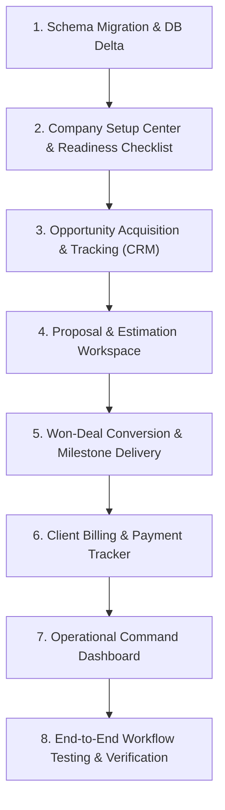

# CYRAOPS — BUSINESS LAUNCH READINESS AUDIT
**Comprehensive Technical & Architectural Evaluation for IT Services Business Launch**

**Audit Timestamp:** 2026-11-06T03:25:00+05:30  
**Target Environment:** Development Workspace (`locally hosted app dev`)  
**Development URL:** `http://localhost:3001`  
**Development Database:** `company_os_dev`  
**Production Isolation:** Verified Untouched (`company_os`, `locally hosted app`)  
**Auditor:** Principal Software Architect & Technical Lead  

---

## 1. EXECUTIVE SUMMARY

Cyraops is being launched as the central company operating system for an agile, two-person IT services firm specializing in cloud infrastructure, AWS operations, DevOps, CI/CD automation, server management, and managed IT services.

The operational objective is to support the complete commercial lifecycle:
$$\text{Opportunity Discovery} \longrightarrow \text{Evaluation} \longrightarrow \text{Proposal} \longrightarrow \text{Deal Won} \longrightarrow \text{Project Delivery} \longrightarrow \text{Client Invoicing} \longrightarrow \text{Payment Collection} \longrightarrow \text{Project Close}$$

This audit establishes the baseline of what currently works, what is partially implemented, what is merely placeholder UI, and what must be engineered to deliver a reliable **Business Launch MVP**.

---

## 2. MODULE READINESS SCORECARD

| Subsystem / Module | Functional Area | Implementation Status | Verdict & Observations |
|---|---|---|---|
| **Company Profile** | Company Setup | **PARTIALLY WORKING** | `Workspace` model has only `name` and `loginEmail`. Full company profile (logo, tagline, description, industry, phone, website, location, timezone, social links) is missing from database schema and UI. |
| **Service Catalogue** | Company Setup | **PARTIALLY WORKING** | `ServiceCapability` exists in database and dashboard, but is formatted as internal engineering readiness rather than a commercial service catalogue with deliverables, duration, and pricing models. |
| **Portfolio & Case Studies** | Company Setup | **UI ONLY** | Tab in `public-website.tsx` renders static text without database persistence, CRUD forms, or client outcome tags. |
| **Team Profiles** | Company Setup | **WORKING** | Individual `User` models, role-based auth, secure onboarding links with single-use tokens work. Bio, skills, technical focus, and allocation availability need display. |
| **Business Contact Details** | Company Setup | **NOT CONFIGURED** | Client contacts exist in CRM, but company's own official business contact information is not centrally stored or editable. |
| **Company Presence** | Company Setup | **UI ONLY** | Channel links in `public-website.tsx` save only to in-memory React state (`setSavedLinks`) and are lost on page refresh. |
| **Company Readiness Checklist** | Company Setup | **NOT IMPLEMENTED** | No structured business readiness checklist tracks onboarding milestones (profile, services, templates, freelance profiles, billing). |
| **Leads & Contacts** | Sales & CRM | **WORKING** | Full CRUD, database-backed deduplication via partial unique indexes, assignment, search, and activity logging. |
| **Companies** | Sales & CRM | **WORKING** | Client company records with partial unique indexes on name and domain, relationship associations to contacts and deals. |
| **Deals & Pipeline** | Sales & CRM | **WORKING** | Deal stages, probability weighting, INR base currency enforcement, Kanban and table views, and activity logs. |
| **Opportunity Tracker (Freelance)** | Sales & CRM | **PARTIALLY WORKING** | CRM accepts deals, but lacks dedicated fields for source platforms (Upwork, Freelancer, Fiverr, LinkedIn), external job URLs, application deadlines, and next actions. |
| **Proposal & Estimation** | Sales & CRM | **NOT IMPLEMENTED** | No proposal data model or workflow exists. Proposals cannot be drafted, templated, previewed, or linked to deals. |
| **Deal-to-Project Conversion** | Sales & Delivery | **WORKING** | Atomic, transactional (`db.$transaction`), idempotent, enforces `CLOSED_WON`, unique 1:1 bidirectional link (`Project_dealId_key`, `Deal_convertedProjectId_key`). |
| **Projects Workspace** | Project Delivery | **WORKING** | Overview, status transitions, deadlines, priority, ownership, and member assignment. |
| **Task Management** | Project Delivery | **WORKING** | Creation, status progression (`BACKLOG`, `TODO`, `IN_PROGRESS`, `IN_REVIEW`, `DONE`), priorities, assignee, due dates. |
| **Task Collaboration** | Project Delivery | **PARTIALLY WORKING** | Two teammates can assign tasks and update status, but task detail view for comments and individual file attachments is absent. |
| **Project Communication** | Project Delivery | **WORKING** | `ProjectPost` discussion board works inside project workspace; team direct messaging and group chat work in `/chat`. |
| **Project Files** | Project Delivery | **WORKING** | `DriveFile` system with local storage, opaque file keys, secure downloads, and project association. |
| **Project Milestones** | Project Delivery | **NOT IMPLEMENTED** | No milestone model or milestone UI exists in `Project`. |
| **Project Completion Checklist** | Project Delivery | **PARTIALLY WORKING** | Project status can be changed to `COMPLETED`, but no verification checklist (deliverables, sign-off, invoice status) exists. |
| **Client Billing & Invoicing** | Finance | **NOT IMPLEMENTED** | `InvoiceRecord` represents vendor expense bills (accounts payable). Client-side project billing (invoices issued, amounts paid, outstanding balance, milestone billing) is completely missing. |
| **Expense & Cost Management** | Finance | **WORKING** | Expenses, categories, investments, recurring schedules, and PDF expense extraction. |
| **Revenue Tracking** | Finance | **PARTIALLY WORKING** | Won deals sum pipeline value; actual received project billing revenue is not tracked. |
| **Company Email Integration** | Communication | **NOT CONFIGURED** | IMAP/SMTP client exists, but `.env` lacks GoDaddy mailbox credentials. Client mailto links and communication notes are needed. |
| **Operational Dashboard** | Management | **PARTIALLY WORKING** | Dashboard renders business health, but displays `$` instead of `₹` on pipeline health and lacks a unified "What needs attention today?" operational view for both collaborators. |
| **Security & Permissions** | Security | **WORKING** | Token authentication, role boundaries (`OWNER`, `ADMIN`, `MEMBER`), same-origin protection, rate limiting, and password hashing. |

---

## 3. DETAILED DEFICIT ANALYSIS

### 3.1 Company and Business Setup Deficits
1. **Volatile Company Presence:** In [`src/components/modules/public-website.tsx:222`](file:///Users/tanveersinghsaini/Desktop/locally%20hosted%20app%20dev/src/components/modules/public-website.tsx#L222), channel links (Upwork, Freelancer, Fiverr, LinkedIn, GitHub) are stored in React component state (`setSavedLinks`). Refreshing the browser clears all entered profile links.
2. **Minimal Workspace Model:** [`prisma/schema.prisma:296`](file:///Users/tanveersinghsaini/Desktop/locally%20hosted%20app%20dev/prisma/schema.prisma#L296) holds only `id`, `name`, `ownerId`, `loginEmail`, and `loginPasswordHash`. No company profile fields (tagline, description, industry, contact phone, website, address, timezone, social links) exist.
3. **No Central Readiness Checklist:** The team lacks a unified checklist showing whether the business is ready to bid (profile, services, proposal templates, Upwork setup, billing).

### 3.2 Sales and Acquisition Deficits
1. **No Quick Opportunity Capture:** When a lead or job is found on Upwork or Freelancer, there is no specialized modal to paste the job URL, capture platform name, record client budget, set application deadline, and assign next action.
2. **Missing Opportunity Attributes on Deal:** The `Deal` model lacks `sourcePlatform`, `externalUrl`, `nextAction`, and `followUpDate`.
3. **Absence of Proposal Architecture:** The system has no `Proposal` entity or templates. Preparing, reviewing, and sending client proposals must currently be done outside Cyraops.

### 3.3 Project Delivery Deficits
1. **No Project Milestones:** Projects have tasks and deadlines, but lack structured milestones with dates, owners, deliverables, and completion status.
2. **No Task Detail Dialog:** In [`src/components/modules/projects.tsx:41`](file:///Users/tanveersinghsaini/Desktop/locally%20hosted%20app%20dev/src/components/modules/projects.tsx#L41), tasks can only be toggled through status cycles. Clicking a task does not open a modal to view description, comments, or attachments.
3. **No Project Closeout Checklist:** Projects can be marked `COMPLETED` without validating deliverable handoff, documentation, and invoice settlement.

### 3.4 Business Operations & Billing Deficits
1. **Confused Financial Concepts:** `InvoiceRecord` in `prisma/schema.prisma` is linked to `Expense` (Accounts Payable). There is zero data model support for Accounts Receivable (Client Invoices).
2. **Missing Client Payment Tracking:** There is no way to record agreed project fee, payment schedule, milestone invoice issued, amount paid, and outstanding balance.

### 3.5 Operational Dashboard Deficits
1. **Currency Inconsistency:** [`src/app/api/dashboard/route.ts:261`](file:///Users/tanveersinghsaini/Desktop/locally%20hosted%20app%20dev/src/app/api/dashboard/route.ts#L261) displays the pipeline value with a dollar symbol (`$${...}k`) even though deals are in INR (`₹`).
2. **Action-Oriented Daily Command Center Missing:** The dashboard presents macro health indicators, but does not provide an actionable daily list: opportunities awaiting review, proposals due, follow-ups scheduled for today, tasks assigned to each collaborator, and overdue project deliverables.

---

## 4. DATABASE CHANGES REQUIRED (PRISMA SCHEMA DELTA)

To support the Business Launch MVP without bloat or schema churn, the following clean schema enhancements are required:

1. **Company Profile & Presence Expansion (`Workspace`):**
   - Add to `Workspace`: `tagline`, `description`, `industry`, `phone`, `website`, `address`, `timezone`, `logoUrl`, `socialLinks` (JSON string), `registrationDetails` (JSON string).
2. **Company Readiness Checklist (`BusinessReadinessItem`):**
   - Model tracking launch checklist items: `category`, `title`, `description`, `status` (`NOT_STARTED`, `IN_PROGRESS`, `COMPLETED`), `ownerId`, `notes`.
3. **Opportunity Fields on `Deal`:**
   - Add to `Deal`: `sourcePlatform` (e.g., UPWORK, FREELANCER, FIVERR, LINKEDIN, DIRECT, REFERRAL), `externalUrl`, `nextAction`, `followUpDate`.
4. **Proposal Engine (`Proposal`):**
   - Model tracking proposals: `dealId`, `leadId`, `title`, `clientName`, `problemStatement`, `solution`, `scope`, `deliverables`, `timeline`, `pricing`, `paymentTerms`, `status` (`DRAFT`, `INTERNAL_REVIEW`, `SENT`, `ACCEPTED`, `REJECTED`, `EXPIRED`), `version`, `authorId`, `reviewedById`.
5. **Project Milestones (`ProjectMilestone`):**
   - Model tracking milestones: `projectId`, `title`, `description`, `dueDate`, `status` (`PENDING`, `IN_PROGRESS`, `COMPLETED`), `deliverables`, `billingAmount`.
6. **Client Billing & Invoicing (`ClientInvoice`):**
   - Distinct Accounts Receivable model: `projectId`, `dealId`, `clientCompanyId`, `invoiceNumber`, `title`, `amount`, `currency` (default INR), `issueDate`, `dueDate`, `amountPaid`, `status` (`DRAFT`, `ISSUED`, `PARTIALLY_PAID`, `PAID`, `OVERDUE`, `CANCELLED`), `notes`.

---

## 5. RECOMMENDED IMPLEMENTATION ORDER

1. **Step 1 — Schema Delta & Prisma Migration:** Apply clean migration adding Company Setup, Opportunity fields, Proposals, Milestones, and Client Invoices to `company_os_dev`.
2. **Step 2 — Company Setup Center:** Implement profile settings, editable readiness checklist, and persistent company presence in UI.
3. **Step 3 — Project Acquisition Workspace:** Add quick "Add Opportunity" modal in CRM with freelance platform fields, job URL, follow-up dates, and source filters.
4. **Step 4 — Proposal & Estimation Workspace:** Implement proposal authoring, IT service templates, review workflow, and deal linkage.
5. **Step 5 — Project Delivery Workspace Enhancement:** Add Milestones tab and task details in `projects.tsx` with completion validation.
6. **Step 6 — Client Billing & Payment Tracker:** Add Client Billing tab to projects and CRM with payment status progression.
7. **Step 7 — Operational Command Dashboard:** Re-anchor dashboard to daily actionable tasks: proposals, follow-ups, overdue tasks, and INR metrics.
8. **Step 8 — Complete Business Workflow Testing:** Run synthetic 23-step end-to-end integration scenario across two collaborator accounts.

