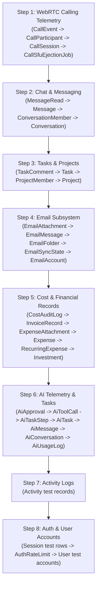

# CYRAOPS — TEST DATA CLEANUP & PURGE PLAN
## Preparation for True Business Operations

**Document Version:** 1.0  
**Target Environment:** Development Database `company_os_dev`  
**Production Invariant:** `company_os` is STRICTLY PRESERVED & UNTOUCHED  
**Deliverable File:** `docs/business-launch/CYRAOPS_TEST_DATA_CLEANUP_PLAN.md`

---

## 1. Executive Summary

This document provides a record-level inventory of all synthetic, test, and demonstration data currently stored in `company_os_dev`. It details exact primary keys, foreign key dependency trees, and a phased execution order to safely purge test artifacts without disrupting workspace configuration or the primary owner account (`tanveer@cyraops.com`).

---

## 2. Complete Record Inventory by Provenance

```
┌──────────────────────┬─────────┬──────────────────────────┬────────────────────────────────────────────────────────┐
│ Subsystem / Table    │ Count   │ Provenance Classification│ Recommended Action                                     │
├──────────────────────┼─────────┼──────────────────────────┼────────────────────────────────────────────────────────┤
│ Workspace            │ 1 row   │ Real Business Scaffold   │ RETAIN. Update placeholders (phone, GSTIN, address).   │
│ User                 │ 30 rows │ 1 Real, 29 Synthetic     │ RETAIN tanveer@cyraops.com; PURGE 29 test accounts.    │
│ Session              │ 171 rows│ 65 Real, 106 Synthetic   │ PURGE test user sessions; RETAIN active owner session. │
│ Project              │ 2 rows  │ 1 Scaffold, 1 Synthetic  │ RETAIN General Operations; PURGE Enterprise Cloud Mig. │
│ Task                 │ 4 rows  │ 100% Synthetic Test Data │ PURGE all 4 voice assistant test tasks.                │
│ Activity             │ 15 rows │ 1 Real, 14 Synthetic     │ RETAIN workspace init; PURGE 14 test logs.             │
│ EmailAccount         │ 2 rows  │ Synthetic Placeholder    │ PURGE unconfigured test mail accounts.                 │
│ EmailMessage         │ 87 rows │ 100% Synthetic Test Data │ PURGE all 87 test email records.                       │
│ EmailFolder          │ 14 rows │ 100% Synthetic Test Data │ PURGE test folder records.                             │
│ Expense              │ 40 rows │ 100% Synthetic Test Data │ PURGE all 40 test expense records.                     │
│ ExpenseCategory      │ 33 rows │ Master Reference Seed    │ RETAIN standard financial taxonomy categories.         │
│ Investment           │ 34 rows │ 100% Synthetic Test Data │ PURGE all 34 test investment records.                  │
│ InvoiceRecord        │ 34 rows │ 100% Synthetic Test Data │ PURGE all 34 invoice test records & ./uploads files.   │
│ RecurringExpense     │ 18 rows │ 100% Synthetic Test Data │ PURGE test recurring schedules.                        │
│ CostAuditLog         │ 134 rows│ 100% Synthetic Test Data │ PURGE test financial audit records.                    │
│ Conversation         │ 12 rows │ 100% Synthetic Test Data │ PURGE test chat conversations.                         │
│ ConversationMember   │ 26 rows │ 100% Synthetic Test Data │ PURGE test conversation memberships.                   │
│ Message              │ 2 rows  │ 100% Synthetic Test Data │ PURGE 2 test messages.                                 │
│ MessageRead          │ 3 rows  │ 100% Synthetic Test Data │ PURGE test message read receipts.                      │
│ CallSession          │ 105 rows│ 100% Synthetic Test Data │ PURGE WebRTC test call sessions.                       │
│ CallParticipant      │ 222 rows│ 100% Synthetic Test Data │ PURGE WebRTC test participants.                        │
│ CallEvent            │ 645 rows│ 100% Synthetic Test Data │ PURGE WebRTC test events.                              │
│ CallSfuEjectionJob   │ 11 rows │ 100% Synthetic Test Data │ PURGE test ejection jobs.                              │
│ AiTask               │ 1 row   │ Synthetic Test Data      │ PURGE test AI task.                                    │
│ AiTaskStep           │ 3 rows  │ Synthetic Test Data      │ PURGE test AI task steps.                              │
│ AiToolCall           │ 2 rows  │ Synthetic Test Data      │ PURGE test tool calls.                                 │
│ AiConversation       │ 12 rows │ Synthetic Test Data      │ PURGE test AI chat conversations.                      │
│ AiMessage            │ 14 rows │ Synthetic Test Data      │ PURGE test AI messages.                                │
│ AiUsageLog           │ 153 rows│ Synthetic Test Data      │ PURGE test AI usage logs.                              │
│ AIUsageRecord        │ 2 rows  │ Synthetic Test Data      │ PURGE test AI usage records.                           │
│ PortfolioItem        │ 2 rows  │ Demonstration Templates  │ RETAIN as internal drafts or replace with real work.   │
│ ServiceCapability    │ 13 rows │ Reference Master Catalog │ RETAIN standard service taxonomy (13 capabilities).    │
│ BusinessReadinessItem│ 8 rows  │ Operational Checklist    │ RETAIN checklist items.                                │
│ Lead, Deal, Contact  │ 0 rows  │ Authentically Clean      │ No action needed (0 records).                          │
│ ClientInvoice        │ 0 rows  │ Authentically Clean      │ No action needed (0 records).                          │
│ Proposal             │ 0 rows  │ Authentically Clean      │ No action needed (0 records).                          │
└──────────────────────┴─────────┴──────────────────────────┴────────────────────────────────────────────────────────┘
```

---

## 3. Exact Record Inventory & Target IDs

### 3.1 Primary Account to Retain
- **User ID:** `cmvvk9sam0000xtiy4d9r0l1e`
- **Email:** `tanveer@cyraops.com`
- **Role:** `OWNER`
- **Status:** **CRITICAL INVARIANT — NEVER DELETE.**

---

### 3.2 Synthetic User Accounts to Purge (29 Records)

```sql
-- Target Test User IDs:
'cmvzwjiwx0000xt2phg0lw90o', -- audit.member@cyraops.com
'cmw10iyzd01soxt64u91fue3k', -- probe@cyraops.com
'cmw3d81mh0000xtzbeujyt1ex', -- phase4_alice@cyraops.com (Alice Engineer)
'cmw3d81mr0001xtzbo8ua4az5', -- phase4_bob@cyraops.com (Bob Designer)
'cmw3e6kgr0000xt7mnpexkr6z', -- audit_alice@cyraops.com
'cmw3e6kgz0001xt7mkt3rxq9k', -- audit_bob@cyraops.com
'cmw3e6kh00002xt7mqspqxk6d', -- audit_charlie@cyraops.com
'cmw3i7vw8000dxt9r3n3c113q', -- audit_disabled@cyraops.com
'cmw3i7vwj000gxt9rnbg4besi', -- audit_removed@cyraops.com
'cmw3jw5ox0002xttictlwdpy2', -- audit_david@cyraops.com
'cmw3kd7rc0000xtgjgjuyoi39', -- group_alice@cyraops.com
'cmw3kd7rh0001xtgjtwue3y02', -- group_bob@cyraops.com
'cmw3kd7ri0002xtgjwet6em4d', -- group_charlie@cyraops.com
'cmw3lsplx0000xta4kaorsrkv', -- host_rem_654884@example.com
'cmw3lspm30001xta4zug522rg', -- member1_rem_654884@example.com
'cmw3lspm50002xta4ng00q7cw', -- member2_rem_654884@example.com
'cmw3lspm70003xta45p4whq3w', -- outside_rem_654884@example.com
'cmw3lt2dt0000xtbiy57iz7wo', -- host_rem_671439@example.com
'cmw3lt2e60001xtbifbtxcmux', -- member1_rem_671439@example.com
'cmw3lt2e80002xtbin5gq1cn7', -- member2_rem_671439@example.com
'cmw3lt2e90003xtbir8bv7bk1', -- outside_rem_671439@example.com
'cmw3ltzyj0000xtd9g70v33kg', -- host_rem_714954@example.com
'cmw3ltzyy0001xtd9wfarwn3x', -- member1_rem_714954@example.com
'cmw3ltzyz0002xtd9znlov2jb', -- member2_rem_714954@example.com
'cmw3ltzz10003xtd94rcxc54j', -- outside_rem_714954@example.com
'cmw3lueq20000xtefog2jh4ny', -- host_rem_734088@example.com
'cmw3lueqe0001xtefnwk1dj8c', -- member1_rem_734088@example.com
'cmw3lueqg0002xtefyn6nlk0g', -- member2_rem_734088@example.com
'cmw3lueqh0003xtefpen623wj'  -- outside_rem_734088@example.com
```

---

### 3.3 Projects & Tasks to Purge
- **Synthetic Project:**
  - `cmvzuynuh0001xtw7772tdqqb` ("Enterprise Cloud Migration")
- **Synthetic Tasks (4 total):**
  - `cmvzu6nfd0001xtxjk9l16o8t` ("Verify Voice Assistant Deployment")
  - `cmvzul1t20003xtkw36m1k7vg` ("Autonomous Voice Verification Task 1793659549277")
  - `cmvzuynw00003xtw717bsijjv` ("Finalize Database Replication Schema")
  - `cmw3cj9a00001xt2sjkpvh68n` ("Verify Voice Assistant Deployment")
- **Retained Project Container:**
  - `cmvwhn8800001xt3x4ne3eu2l` ("General Operations", owned by `tanveer@cyraops.com`). Retain as clean operational workspace.

---

### 3.4 Activity Logs to Purge (14 Records)
Retain only the initial workspace record (`cmvvk9sjw0002xtiyf0qi3bqf`).
Purge all 14 test logs:
```sql
'cmw3qrsjx000axtnc3buezam5', 'cmw3qrro10006xtncqq6htwqz',
'cmw3pzuo0000axt9xs4x7u94d', 'cmw3pzund0006xt9x22p0a7wp',
'cmw3p2x5p000axt1r2p7t1yk1', 'cmw3p2x560006xt1rb0doy6nv',
'cmw3m01hq002rxtn00wckijc6', 'cmw3dcot8002kxtwkwe39dph3',
'cmw3cj9a50003xt2snrm3561h', 'cmw10iyzv01ssxt648w30dzvk',
'cmw10iyzd01sqxt64v83whahe', 'cmvzuynw40005xtw7hckv8aba',
'cmvzul1tb0005xtkwwsrgr9fj', 'cmvzu6nfg0003xtxjqfou48m7'
```

---

## 4. Safe Relational Dependency Deletion Order

Due to PostgreSQL foreign key constraints (`RESTRICT` and `CASCADE`), records must be purged in the following strict topological order:



---

## 5. Automated Pre-Cleanup Verification & SQL Script

> [!CAUTION]
> This script is provided for authorized execution only. Do not execute during this read-only audit. Always create a verified database backup (`bash scripts/backup-db.sh`) immediately before execution.

```sql
-- =============================================================================
-- CYRAOPS CLEANUP SCRIPT: RESET TO TRUE BUSINESS ZERO
-- Target DB: company_os_dev ONLY
-- =============================================================================

BEGIN;

-- Safety invariant: Abort immediately if not company_os_dev
DO $$
BEGIN
  IF current_database() != 'company_os_dev' THEN
    RAISE EXCEPTION 'SAFETY VIOLATION: Current database is % (expected company_os_dev)', current_database();
  END IF;
END $$;

-- 1. WebRTC Calling Artifacts
DELETE FROM "CallEvent";
DELETE FROM "CallParticipant";
DELETE FROM "CallSession";
DELETE FROM "CallSfuEjectionJob";
DELETE FROM "CallIdempotencyKey";

-- 2. Chat Artifacts
DELETE FROM "MessageRead";
DELETE FROM "Message";
DELETE FROM "ConversationMember";
DELETE FROM "Conversation";

-- 3. Synthetic Tasks & Projects
DELETE FROM "Task" WHERE id IN (
  'cmvzu6nfd0001xtxjk9l16o8t',
  'cmvzul1t20003xtkw36m1k7vg',
  'cmvzuynw00003xtw717bsijjv',
  'cmw3cj9a00001xt2sjkpvh68n'
);
DELETE FROM "ProjectMember" WHERE "projectId" = 'cmvzuynuh0001xtw7772tdqqb';
DELETE FROM "Project" WHERE id = 'cmvzuynuh0001xtw7772tdqqb';

-- 4. Email Artifacts
DELETE FROM "EmailAttachment";
DELETE FROM "EmailMessage";
DELETE FROM "EmailFolder";
DELETE FROM "EmailSyncState";
DELETE FROM "EmailAccount";

-- 5. Financial Test Artifacts
DELETE FROM "CostAuditLog";
DELETE FROM "InvoiceRecord";
DELETE FROM "ExpenseAttachment";
DELETE FROM "Expense";
DELETE FROM "RecurringExpense";
DELETE FROM "Investment";

-- 6. AI Subsystem Artifacts
DELETE FROM "AiApproval";
DELETE FROM "AiToolCall";
DELETE FROM "AiTaskStep";
DELETE FROM "AiTask";
DELETE FROM "AiMessage";
DELETE FROM "AiConversation";
DELETE FROM "AiUsageLog";
DELETE FROM "AIUsageRecord";

-- 7. Synthetic Activity Logs (Retain workspace creation)
DELETE FROM "Activity" WHERE id != 'cmvvk9sjw0002xtiyf0qi3bqf';

-- 8. Test Sessions & User Accounts (Retain tanveer@cyraops.com)
DELETE FROM "Session" WHERE "userId" != 'cmvvk9sam0000xtiy4d9r0l1e';
DELETE FROM "AuthRateLimit";
DELETE FROM "User" WHERE id != 'cmvvk9sam0000xtiy4d9r0l1e';

COMMIT;
```

---

## 6. Post-Cleanup Verification Checklist

Following cleanup execution, verify the database state:
1. `SELECT count(*) FROM "User";` -> Exactly **1 row** (`tanveer@cyraops.com`).
2. `SELECT count(*) FROM "Project";` -> Exactly **1 row** (`General Operations`).
3. `SELECT count(*) FROM "Task";` -> Exactly **0 rows**.
4. `SELECT count(*) FROM "Expense";` -> Exactly **0 rows**.
5. `SELECT count(*) FROM "Investment";` -> Exactly **0 rows**.
6. `SELECT count(*) FROM "EmailMessage";` -> Exactly **0 rows**.
7. `SELECT count(*) FROM "Lead", "Deal", "Proposal", "ClientInvoice";` -> Exactly **0 rows**.
8. Run test suite: `npm test` -> Confirm 175 tests pass against clean state.

