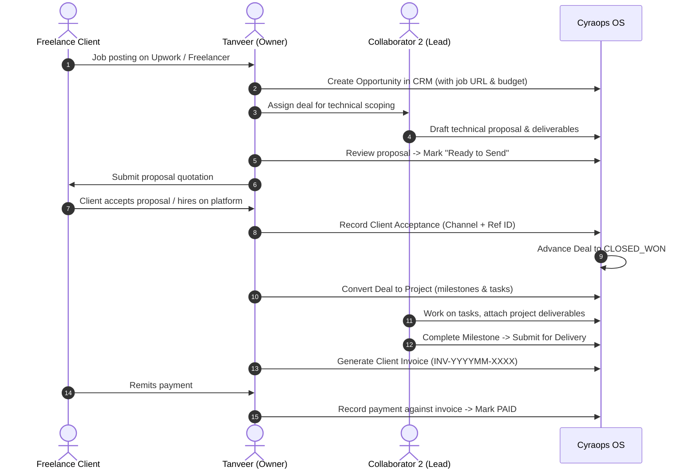

# CYRAOPS — TWO-PERSON PILOT OPERATIONAL CHECKLIST
## Step-by-Step Runbook for Commencing Real Business Operations

**Document Version:** 1.0  
**Target Environment:** Development / Pilot Host (`localhost:3001`)  
**Deliverable File:** `docs/business-launch/CYRAOPS_TWO_PERSON_PILOT_CHECKLIST.md`

---

## 1. Overview & Collaboration Roles

This checklist defines the operational steps required for Tanveer (Founder / Owner) and Collaborator 2 (Co-Founder / Delivery Lead) to begin acquiring, executing, and billing real IT services projects using Cyraops.

```
┌─────────────────────────────────┬───────────────────────────┬──────────────────────────────────────────┐
│ Role                            │ User Account              │ Key Responsibilities                     │
├─────────────────────────────────┼───────────────────────────┼──────────────────────────────────────────┤
│ Workspace Owner (Commercial)    │ tanveer@cyraops.com       │ Sales pipeline, banking, billing, legal  │
│ Team Collaborator (Delivery)    │ Collaborator 2 (Invited)  │ Technical scoping, task delivery, code   │
└─────────────────────────────────┴───────────────────────────┴──────────────────────────────────────────┘
```

---

## 2. Phase 0: System Readiness & Daemon Restart (Immediate)

- [ ] **0.1 Stop and Restart Development Server Daemon**
  - *Context:* The running background server daemon (`task-8962`) has a stale Prisma client in memory from Nov 5, causing `/api/dashboard`, `/api/crm/stats`, and `/api/workspace` to return 500 errors.
  - *Action:* Restart the dev server so that all latest migrations are active:
    ```bash
    cd "/Users/tanveersinghsaini/Desktop/locally hosted app dev"
    PORT=3001 NODE_ENV=development npx tsx server.ts
    ```
- [ ] **0.2 Verify Health & CRM Endpoints**
  - *Action:* Confirm that `/api/health`, `/api/crm/stats`, and `/api/dashboard` return HTTP 200:
    ```bash
    curl -s http://localhost:3001/api/health
    ```
  - *Expected:* `{"status":"ok","database":"connected"}`

---

## 3. Phase 1: Database Test Data Purge (Reset to True Zero)

- [ ] **1.1 Pre-Purge Checkpoint Backup**
  - *Action:* Create a fresh point-in-time snapshot before running the cleanup script:
    ```bash
    cd "/Users/tanveersinghsaini/Desktop/locally hosted app dev"
    bash scripts/backup-db.sh
    ```
- [ ] **1.2 Execute Structured Purge Script**
  - *Action:* Execute the SQL script defined in `CYRAOPS_TEST_DATA_CLEANUP_PLAN.md` to remove the 29 test accounts, 4 test tasks, 1 synthetic project, 40 test expenses, 34 test investments, and 87 test emails.
- [ ] **1.3 Clean Local Uploads Storage**
  - *Action:* Remove the 34 dummy test invoice PDFs from `./uploads`:
    ```bash
    rm -f "/Users/tanveersinghsaini/Desktop/locally hosted app dev/uploads"/*.pdf
    ```
- [ ] **1.4 Verify Clean State**
  - Verify that `User` count is 1 (`tanveer@cyraops.com`), `Expense` count is 0, `Investment` count is 0, and `Task` count is 0.

---

## 4. Phase 2: Collaborator 2 Onboarding

- [ ] **2.1 Generate Collaborator 2 Invitation Link**
  - Log in as Owner (`tanveer@cyraops.com`).
  - Navigate to **Team Management** (`/team` or `/settings`).
  - Click **"+ Invite Member"**.
  - Enter Collaborator 2's email address, full name, and select role: `ADMIN` (co-founder / technical lead) or `MEMBER`.
  - Copy the generated setup link.
- [ ] **2.2 Collaborator 2 Account Activation**
  - Open the setup link in Collaborator 2's browser.
  - Set a secure master password.
  - Confirm successful login and verify access to the Cyraops workspace shell.

---

## 5. Phase 3: Company Profile & Commercial Information

- [ ] **3.1 Update Real Legal & Office Information**
  - Navigate to **Settings > Company Profile**.
  - Update:
    - Company Description: Enter official business overview.
    - Official Phone: Replace `+91 98765 43210` with real contact number.
    - Registered Address: Enter full physical office or registered entity address.
- [ ] **3.2 Update Tax & Remittance Details (Owner Only)**
  - Enter actual company GSTIN / PAN (replacing synthetic sample `29AAAAA0000A1Z5`).
  - Enter official corporate bank account details (Bank Name, Account Number, IFSC Code, Branch) for client invoices.
- [ ] **3.3 Update Acquisition Channel Links**
  - Replace placeholder URLs in Settings with live company profiles:
    - Upwork Agency profile URL
    - Freelancer profile URL
    - Fiverr profile URL
    - LinkedIn Company page URL
    - GitHub Organization URL

---

## 6. Phase 4: Service Catalog & Portfolio Baseline

- [ ] **4.1 Select 2–3 Immediate Launch Services**
  - Navigate to **Settings > Services**.
  - Select the core capabilities offered immediately (e.g., *Cloud Architecture & Migration*, *DevOps & CI/CD Automation*).
  - Update standard delivery durations, deliverables checklist, and base pricing model.
- [ ] **4.2 Publish 1–2 Verified Case Studies**
  - Navigate to **Settings > Portfolio**.
  - Add 1–2 authentic case studies demonstrating past successful implementations.
  - Toggle `Verified Client` and `Publish to Website` once confirmed.
  - Note: Keep demonstration case studies flagged as `isRealClient: false` until real client deliveries are logged.

---

## 7. Phase 5: GoDaddy Corporate Mailbox Setup

- [ ] **5.1 Configure Environment Variables in `.env`**
  - In `/Users/tanveersinghsaini/Desktop/locally hosted app dev/.env`, provide:
    ```env
    GODADDY_EMAIL_ADDRESS="contact@cyraops.com"
    GODADDY_EMAIL_PASSWORD="<actual_godaddy_mailbox_password>"
    ```
- [ ] **5.2 Test Mailbox Connectivity**
  - Navigate to **Email** (`/email`) and click **"Check Connection"**.
  - Verify that IMAP (`imap.secureserver.net:993`) and SMTP (`smtpout.secureserver.net:465`) return green connected status.
  - Trigger initial sync to confirm inbox folders populate cleanly.

---

## 8. Phase 6: Remote Collaboration & Host Management

- [ ] **8.1 Keep Host Machine Awake (`caffeinate`)**
  - When conducting collaborative working sessions or awaiting remote updates:
    ```bash
    caffeinate -dimsu &
    ```
  - Alternatively, enable "Prevent automatic sleeping when display is off" in macOS Energy Saver settings.
- [ ] **8.2 Connect via Tailscale**
  - On Tanveer's Mac: Confirm Tailscale is active.
  - On Collaborator 2's device: Connect to the Tailscale tailnet.
  - Access Cyraops via the host's Tailscale IP or MagicDNS URL (e.g., `https://macbook.tailnet-name.ts.net:3001`).
- [ ] **8.3 External Meeting Tool for Audio/Video**
  - Use Google Meet, Zoom, or Slack for team audio/video calls until LiveKit WebRTC is reconfigured for external Tailscale IP binding.

---

## 9. Phase 7: First Real Project Workflow Walkthrough



- [ ] **7.1 Step 1: Log First Opportunity**
  - Go to **CRM > Deals > "+ New Opportunity"**.
  - Enter client name, project title, platform source (e.g. `UPWORK`), and paste the job posting URL.
- [ ] **7.2 Step 2: Technical Proposal**
  - Open deal detail view.
  - Click **"+ Draft Proposal"**. Select technical template and define milestone deliverables and pricing.
- [ ] **7.3 Step 3: Record Verified Client Acceptance**
  - When the client accepts on the platform, click **"Record Client Acceptance ✓"**.
  - Select platform (`UPWORK_CONTRACT`) and enter contract ID.
  - Deal automatically transitions to `CLOSED_WON`.
- [ ] **7.4 Step 4: Convert to Active Project**
  - Click **"Convert to Project"**.
  - Assign Collaborator 2 as Technical Delivery Lead.
  - Assign milestone tasks on the Kanban board.
- [ ] **7.5 Step 5: Issue Invoice & Track Payment**
  - Navigate to **Client Invoices > "+ New Invoice"**.
  - System generates atomic invoice number (e.g. `INV-202611-0001`).
  - Record payment receipt when funds clear.

