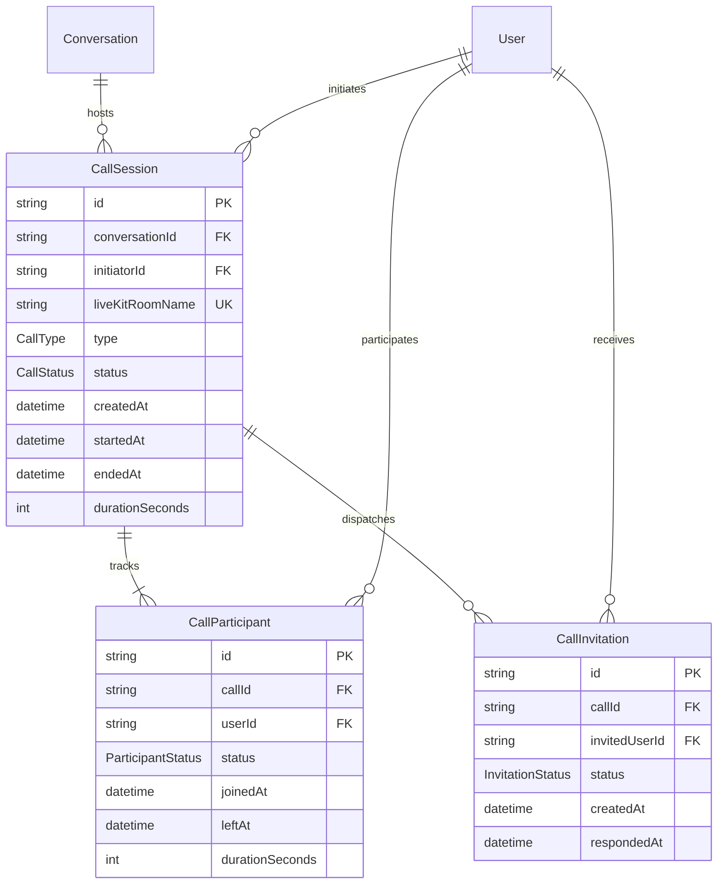
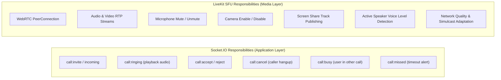

# CYRAOPS CALLING DATABASE & API DESIGN
## Data Models · REST Endpoints · LiveKit Webhooks · Signalling Protocol

> [!IMPORTANT]
> **Audit & Proposal Specification**: In accordance with the strict audit rules, no database schema migrations or code changes have been executed. The models and API specifications below represent the recommended, production-grade schema design for future implementation.

---

## 1. Relational Database Models (Prisma Specification)

To provide reliable call history, missed call alerts, and audit trails without polluting transient WebRTC state into PostgreSQL, we evaluate the three required models:



### Proposed Schema Additions for `prisma/schema.prisma`

```prisma
enum CallType {
  AUDIO_DIRECT
  VIDEO_DIRECT
  AUDIO_GROUP
  VIDEO_GROUP
}

enum CallStatus {
  RINGING       // Initiated, waiting for answer
  ACTIVE        // At least two participants connected
  COMPLETED     // Call finished normally
  MISSED        // No recipient answered before timeout
  REJECTED      // Recipient explicitly declined
  CANCELLED     // Caller hung up before answer
  FAILED        // Technical/media connection failure
}

enum ParticipantStatus {
  INVITED
  RINGING
  CONNECTED
  DISCONNECTED
  DECLINED
  BUSY
}

enum InvitationStatus {
  PENDING
  ACCEPTED
  REJECTED
  MISSED
  CANCELLED
}

model CallSession {
  id                String            @id @default(cuid())
  conversationId    String
  initiatorId       String
  liveKitRoomName   String            @unique
  type              CallType          @default(AUDIO_DIRECT)
  status            CallStatus        @default(RINGING)
  createdAt         DateTime          @default(now())
  startedAt         DateTime?
  endedAt           DateTime?
  durationSeconds   Int?              @default(0)

  conversation      Conversation      @relation(fields: [conversationId], references: [id], onDelete: Cascade)
  initiator         User              @relation("CallInitiator", fields: [initiatorId], references: [id])
  participants      CallParticipant[]
  invitations       CallInvitation[]

  @@index([conversationId, createdAt])
  @@index([initiatorId, createdAt])
  @@index([status, createdAt])
}

model CallParticipant {
  id              String            @id @default(cuid())
  callId          String
  userId          String
  status          ParticipantStatus @default(INVITED)
  joinedAt        DateTime?
  leftAt          DateTime?
  durationSeconds Int?              @default(0)

  call            CallSession       @relation(fields: [callId], references: [id], onDelete: Cascade)
  user            User              @relation(fields: [userId], references: [id], onDelete: Cascade)

  @@unique([callId, userId])
  @@index([userId, joinedAt])
}

model CallInvitation {
  id            String           @id @default(cuid())
  callId        String
  invitedUserId String
  status        InvitationStatus @default(PENDING)
  createdAt     DateTime         @default(now())
  respondedAt   DateTime?

  call          CallSession      @relation(fields: [callId], references: [id], onDelete: Cascade)
  invitedUser   User             @relation("ReceivedCallInvitations", fields: [invitedUserId], references: [id], onDelete: Cascade)

  @@index([invitedUserId, status])
  @@index([callId, invitedUserId])
}
```

---

## 2. Separation of Concerns: PostgreSQL vs LiveKit Transient State

A critical real-time architecture principle is to **avoid storing high-frequency transient state in PostgreSQL**:

| Data Item | Storage Location | Retention / Lifecycle | Rationale |
| :--- | :--- | :--- | :--- |
| **Call Records & History** | **PostgreSQL** (`CallSession`) | Permanent (or audit policy) | Required for CRM activity timeline, user call history, and missed call badges. |
| **Participant Attendance & Durations** | **PostgreSQL** (`CallParticipant`) | Permanent | Required for billing, capacity metrics, and compliance logs. |
| **Invitation Dispositions** | **PostgreSQL** (`CallInvitation`) | Permanent | Identifies who was called, who declined, and who missed. |
| **Microphone Mute / Camera On-Off** | **LiveKit Room State** | Ephemeral (Call duration) | High-frequency toggling (e.g. 5 times/min) would cause extreme database write amplification. Handled natively via WebRTC track mute events. |
| **Screen Share Active Track** | **LiveKit Room State** | Ephemeral (Call duration) | Pure media stream state. |
| **Active Speaker Decibel Levels** | **LiveKit SFU Engine** | Real-time UDP packets | Dispatched directly to subscribers over WebRTC data channels. |
| **Media Audio / Video Packets** | **NEVER STORED** | In-flight UDP packets in SFU RAM | Storing media streams in DB causes massive I/O saturation and severe privacy violations. |

---

## 3. REST API Specifications

All endpoints enforce session authentication, same-origin CSRF checks, and conversation membership verification.

### 1. `POST /api/calls/initiate`
* **Purpose**: Initiates a 1:1 or group call within an existing conversation.
* **Request Body**:
  ```json
  {
    "conversationId": "cmv123abc...",
    "type": "VIDEO_DIRECT" // or AUDIO_DIRECT, AUDIO_GROUP, VIDEO_GROUP
  }
  ```
* **Server Logic**:
  1. Authenticates user from session cookie.
  2. Verifies membership in `ConversationMember`.
  3. Checks if an active call already exists in this conversation. If active, returns existing session details.
  4. Generates unique room name: `call_${randomUUID()}`.
  5. Creates `CallSession`, records caller in `CallParticipant` with status `CONNECTED`.
  6. Creates `CallInvitation` records for all other conversation members.
  7. Mints short-lived LiveKit JWT token for caller (`ttl: "10m"`).
  8. Emits Socket.IO event `call:incoming` to recipients' personal rooms (`user:${recipientId}`).
* **Response (201 Created)**:
  ```json
  {
    "callId": "call_sess_abc123",
    "roomName": "call_9f8a32d1-...",
    "token": "eyJhbGciOi...",
    "serverUrl": "wss://call.cyraops.com"
  }
  ```

### 2. `POST /api/calls/[id]/accept`
* **Purpose**: Recipient accepts an incoming call invitation.
* **Request Body**: `{}`
* **Server Logic**:
  1. Verifies caller is in `CallInvitation` with status `PENDING`.
  2. Updates `CallInvitation.status = ACCEPTED`.
  3. Upserts `CallParticipant` with status `CONNECTED`, `joinedAt = now()`.
  4. Updates `CallSession.status = ACTIVE`, `startedAt = now()`.
  5. Mints LiveKit JWT token for accepting user.
  6. Emits Socket.IO event `call:accepted` to room.
* **Response (200 OK)**:
  ```json
  {
    "token": "eyJhbGciOi...",
    "roomName": "call_9f8a32d1-...",
    "serverUrl": "wss://call.cyraops.com"
  }
  ```

### 3. `POST /api/calls/[id]/reject`
* **Purpose**: Recipient declines the call.
* **Request Body**: `{"reason": "declined"}` (or `"busy"`)
* **Server Logic**:
  1. Updates `CallInvitation.status = REJECTED`.
  2. If 1:1 call, marks `CallSession.status = REJECTED` and emits `call:rejected` to caller.
  3. If group call, emits `call:participant-rejected` so other participants see the decline without ending the meeting.

### 4. `POST /api/calls/[id]/cancel`
* **Purpose**: Caller hangs up before anyone answers.
* **Server Logic**:
  1. Verifies caller is session initiator.
  2. Marks `CallSession.status = CANCELLED`.
  3. Updates pending invitations to `CANCELLED`.
  4. Emits `call:cancelled` to recipient socket rooms to dismiss ringing dialogs.

### 5. `POST /api/calls/[id]/end`
* **Purpose**: Participant departs or host terminates call.
* **Server Logic**:
  1. Updates `CallParticipant.leftAt = now()`, calculates duration.
  2. Checks remaining active participants. If zero participants remain, marks `CallSession.status = COMPLETED`, `endedAt = now()`.
  3. Emits `call:participant-left` or `call:ended`.

### 6. `POST /api/calls/webhook` (LiveKit Webhook Receiver)
* **Purpose**: Authoritative room lifecycle synchronization from LiveKit SFU.
* **Security**: Validates `Authorization` header containing LiveKit HMAC-SHA256 JWT using `LIVEKIT_API_KEY` and `LIVEKIT_API_SECRET`.
* **Events Handled**:
  - `room_started`: Confirms media channel is active.
  - `participant_joined`: Updates database join timestamp if missed by HTTP.
  - `participant_left`: Records participant departure duration.
  - `room_finished`: Authoritatively closes `CallSession` and frees SFU room memory.

---

## 4. Socket.IO Signalling Event Architecture

Socket.IO handles **application-level telephony orchestration**, while LiveKit handles **in-room media tracks**:



### Signalling Event Dictionary

| Socket.IO Event | Direction | Payload Schema | Functional Action |
| :--- | :--- | :--- | :--- |
| `call:incoming` | Server $\rightarrow$ Client | `{callId, conversationId, caller: {id, name, avatarUrl}, type}` | Displays incoming call modal and plays ringtone on recipient's device. |
| `call:ringing` | Server $\rightarrow$ Client | `{callId}` | Notifies caller that recipient's device has received the alert and is ringing. |
| `call:accepted` | Server $\rightarrow$ Client | `{callId, acceptedBy: {id, name}}` | Stops ringback tone on caller's device; initiates WebRTC media connection. |
| `call:rejected` | Server $\rightarrow$ Client | `{callId, userId, reason: "declined" | "busy"}` | Displays "Busy" or "Declined" notification to caller and terminates session. |
| `call:cancelled` | Server $\rightarrow$ Client | `{callId}` | Dismisses ringing modal immediately on all recipient devices. |
| `call:ended` | Server $\rightarrow$ Client | `{callId, durationSeconds}` | Closes call view, disconnects LiveKit room, appends call summary to chat. |
| `call:user-joined`| Server $\rightarrow$ Client | `{callId, user: {id, name}}` | Updates group participant roster in the UI. |
| `call:user-left` | Server $\rightarrow$ Client | `{callId, userId}` | Removes participant from roster and active video grid. |
