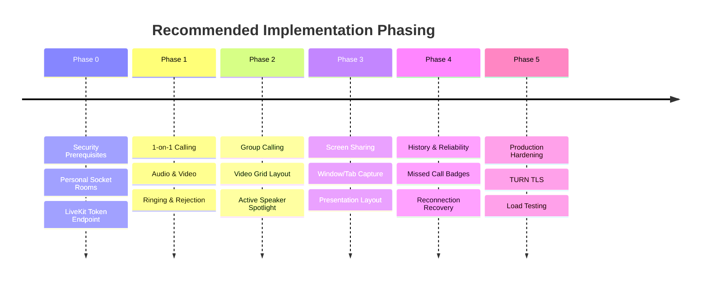

# CYRAOPS CALLING EXECUTIVE DECISION REPORT
## Strategic Feasibility Assessment · Architecture Answers · Executive Synthesis

> [!IMPORTANT]
> **Executive Summary**: This report delivers the strategic conclusion to the Calling Compatibility Audit and Self-Hosted Architecture Assessment. It directly answers the 10 fundamental engineering questions governing the project.

---

## 1. Direct Answers to the 10 Executive Questions

### 1. Can Cyraops support audio and video calls using its existing Chat architecture?
**YES, with a dedicated media server layer.**
The existing chat architecture provides the essential foundation: conversational data models, user relationships, join tables, message history, and active browser WebSockets. However, the existing application server cannot and should not route audio/video streams directly. By introducing LiveKit SFU as an independent media plane while keeping the existing Next.js / PostgreSQL / Socket.IO stack as the application plane, Cyraops can fully support professional audio, video, group calling, and screen sharing.
*Classification: `CONFIRMED FROM SOURCE CODE & ARCHITECTURE`*

---

### 2. Can the current Socket.IO infrastructure be reused for signalling?
**YES, for application telephony signalling, with one required enhancement.**
The current Socket.IO server ([server.ts](file:///Users/tanveersinghsaini/Desktop/locally%20hosted%20app%20dev/server.ts)) already authenticates session cookies and manages rooms. It is ideally suited to handle call invitations (`call:incoming`), ringback tones, call acceptance (`call:accepted`), call rejection, and hangup notifications.
**The Required Fix**: Currently, sockets only join conversation rooms (`conversation:join`). Sockets must also join personal user rooms (`user:${userId}`) upon connection so incoming call alerts can reach users regardless of which page or conversation they are currently viewing.
*Classification: `CONFIRMED FROM SOURCE CODE`*

---

### 3. Is LiveKit the best self-hosted media server for this application?
**YES, unequivocally.**
Compared to mediasoup (which requires low-level C++ toolchains, custom signaling, and complex state management) and Jitsi Meet (which is an unweildy monolithic Java/XMPP stack with excessive RAM requirements), LiveKit is distributed as a single static Go binary or lightweight Docker container. It natively provides simulcast, dynacast, active speaker detection, and official TypeScript SDKs for Node.js and modern React.
*Classification: `ENGINEERING RECOMMENDATION & OFFICIAL DOCUMENTATION`*

---

### 4. What needs to be added?
1. **Infrastructure**: One dedicated Linux VM (or container) running the LiveKit SFU with direct public UDP ports and DNS (`call.cyraops.com` and `turn.cyraops.com`).
2. **Database Schema**: Three Prisma models (`CallSession`, `CallParticipant`, `CallInvitation`) to record call history and missed calls.
3. **Backend API**: Endpoints for token generation (`POST /api/calls/token`), invitation acceptance/rejection, and a secure webhook receiver (`POST /api/calls/webhook`).
4. **Signalling Handlers**: New telephony event handlers in `server.ts` and personal user socket rooms.
5. **Frontend UI**: Call buttons in the chat header, incoming call ringing banner, and an in-call video grid overlay built using `livekit-client`.
*Classification: `CONFIRMED FROM ARCHITECTURAL GAP ANALYSIS`*

---

### 5. What existing functionality can be reused?
- **Authentication**: Existing cookie verification, session parsing, and SHA-256 token hashing in [auth.ts](file:///Users/tanveersinghsaini/Desktop/locally%20hosted%20app%20dev/src/lib/auth.ts).
- **Relational Access Control**: Existing `ConversationMember` join table to prevent unauthorized users from calling or joining conversation rooms.
- **Socket.IO Transport**: Existing HTTP server integration and connection lifecycle in [server.ts](file:///Users/tanveersinghsaini/Desktop/locally%20hosted%20app%20dev/server.ts).
- **In-Call Chat**: The existing messaging system can be used inside the call view without duplicating chat rooms or messages.
- **Design System & Components**: Existing avatars, modals, icons, and styling variables in [src/components/ui](file:///Users/tanveersinghsaini/Desktop/locally%20hosted%20app%20dev/src/components/ui).
*Classification: `CONFIRMED FROM SOURCE CODE`*

---

### 6. Does the current authentication architecture create a security blocker?
**YES, a significant vulnerability that MUST be addressed in Phase 0.**
The application's profile-switching endpoint (`POST /api/profile/active`) allows any user with the shared workspace password to mutate their active `userId` to the Owner or an Admin without entering a password.
**The Solution**: Calling permissions must not rely on an unverified client identity. LiveKit access tokens must be minted strictly server-side, verifying that the requesting session is an authorized member of the specific conversation and matched to a valid pending invitation record.
*Classification: `CONFIRMED SECURITY VULNERABILITY`*

---

### 7. What infrastructure is required?
- **Host**: A dedicated virtual machine (e.g. 4 vCPU AMD, 8 GB RAM on Hetzner or DigitalOcean).
- **Public Networking**: One static public IPv4 address with direct UDP connectivity (ports 50000–60000) and STUN/TURN (port 3478).
- **Reverse Proxy**: Caddy or Nginx for automated Let's Encrypt SSL on `call.cyraops.com`.
- **Note on Cloudflare Tunnel**: Cloudflare Tunnel alone **cannot** route WebRTC media streams because it drops arbitrary UDP traffic on standard plans. Direct UDP to the public IP is mandatory.
*Classification: `BASED ON OFFICIAL DOCUMENTATION & NETWORKING PRINCIPLES`*

---

### 8. What is the realistic cost and maintenance burden?
- **Monthly Cloud Cost**: **\$14.00 to \$24.00 / month total** (covering dedicated VM, static IP, and 4–20 TB included egress bandwidth).
- **Maintenance Burden**: Very low ($\sim 1\text{--}2\text{ hours/month}$). LiveKit is a single binary with built-in TURN and zero database dependencies (it stores room state in RAM). Service auto-restart is handled via systemd or Docker restart policies.
*Classification: `ESTIMATE BASED ON CURRENT CLOUD PRICING`*

---

### 9. What should be built first?
**Phase 0 & Phase 1: One-to-One Audio and Video Calling.**
Establish personal socket rooms (`user:${userId}`), implement the backend token minting route with strict conversation membership verification, and add direct 1:1 calling buttons in the direct chat header. This delivers immediate business value while validating audio/video quality before tackling multi-party group layouts.
*Classification: `STRATEGIC RECOMMENDATION`*

---

### 10. What should explicitly remain out of scope for the first release?
1. **Server-side video recording (Egress/MP4 storage)**.
2. **PSTN / Telephone number dialing (SIP trunks)**.
3. **Live AI speech-to-text transcription during calls**.
4. **Virtual backgrounds and AI face filters**.
*Classification: `SCOPE BOUNDARY SPECIFICATION`*

---

## 2. Executive Synthesis & Next Steps

### Final Conclusion
Integrating Microsoft Teams-style calling into Cyraops Chat is **technically feasible, cost-effective, and architecturally sound**. By coupling the existing Next.js / Socket.IO infrastructure with an open-source, self-hosted LiveKit SFU, Cyraops will gain a high-performance, private, zero-external-vendor communications platform for less than \$25/month in operational infrastructure.
