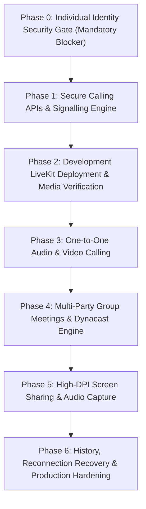

# CYRAOPS CALLING — FINAL IMPLEMENTATION PLAN
## Seven-Phase Engineering Blueprint · Empirical Verification Gates · Measurable Acceptance Criteria

> [!IMPORTANT]
> **Implementation Mandate**: This plan defines the complete engineering lifecycle for introducing self-hosted real-time calling into Cyraops. Universal claims (e.g. "zero packet loss", "zero latency") are replaced with measurable empirical thresholds. Phase 0 is an absolute security blocker.

---

## 1. Master Phased Roadmap

---

## 2. Phase-by-Phase Technical Specifications & Verification Gates

### Phase 0: Individual Identity Security Gate (Mandatory Blocker)
* **Objective**: Replace the shared-workspace credential model with authentic individual employee credentials, permanently bind sessions, and retire `/api/profile/active`.
* **Deliverables**:
  1. Add `email` (unique) and `passwordHash` (bcrypt) to Prisma model `User`.
  2. Bind model `Session` permanently to `authenticatedUserId`.
  3. Retire and remove [src/app/api/profile/active/route.ts](file:///Users/tanveersinghsaini/Desktop/locally%20hosted%20app%20dev/src/app/api/profile/active/route.ts).
  4. Write automated security unit tests verifying that session identity cannot be mutated by unauthenticated client requests.
* **Verification Gate**:
  - **Environment**: Development server (`http://localhost:3001`, `company_os_dev`).
  - **Test Suite**: Automated security regression suite (`scratch/verify-identity-security.ts`).
  - **Acceptance Threshold**:
    - $100\%$ pass on 10 security test cases.
    - Zero endpoints permit mutating `Session.authenticatedUserId`.
    - Attempting to access calling APIs without authentic individual session returns `HTTP 401`.
  - **Failure Handling**: Revert migration, restore database snapshot, block all subsequent phases.

---

### Phase 1: Secure Calling APIs & Signalling Engine
* **Objective**: Build database models, the dual-tier state machine, persisted timeout sweepers, atomic collision resolution, and personal socket rooms.
* **Deliverables**:
  1. Prisma models: `CallSession`, `CallParticipant`, `CallInvitation`.
  2. In [server.ts](file:///Users/tanveersinghsaini/Desktop/locally%20hosted%20app%20dev/server.ts), add personal rooms: `socket.join("user:" + socket.data.userId)` upon connection.
  3. Implement persisted timeout worker (`ringTimeoutAt`, `emptyRoomDeadlineAt`) sweeping every 15s.
  4. Implement atomic collision resolution: concurrent dials return `409 Conflict` with `collision: true` and prompt user for explicit acceptance.
  5. Implement Next.js calling REST endpoints and 60-second JWT token minter.
* **Verification Gate**:
  - **Environment**: Development environment.
  - **Test Suite**: Automated Node.js integration tests (`npm run test`).
  - **Acceptance Threshold**:
    - Simultaneous dialing race condition correctly serializes: exactly 1 canonical `CallSession` created, competing dialer receives `409 Conflict` and prompts user.
    - Server process restart during active ringing safely transitions expired calls to `MISSED` within 15 seconds of restart.
    - Token requests for non-members or ejected participants strictly return `403 Forbidden`.

---

### Phase 2: Development LiveKit Deployment & Media Verification
* **Objective**: Deploy a standalone development LiveKit SFU instance and measure real-world WebRTC transport performance across direct UDP, TCP fallback, TURN/UDP, and TURNS port 443.
* **Deliverables**:
  1. Standalone LiveKit container on dev cloud VM with `network_mode: host` and zero Redis.
  2. Single-Port UDP Mux configured on port 7882 (`rtc.udp_port: 7882`).
  3. TCP fallback on port 7881.
  4. Embedded TURN server listening on UDP 3478 and TURNS on TCP port 443 via Layer-4 SNI.
  5. Cloudflare DNS records in DNS-only mode (Grey Cloud).
  6. Prometheus metrics endpoint configured on internal port 6789.
* **Verification Gate**:
  - **Environment**: Dev LiveKit VM (`call-dev.cyraops.com`, `turn-dev.cyraops.com`).
  - **Tool**: Official `livekit-cli test` suite.
  - **Network Conditions Tested**:
    1. Direct UDP connection: Packet loss $< 1.0\%$, RTT $< 80\text{ ms}$.
    2. Simulated UDP block (ICE TCP fallback): Connects over TCP 7881 within $3\text{ seconds}$.
    3. Symmetric NAT (TURN/UDP port 3478): Media relays successfully.
    4. Enterprise restricted firewall (Simulated ports 80/443 only): Media relays over TURNS TCP port 443.
  - **Acceptance Threshold**: All 4 network profiles establish active media tracks within 5 seconds.

---

### Phase 3: One-to-One Audio & Video Calling
* **Objective**: Introduce direct audio and video calling between two teammates into the chat interface.
* **Deliverables**:
  1. Add Audio/Video call buttons in direct chat header in [chat.tsx](file:///Users/tanveersinghsaini/Desktop/locally%20hosted%20app%20dev/src/components/modules/chat.tsx).
  2. Ringing modal with ringtone and Accept/Decline actions.
  3. Calling overlay built with `livekit-client` (vanilla SDK to avoid React 19 UI conflicts).
  4. Hardware controls: mic mute, camera toggle, hangup.
* **Verification Gate**:
  - **Environment**: Staging / dev web client (`http://localhost:3001`).
  - **Test Profile**: 2 real browser sessions conducting a 15-minute 720p video call.
  - **Acceptance Threshold**:
    - WebRTC media exchange establishes within $2.5\text{ seconds}$ of clicking "Accept".
    - Measured aggregate server throughput equals $3.08\text{ Mbps} \pm 10\%$.
    - Packet loss $< 1.0\%$ on standard residential connections.
    - Zero CSS or layout regressions in the surrounding workspace shell.

---

### Phase 4: Multi-Party Group Meetings & Dynacast Engine
* **Objective**: Enable scalable group calling (3 to 20 participants) in group conversations.
* **Deliverables**:
  1. "Start Group Call" button in group chat headers.
  2. Signaling emitted to all conversation members; users in other calls flagged `isBusy: true`.
  3. Responsive video grid (2x2, 3x3, paginated) with active speaker border highlight.
  4. Late-joiner button (*"Meeting in progress · Join"*).
  5. LiveKit Dynacast integration with `IntersectionObserver` to halt video forwarding for off-screen tiles.
* **Verification Gate**:
  - **Environment**: Dev cluster.
  - **Test Profile**: 5 real browser sessions (Scenario B) in a 10-minute meeting.
  - **Acceptance Threshold**:
    - Measured server egress matches mathematical model: $\mathbf{10.55\text{ Mbps}} \pm 15\%$.
    - Dynacast verification: Muting camera on 4 senders reduces subscriber downlink to $< 500\text{ kbps}$.
    - Active speaker border highlight updates within $250\text{ ms}$ of speech onset.

---

### Phase 5: High-DPI Screen Sharing & Audio Capture
* **Objective**: Allow participants to share entire screens, windows, or tabs with sharp text clarity.
* **Deliverables**:
  1. "Share Screen" button in call toolbar invoking `navigator.mediaDevices.getDisplayMedia`.
  2. Dual-track publishing (`detail` content hint for text clarity).
  3. Presentation stage layout (screen share takes 80% window, video feeds shift to top carousel).
  4. System audio capture toggle.
  5. OS-level screen share revocation listener (`track.onended`).
* **Verification Gate**:
  - **Environment**: Cross-browser (Chrome, Safari, Edge on macOS & Windows).
  - **Test Profile**: Sharing a 1080p VS Code code editor and an Excel spreadsheet for 10 minutes.
  - **Acceptance Threshold**:
    - Code font at 11px is crisp and legible without blurring or compression artifacts.
    - Screen share latency $< 150\text{ ms}$.
    - Revoking permission in OS immediately clears presentation view and notifies peers.

---

### Phase 6: History, Reconnection Recovery & Production Hardening
* **Objective**: Persist call logs, survive network flapping, and validate production capacity under peak load.
* **Deliverables**:
  1. Automatic chat summary cards: *"Video call ended · 18m 42s"* or *"Missed audio call"*.
  2. Missed call notification badge in sidebar navigation.
  3. In-call chat drawer reusing `/api/conversations/[id]/messages`.
  4. Network flapping auto-reconnect (ICE restart recovers $< 15\text{s}$ drops without full reload).
  5. Prometheus metrics monitoring scraping port 6789.
  6. Empirical load test with `livekit-load-tester` (Scenario F vs. Scenario G).
* **Verification Gate**:
  - **Load Test A (Scenario F - Single 50-Person Meeting)**:
    - 50 synthetic participants in 1 room.
    - Measured egress matches $\mathbf{233\text{ Mbps}} \pm 15\%$.
    - Host CPU utilization $< 80\%$.
  - **Load Test B (Scenario G - 5 Concurrent 10-Person Meetings)**:
    - 50 synthetic participants across 5 distinct rooms.
    - Measured egress matches $\mathbf{153\text{ Mbps}} \pm 15\%$.
    - Host CPU utilization $< 70\%$.
  - **Network Drop Test**: Disconnect client Wi-Fi for 8 seconds; call automatically restores audio/video within 3 seconds of reconnection without minting a new token.
