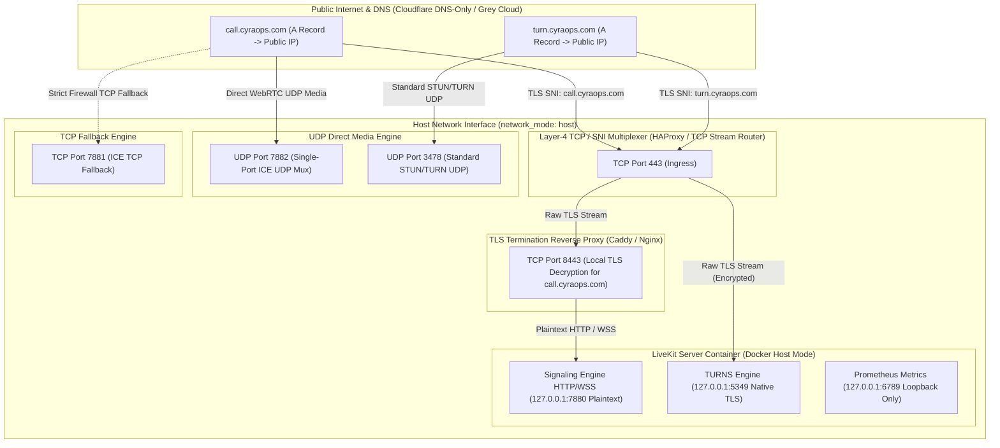

# CYRAOPS CALLING — FINAL INFRASTRUCTURE DESIGN
## Production Network Topology · Layer-4 SNI Routing · TLS Termination Points · Advertised ICE URLs · Monitoring Isolation

> [!IMPORTANT]
> **Validated Infrastructure Specification**: This document establishes the exact, production-ready network configuration, port architecture, and TLS termination boundaries. It corrects the HAProxy configuration by explicitly showing where TLS terminates for WSS signaling and where TURN/TLS passes through encrypted to port 5349, ensuring advertised ICE URLs correctly expose port 443.

---

## 1. Network Topology & Port Architecture



---

## 2. Port 443 Coexistence & TLS Termination Points

### 2.1. Why the Previous HAProxy Configuration Was Defective
In earlier drafts, HAProxy in `mode tcp` routed incoming traffic for `call.cyraops.com` directly to `127.0.0.1:7880`. **This was broken**: LiveKit's internal port 7880 is an **unencrypted plaintext** HTTP/WebSocket listener. Forwarding an encrypted TLS byte stream directly to a plaintext HTTP socket causes an immediate handshake failure (`HTTP/1.1 400 Bad Request: Plaintext HTTP request was sent to HTTPS port`).

### 2.2. The Correct Layer-4 SNI Architecture (Option B — Single Public IP)
When operating with a single public IPv4 address, TLS termination must be explicitly divided:

1. **HAProxy Layer-4 Stream Router (Listens on `:443`)**:
   - Operates in `mode tcp` (Layer 4). It inspects the `ClientHello` SNI without decrypting traffic.
   - If SNI is `turn.cyraops.com` $\rightarrow$ forwards raw TLS stream to **`127.0.0.1:5349`** (LiveKit TURNS). LiveKit natively terminates TURN/TLS using its configured certificates.
   - If SNI is `call.cyraops.com` $\rightarrow$ forwards raw TLS stream to **`127.0.0.1:8443`** (Local TLS Reverse Proxy).
2. **Local Reverse Proxy (Caddy or Nginx on `127.0.0.1:8443`)**:
   - Terminates TLS for `call.cyraops.com` using Let's Encrypt certificates.
   - Proxies the decrypted plaintext HTTP/WebSocket stream to LiveKit Signaling on **`127.0.0.1:7880`**.

#### HAProxy Production Configuration (`/etc/haproxy/haproxy.cfg`)
```haproxy
frontend tls_sni_router
    bind :443
    mode tcp
    tcp-request inspect-delay 5s
    tcp-request content accept if { req_ssl_hello_type 1 }

    # Route based on SNI
    use_backend backend_turn if { req_ssl_sni -i turn.cyraops.com }
    default_backend backend_signaling_tls

# LiveKit TURNS: Passes raw TLS stream to LiveKit's internal TLS port
backend backend_turn
    mode tcp
    server livekit_turns 127.0.0.1:5349

# LiveKit WSS Signaling: Passes raw TLS stream to local TLS-terminator
backend backend_signaling_tls
    mode tcp
    server local_caddy 127.0.0.1:8443
```

### 2.3. Dual Public IP Architecture (Option A — Recommended for Simplicity)
If the cloud VM provides two dedicated public IPv4 addresses:
* **Public IP 1 (`call.cyraops.com`)**: Port 443 terminates TLS via Caddy/Nginx directly, proxying plaintext WSS to `127.0.0.1:7880`.
* **Public IP 2 (`turn.cyraops.com`)**: Port 443 binds directly to LiveKit's TURNS listener (`turn.tls_port: 443`), terminating TURN/TLS natively.
* **Verdict**: Eliminates HAProxy layer-4 multiplexing entirely.

### 2.4. Advertised ICE Server URLs
Regardless of whether Option A or Option B is deployed, **the browser connects to port 443 externally**. The backend must advertise the following ICE server configuration to clients:

```json
{
  "iceServers": [
    {
      "urls": [
        "turn:turn.cyraops.com:3478?transport=udp",
        "turn:turn.cyraops.com:3478?transport=tcp"
      ],
      "username": "<ephemeral_turn_username>",
      "credential": "<ephemeral_turn_password>"
    },
    {
      "urls": [
        "turns:turn.cyraops.com:443?transport=tcp"
      ],
      "username": "<ephemeral_turn_username>",
      "credential": "<ephemeral_turn_password>"
    }
  ]
}
```
* **Notice**: The advertised TURNS port is **`443`**, matching the externally reachable WAN firewall port, even though internal routing directs it to port 5349.

---

## 3. Media Multiplexing & Prometheus Monitoring Port Separation

### 3.1. Single-Port UDP Mux (`udp_port: 7882`)
* In `livekit.yaml`, `rtc.udp_port: 7882` multiplexes all inbound/outbound audio, video, and screen-share RTP packets over a single UDP socket.
* **Mutual Exclusivity**: Defining `udp_port` **completely disables** the legacy 10,000-port range (`50000–60000`). Only port 7882 UDP is opened in cloud security groups.

### 3.2. Prometheus Monitoring Port Resolution
* Previous drafts erroneously placed Prometheus metrics on port 7882.
* **Resolution**:
  - **Port 7882 UDP**: Reserved exclusively for WebRTC Media RTP packets.
  - **Port 6789 TCP**: Internal Prometheus scrape endpoint (`prometheus_port: 6789`).
* **Firewall Mandate**: Port 6789 TCP **must be bound to `127.0.0.1`** and blocked from the public WAN. Scrapes occur locally or over an internal VPN.

```yaml
# livekit.yaml snippet
port: 7880
bind_addresses:
  - "127.0.0.1"
rtc:
  udp_port: 7882
  tcp_port: 7881
  use_external_ip: true
turn:
  enabled: true
  domain: turn.cyraops.com
  tls_port: 5349
  udp_port: 3478
  external_tls: false
prometheus_port: 6789
```

---

## 4. Cloudflare DNS & Docker Host Networking

1. **Cloudflare DNS Configuration**:
   - `call.cyraops.com` $\rightarrow$ Host Public IP (DNS-only / Grey Cloud).
   - `turn.cyraops.com` $\rightarrow$ Host Public IP (DNS-only / Grey Cloud).
   - *Cloudflare HTTP proxying drops raw UDP packets and destroys WebRTC media.*
2. **Docker Host Networking**:
   - The LiveKit container must run with `network_mode: host` to eliminate `docker-proxy` packet translation overhead and achieve maximum UDP packet forwarding performance.
