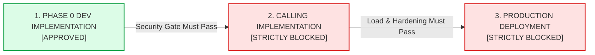

# CYRAOPS CALLING — FINAL IMPLEMENTATION READINESS REPORT
## Three-Tier Readiness Determination · Blockers & Uncertainties · Phase Entry & Exit Criteria · Final Executive Verdict

> [!IMPORTANT]
> **Definitive Architectural Determination**: This document synthesizes the final technical correction pass across all calling engineering specifications for the Cyraops Company Operating System. It provides an honest, evidence-based assessment of project readiness, identifies active blockers, and delivers the three-tier executive status determination.

---

## 1. Three-Tier Executive Readiness Determination

To ensure complete transparency and prevent premature deployment, readiness is authoritatively segregated into three distinct lifecycle tiers:

### 1. **READY FOR PHASE 0 DEVELOPMENT IMPLEMENTATION**: **`APPROVED`**
* **Status**: **READY TO BEGIN**.
* **Scope**: Individual Employee Identity Migration in development (`company_os_dev`):
  - Add nullable `email` and `passwordHash` to `User`.
  - Add `PasswordSetupToken` model with SHA-256 token hashing at rest.
  - Bind `Session.authenticatedUserId` permanently with a PostgreSQL immutability trigger.
  - Delete [src/app/api/profile/active/route.ts](file:///Users/tanveersinghsaini/Desktop/locally%20hosted%20app%20dev/src/app/api/profile/active/route.ts).
  - Execute the 14-point identity security test suite (`scratch/verify-identity-security.ts`).
* **Confidence**: High (100% audited against existing codebase).

### 2. **READY FOR CALLING IMPLEMENTATION**: **`NOT READY (STRICTLY BLOCKED)`**
* **Status**: **STRICTLY BLOCKED**.
* **Reason**: Blocked on the successful development deployment, session purge, and automated test verification of Phase 0. No calling models, Socket.IO telephony events, or LiveKit APIs may be implemented until individual employee identity is immutable.

### 3. **READY FOR PRODUCTION**: **`NOT READY (STRICTLY BLOCKED)`**
* **Status**: **STRICTLY BLOCKED**.
* **Reason**: Blocked on the full execution of Phases 0 through 6, including dedicated VM provisioning with DNS-only records, Layer-4 SNI routing for TURNS on port 443, empirical load testing with `lk perf`, and cross-browser screen sharing verification.

---

## 2. Active Blockers & Capacity Uncertainties

| Dimension | Specific Blocker / Uncertainty | Mandatory Resolution Action |
| :--- | :--- | :--- |
| **Security Blocker** | `/api/profile/active` mutates database session `userId` without credential challenge. | Execute Phase 0: Add individual credentials to `User`, bind `Session` permanently, delete `/api/profile/active`. |
| **Infrastructure Blocker** | Cloudflare Tunnel drops raw UDP packets. | Provision dedicated cloud VM with static public IP and DNS-only (Grey Cloud) records for `call.` and `turn.`. |
| **Capacity Uncertainty** | Scenario F (50 users all-camera) reaches $3.0\text{--}3.6\text{ vCPU cores}$ on 4 vCPU VM. | Execute `lk perf load-test` in Phase 6. If CPU $> 80\%$, upgrade production host to 8 vCPU / 16 GB RAM. |
| **Browser Uncertainty** | Screen share audio capture fails on Safari and macOS system audio. | Implement client-side OS/browser detection disabling audio checkbox with clear explanatory tooltip. |

---

## 3. Phase 0 Implementation Authorization

The engineering team is authorized to begin work exclusively on **Phase 0 (Individual Employee Identity Security)**. 

### Phase 0 Entry Criteria (Satisfied)
- Complete code audit of existing authentication endpoints.
- Validated non-destructive migration and rollback script design (preserving business records).
- Approval of `PasswordSetupToken` model and database trigger immutability.

### Phase 0 Exit Criteria (Required to Unlock Calling Implementation)
- $100\%$ pass on the automated 14-point security test suite (`scratch/verify-identity-security.ts`).
- Verification that no endpoint in the application can mutate `Session.authenticatedUserId`.
- Verification that `/api/profile/active` is completely deleted.
- Verification that existing business records (messages, tasks, costs) remain 100% intact.
