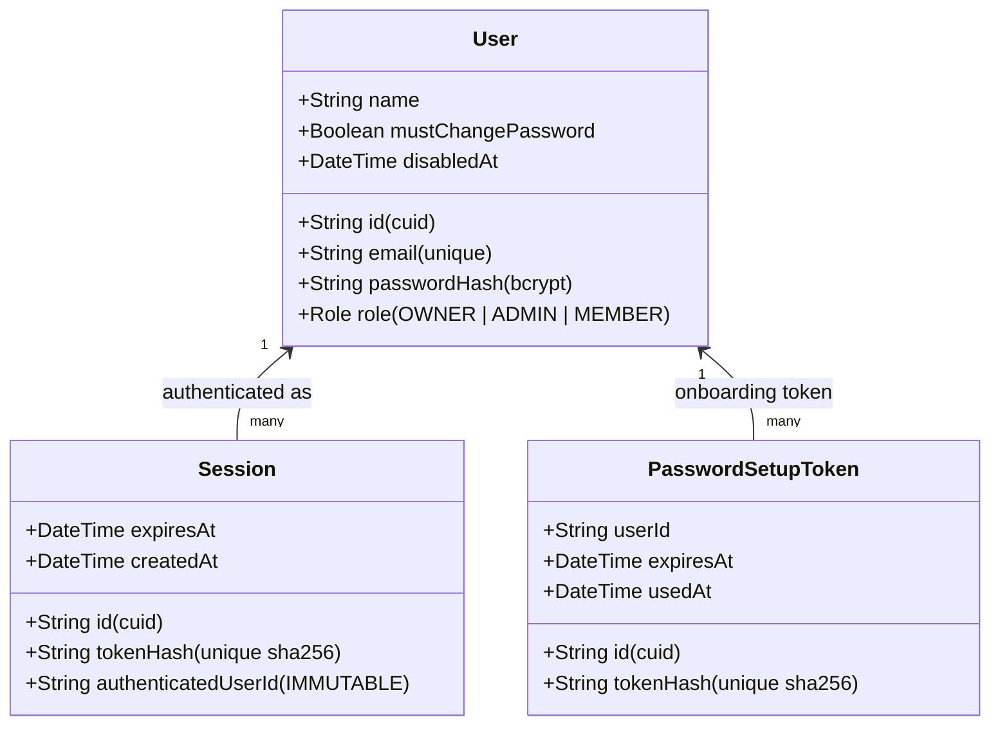

# CYRAOPS CALLING — FINAL SECURITY & AUTHENTICATION ARCHITECTURE
## Authoritative Identity Enforcement · Token Lifecycle Governance · Residual Reconnection Containment · Phase 0 Migration Blueprint

> [!CAUTION]
> **Authoritative Security Baseline**: Real-time calling permissions must never be minted against client-mutable session pointers. This document provides the corrected security architecture, eliminating unsupported permission parameters, defining the actual residual risk window for stateless tokens, and specifying the non-destructive Phase 0 employee identity migration.

---

## 1. Authentication Audit & Root Cause Analysis

### 1.1. Verified Existing Authentication Paths
An exhaustive audit of the Cyraops codebase reveals the exact authentication and identity flow:

| File Path | Function / Route | Existing Behavior | Security Vulnerability |
| :--- | :--- | :--- | :--- |
| [src/lib/auth.ts](file:///Users/tanveersinghsaini/Desktop/locally%20hosted%20app%20dev/src/lib/auth.ts#L18) | `userFromRequest(req)` | Reads `company_session` cookie, verifies `tokenHash` in `Session` table, and returns `session.user`. | Resolves whichever `userId` the session row currently points to. |
| [src/app/api/auth/login/route.ts](file:///Users/tanveersinghsaini/Desktop/locally%20hosted%20app%20dev/src/app/api/auth/login/route.ts#L9) | `POST /api/auth/login` | Validates email/password against `Workspace.loginEmail` and `Workspace.loginPasswordHash`. Creates session with `createSession(workspace.ownerId)`. | All employees share a single company login; individual employee passwords do not exist. |
| [src/app/api/profile/active/route.ts](file:///Users/tanveersinghsaini/Desktop/locally%20hosted%20app%20dev/src/app/api/profile/active/route.ts#L7) | `POST /api/profile/active` | Executes `UPDATE "Session" SET userId = targetUserId` without password challenge. | **CRITICAL FLAW**: Any user can mutate their database session identity to any employee or the Owner. |
| [src/app/api/team/route.ts](file:///Users/tanveersinghsaini/Desktop/locally%20hosted%20app%20dev/src/app/api/team/route.ts#L15) | `POST /api/team` | Creates a new user row with only `name` and `role`. | Users in PostgreSQL have no email, password, or independent credential. |
| [src/app/api/team/[id]/route.ts](file:///Users/tanveersinghsaini/Desktop/locally%20hosted%20app%20dev/src/app/api/team/%5Bid%5D/route.ts#L9) | `PATCH /api/team/[id]` | Updates role or sets `disabledAt`. If disabled, deletes all sessions where `userId = id`. | Disabling terminates sessions, but does not provide individual identity credentials. |

### 1.2. Why Session and Invitation Checks Fail Under Profile Switching
If Alice wishes to eavesdrop on an executive meeting:
1. Alice invokes `POST /api/profile/active` with `userId: "owner_tanveer_id"`.
2. Her database `Session` row is mutated: `session.userId` becomes `owner_tanveer_id`.
3. From the perspective of PostgreSQL and `userFromRequest(request)`, Alice **is** Tanveer Singh Saini.
4. If the calling backend checks `session.userId === invitation.invitedUserId`, **the check evaluates to true**.
5. The backend mints a signed LiveKit JWT bearing Tanveer's name and ID. Alice connects to the video call with executive authority.

**Architectural Law**: Proposing session tokens, invitation IDs, or database queries cannot secure calling as long as the underlying identity pointer can be mutated by the client without authentication.

---

## 2. Phase 0: Non-Destructive Individual Identity Migration

Before any calling endpoint is implemented, Cyraops must transition to **Individual Employee Authentication**:



### 2.1. Safe Database Schema Evolution
```prisma
model User {
  id                 String               @id @default(cuid())
  email              String?              @unique
  passwordHash       String?
  name               String
  role               Role                 @default(MEMBER)
  mustChangePassword Boolean              @default(false)
  disabledAt         DateTime?
  sessions           Session[]
  setupTokens        PasswordSetupToken[]
  ...
}

model Session {
  id                  String   @id @default(cuid())
  tokenHash           String   @unique
  authenticatedUserId String   // IMMUTABLE: set once at login, never mutated
  expiresAt           DateTime
  createdAt           DateTime @default(now())
  user                User     @relation(fields: [authenticatedUserId], references: [id], onDelete: Cascade)

  @@index([authenticatedUserId, expiresAt])
}

model PasswordSetupToken {
  id        String    @id @default(cuid())
  tokenHash String    @unique // SHA-256 hash of the one-time raw secret
  userId    String
  expiresAt DateTime  // 48-hour expiration
  usedAt    DateTime? // Set atomically on password setup; prevents replay
  createdAt DateTime  @default(now())
  user      User      @relation(fields: [userId], references: [id], onDelete: Cascade)

  @@index([userId, expiresAt])
}
```

### 2.2. Database-Level Immutability Trigger (PostgreSQL)
A PostgreSQL trigger guarantees that `authenticatedUserId` cannot be altered by an application bug or SQL injection:
```sql
CREATE OR REPLACE FUNCTION enforce_session_identity_immutability()
RETURNS TRIGGER AS $$
BEGIN
  IF NEW."authenticatedUserId" <> OLD."authenticatedUserId" THEN
    RAISE EXCEPTION 'SECURITY VIOLATION: Session authenticatedUserId is immutable and cannot be modified.';
  END IF;
  RETURN NEW;
END;
$$ LANGUAGE plpgsql;

CREATE TRIGGER trg_session_identity_immutable
BEFORE UPDATE ON "Session"
FOR EACH ROW
EXECUTE FUNCTION enforce_session_identity_immutability();
```

---

## 3. LiveKit Token Security & Reconnection Governance

### 3.1. Verified LiveKit Server & SDK APIs
* **Protocol Specification**:
  LiveKit's `ParticipantPermission` protobuf contains:
  `can_subscribe`, `can_publish`, `can_publish_data`, `can_publish_sources`, `hidden`, `recorder`, `agent`. There is no `can_join` parameter.
* **Node.js Server SDK Methods (`livekit-server-sdk`)**:
  - `roomService.removeParticipant(room: string, identity: string): Promise<void>`
  - `roomService.updateParticipant(room: string, identity: string, metadata?: string, permission?: ParticipantPermission): Promise<ParticipantInfo>`

### 3.2. Stateless Bearer Token Lifecycle & The Residual Risk Window
1. **Initial Connection Verification**:
   - LiveKit Access Tokens are signed bearer JWTs. The LiveKit SFU does **not** maintain a single-use token registry or revoke individual JWTs by default.
   - The LiveKit SFU decodes and verifies the HMAC-SHA256 signature and `exp` timestamp during the initial WebSocket handshake (`/rtc`).
   - Token expiration is evaluated ONLY during the initial connection handshake. Once connected, media flows indefinitely.
2. **The Residual Risk Window & Replay Reality**:
   - Because the SFU does not maintain a distributed token blacklist, a 60-second TTL reduces the exposure window but does **not** eliminate replay attacks during that 60-second window.
   - If an ejected participant holds a 60-second token minted 15 seconds ago, they hold a cryptographically valid JWT for another 45 seconds ($60 - 15 = 45\text{ seconds}$).
   - Any client holding this bearer JWT can connect or reconnect to the room within that window unless the participant is explicitly disconnected by the server via `RoomServiceClient.removeParticipant`.

### 3.3. Multi-Layer Containment: Outbox SFU Ejection, Backend Gatekeeper & Webhook Auto-Eject
1. **Transactional Outbox SFU Ejection (`CallSfuEjectionJob`)**:
   - To guarantee that database transactions are never blocked on network calls, administrative user disablement and call terminations atomically queue an ejection job into `CallSfuEjectionJob` within PostgreSQL.
   - A synchronous post-commit trigger initiates `RoomServiceClient.removeParticipant(room, identity)` immediately without waiting for background crons.
   - If LiveKit is temporarily unreachable, the user remains securely disabled in PostgreSQL and an asynchronous retry worker retries ejection with bounded exponential backoff (up to 5 attempts).
   - "Participant not found" and "room not found" errors are treated as successful idempotent completions.
2. **Backend Token Gatekeeper**:
   - Disabled and ejected users can never obtain a fresh or refreshed token. The backend checks `user.disabledAt` and `CallParticipant.status === "EJECTED"` and returns `HTTP 403 Forbidden`.
3. **Webhook Auto-Eject Loop (Asynchronous Containment)**:
   - When an ejected or disabled client reconnects using an unexpired JWT, LiveKit sends an asynchronous HTTP POST `participant_joined` webhook.
   - The Next.js webhook handler verifies the JWS HMAC-SHA256 signature, checks the database, sees `user.disabledAt` or `CallParticipant.status === "EJECTED"`, and immediately queues/triggers SFU removal.
   - The client is re-ejected within $\sim 100\text{--}300\text{ ms}$.
4. **Zero-Window Revocation Alternative (Room Evacuation)**:
   - If zero media leakage is mandatory, the backend generates a new cryptographic room UUID, migrates legitimate participants via Socket.IO `call:migrate`, and destroys the old room via `roomService.deleteRoom()`.

### 3.4. Absolute Prohibition of Client-Side Room Administration
- Client-minted JWTs must **never** contain `roomAdmin: true` or `roomRecord: true`.
- All participant kicks, mutes, and room deletions must route through Next.js endpoints using `livekit-server-sdk`'s `RoomServiceClient`.
