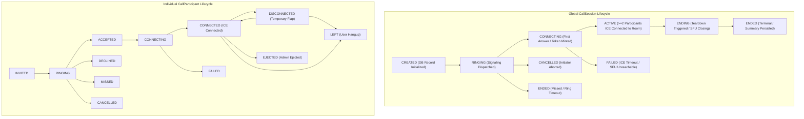
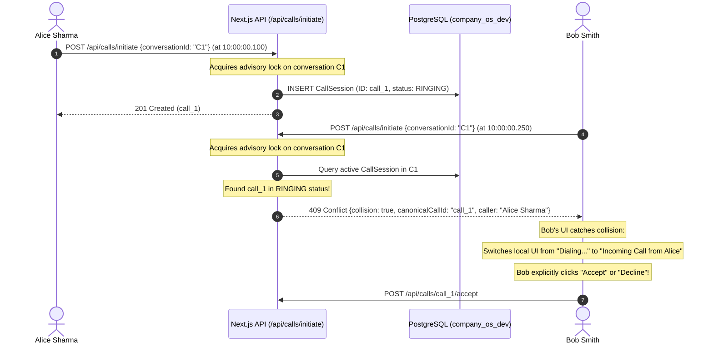

# CYRAOPS CALLING — FINAL STATE MACHINE & API SPECIFICATION
## Authoritative Dual-Tier State Engine · Participant Connection Gating · Atomic Collision Resolution · Group Governance

> [!IMPORTANT]
> **State Machine Architecture**: This document defines the decoupled state machines for global call sessions and individual participants, establishes the correct criteria for the `ACTIVE` state based on WebRTC participant connections (supporting audio-only, muted, and camera-off calls), resolves simultaneous dialing collisions without silent auto-acceptance, and details group meeting governance.

---

## 1. Decoupled Dual-Tier State Architecture



---

## 2. Redefining the Call `ACTIVE` State

### 2.1. The Flaw in Requiring Track Publication
Requiring participants to publish and subscribe to media tracks before marking a call `ACTIVE` breaks standard business calling scenarios:
- **Audio-Only Calls**: Senders intentionally publish zero video tracks.
- **Camera-Off / Muted Participants**: Users joining with camera disabled or microphone muted would prevent the call from becoming active.
- **Listen-Only / Permission-Denied Users**: If a participant denies microphone permission, they join to listen/watch. Requiring them to publish causes the entire call state to hang indefinitely in `CONNECTING`.

### 2.2. Correct Criteria: Participant Media Connection
A call transitions from `CONNECTING` to `ACTIVE` **as soon as at least two participants have successfully established active WebRTC transport connections to the LiveKit room**.

```
Participant Connection  !=  Track Publication  !=  Track Subscription  !=  Media Delivery
(WebRTC PeerConnection      (Local Camera/Mic       (SFU Routes Track       (Decibels / Video
 Established, ICE Done)      Track Published)        to Remote Peer)         Frames Flowing)
```

1. **Participant Connection**: WebRTC signaling handshake completes, ICE candidate exchange completes, and `RTCPeerConnection.iceConnectionState` reaches `connected` or `completed`.
2. **Track Publication**: Client creates audio/video track and begins streaming RTP packets to SFU.
3. **Track Subscription**: SFU negotiates track reception with remote clients.
4. **Media Delivery**: Remote client decodes and renders RTP packets to `<audio>` or `<video>` elements.

**Authoritative Trigger**: The Next.js backend marks `CallSession.status = "ACTIVE"` when LiveKit sends a `participant_joined` webhook (or room event) showing that **two distinct participants currently hold active WebRTC peer connections in the room**. Track publication and subscription operate independently within the active call.

---

## 3. Global CallSession & Participant State Matrices

### Global CallSession State Invariants

| State | Allowed Transitions To | Trigger / Guard Condition | Server Action |
| :--- | :--- | :--- | :--- |
| **`CREATED`** | `RINGING`, `FAILED` | Initiator clicks call icon; membership verified. | Allocates cryptographic room UUID; sets `ringTimeoutAt = now() + 45s`. |
| **`RINGING`** | `CONNECTING`, `CANCELLED`, `ENDED` | Telephony signaling emitted via Socket.IO. | Emits `call:incoming` to recipient user rooms (`user:${id}`). |
| **`CONNECTING`** | `ACTIVE`, `FAILED`, `ENDING` | Recipient invokes `POST /api/calls/[id]/accept`. | Returns 60s join JWT; sets connection deadline (now + 30s). |
| **`ACTIVE`** | `ENDING` | **$\ge 2$ participants have established WebRTC peer connections**. | Room is live. Duration counter active. |
| **`ENDING`** | `ENDED` | Host clicks "End for All" OR empty room countdown expires. | Invokes `RoomServiceClient.deleteRoom()`. |
| **`ENDED`** | None (Terminal) | All participants left; room closed in SFU. | Calculates duration; writes call summary card to chat. |
| **`CANCELLED`** | None (Terminal) | Initiator hung up before any recipient accepted. | Emits `call:cancelled` to dismiss ringing dialogs on all devices. |
| **`FAILED`** | None (Terminal) | Connection timeout (30s) or SFU unreachable. | Records technical diagnostic log. |

### Persisted Deadlines vs. Server Restarts
- In-memory `setTimeout` timers are strictly prohibited.
- Deadlines are persisted in PostgreSQL:
  - `CallSession.ringTimeoutAt`: Initiation timestamp + 45 seconds.
  - `CallSession.emptyRoomDeadlineAt`: Timestamp set when participant count drops to 1 (now + 60s).
- A periodic background worker in [server.ts](file:///Users/tanveersinghsaini/Desktop/locally%20hosted%20app%20dev/server.ts) runs every 15 seconds to sweep expired deadlines, ensuring server reboots cleanly recover all pending state transitions.

---

## 4. Simultaneous Call Handling (Collision Resolution Engine)

### 4.1. Absolute Prohibition: Never Silently Accept on Behalf of a User
Auto-accepting a call when a user initiates a competing call violates human agency. The user may have dialed to report an emergency, or may not be ready to immediately open their camera and microphone.

### 4.2. Atomic Collision Resolution Engine



#### Technical Implementation Rules
1. **Advisory Lock Serialization**:
   `POST /api/calls/initiate` executes inside a serializable transaction acquiring `pg_advisory_xact_lock(hashtext(conversationId))`.
2. **Conflict Response**:
   If an active call in `CREATED` or `RINGING` exists for this conversation, the second request returns `HTTP 409 Conflict`:
   ```json
   {
     "error": "Call collision detected",
     "collision": true,
     "canonicalCallId": "call_clx1...",
     "caller": { "id": "user_alice", "name": "Alice Sharma" }
   }
   ```
3. **Explicit Client Authorization**:
   Bob's client intercepts `collision: true`. It aborts its local dial state and immediately displays an incoming call prompt: *"Alice Sharma is already calling you. Would you like to connect?"* with explicit **Accept** and **Decline** buttons. No call is accepted without user interaction.

---

## 5. Group Meeting Governance & Authorization Rules

### 5.1. Authorization Matrix

| Action | Ordinary Participant | Conversation Creator | Admin | Workspace Owner |
| :--- | :--- | :--- | :--- | :--- |
| **Start Group Call** | Allowed (if member) | Allowed | Allowed | Allowed |
| **Join Ongoing Call** | Allowed (if member) | Allowed | Allowed | Allowed |
| **Mute Own Mic / Stop Camera** | Allowed | Allowed | Allowed | Allowed |
| **Share Screen** | Allowed (if permitted) | Allowed | Allowed | Allowed |
| **Eject Participant** | **DENIED (403)** | Allowed | Allowed | Allowed |
| **Mute Another Participant** | **DENIED (403)** | Allowed | Allowed | Allowed |
| **End Call for Everyone** | **DENIED (403)** | Allowed | Allowed | Allowed |

### 5.2. Governance Rules
1. **Invitation Distribution & Busy Users**:
   - Dispatched to all active members in `ConversationMember`.
   - Users currently connected to another call receive `isBusy: true`. They receive a subtle in-app header badge instead of an audible ringing modal.
2. **Late Joiners**:
   - Any conversation member can join an ongoing `ACTIVE` meeting via `POST /api/calls/[id]/accept` (or `/join`).
3. **Initiator Departure**:
   - The meeting **does not terminate** when the initiator leaves. It continues as long as $\ge 2$ participants remain connected.
4. **Host Departure & Reassignment**:
   - If the meeting host leaves, host authority automatically reassigns:
     1. The conversation creator (if connected).
     2. An active `ADMIN` or `OWNER`.
     3. The connected participant with the earliest `joinedAt` timestamp.
5. **Chat Member Removal While Call is Active**:
   - If an Admin removes a user from the underlying chat conversation in [src/app/api/conversations/[id]/route.ts](file:///Users/tanveersinghsaini/Desktop/locally%20hosted%20app%20dev/src/app/api/conversations/[id]/route.ts#L32), the removal handler immediately executes `roomService.removeParticipant(room, removedUserId)` and sets `CallParticipant.status = "EJECTED"`. The removed user is evicted from the call instantly.
