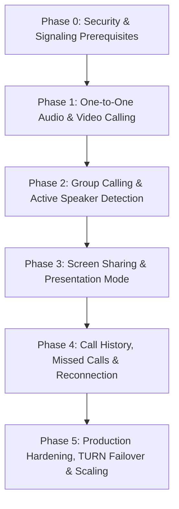

# CYRAOPS CALLING IMPLEMENTATION ROADMAP
## Phased Engineering Plan · Deliverables · Dependencies · Risk Mitigations · Testing Strategy

> [!IMPORTANT]
> **Audit & Implementation Blueprint**: This engineering roadmap establishes the strict phased rollout plan for integrating self-hosted calling into Cyraops. Each phase defines concrete entry criteria, deliverables, risk mitigations, testing requirements, and complexity estimates.

---

## 1. Roadmap Overview & Timeline Phasing

| Phase | Core Objective | Key Deliverables | Risk Level | Complexity |
| :--- | :--- | :--- | :--- | :--- |
| **Phase 0** | **Security & Signalling Foundation** | Personal socket rooms (`user:${id}`), session identity lock, LiveKit token endpoint. | High (Security) | Moderate |
| **Phase 1** | **One-to-One Audio & Video** | Call initiation, ringing dialog, answer/reject, 1:1 LiveKit WebRTC media container. | Medium | Moderate |
| **Phase 2** | **Group Calling** | Multi-party room creation, grid video layout, active speaker detection, participant sidebar. | Medium | High |
| **Phase 3** | **Screen Sharing** | `getDisplayMedia` capture, dual-track rendering, presentation layout toggle, audio sharing. | Low | Moderate |
| **Phase 4** | **History & Reconnection** | Missed call badges, CRM activity logging, offline detection, network flapping auto-reconnect. | Low | Moderate |
| **Phase 5** | **Hardening & Infrastructure** | Dedicated VM deployment, TURNS TLS fallback, load testing, Prometheus metrics. | Medium | High |

---

## 2. Phase-by-Phase Technical Specifications

### Phase 0: Security & Signalling Prerequisites
* **Objective**: Eliminate the profile-switching vulnerability for calling and establish personal socket rooms.
* **Dependencies**: Existing [server.ts](file:///Users/tanveersinghsaini/Desktop/locally%20hosted%20app%20dev/server.ts), [src/lib/auth.ts](file:///Users/tanveersinghsaini/Desktop/locally%20hosted%20app%20dev/src/lib/auth.ts).
* **Key Tasks**:
  1. In `server.ts`, add `socket.join(`user:${socket.data.userId}`)` immediately upon connection.
  2. Implement `livekit-server-sdk` in backend Next.js API handlers.
  3. Create `POST /api/calls/token` route enforcing session identity and conversation membership validation.
  4. Create `CallSession`, `CallParticipant`, and `CallInvitation` Prisma models.
* **Security & Testing**:
  - Unit test verifying unauthenticated users receive 401.
  - Integration test verifying users cannot mint tokens for rooms belonging to conversations where they are not a member (403).
  - Verify that switching active profile does not grant access to other users' call tokens.
* **Acceptance Criteria**: Backend can successfully mint a signed LiveKit JWT for an authorized conversation member and reject unauthorized requests.

---

### Phase 1: One-to-One Audio and Video Calling
* **Objective**: Enable two team members to engage in direct audio and video calls.
* **Dependencies**: Phase 0 completion, LiveKit server instance reachable.
* **Key Tasks**:
  1. Add Audio Call and Video Call buttons to the chat conversation header in [chat.tsx](file:///Users/tanveersinghsaini/Desktop/locally%20hosted%20app%20dev/src/components/modules/chat.tsx).
  2. Implement incoming call banner/modal with ringtone and "Accept" / "Decline" buttons.
  3. Integrate `livekit-client` into a dedicated calling overlay modal matching Cyraops design styling.
  4. Handle microphone mute/unmute and camera on/off buttons.
  5. Implement call termination (`call:ended`) and ringback timeout (auto-cancel after 45 seconds if no answer).
* **Testing Requirements**:
  - End-to-end test of Alice calling Bob: Bob receives ringing notification, accepts, and audio/video tracks connect.
  - Test Bob declining call: Alice's screen displays "Call declined".
  - Test Alice cancelling before Bob answers: Bob's ringing dialog dismisses immediately.
* **Acceptance Criteria**: Two users can conduct a 10-minute 720p video call with bidirectional audio and zero visual regressions.

---

### Phase 2: Group Calling & Active Speaker Management
* **Objective**: Scale calls to group conversations (3 to 20 participants).
* **Dependencies**: Phase 1 completion.
* **Key Tasks**:
  1. Add "Start Group Call" button in group chat headers.
  2. Emit `call:incoming` to all active members of the group conversation.
  3. Implement responsive video grid (1-4 participants: 2x2 grid; 5-9 participants: 3x3 grid; 10+ participants: paginated grid with active speaker spotlight).
  4. Hook into LiveKit's `RoomEvent.ActiveSpeakerChanged` to dynamically highlight speaking participant borders.
  5. In-call participant drawer listing all joined and invited members.
* **Testing Requirements**:
  - Test 5 simultaneous participants joining and leaving gracefully.
  - Validate Dynacast: verify subscriber download bandwidth decreases when other participants mute cameras.
* **Acceptance Criteria**: Group of 5+ users can meet with active speaker detection and smooth layout transitions.

---

### Phase 3: Screen Sharing & Presentation Layout
* **Objective**: Allow participants to share screens, application windows, or browser tabs with system audio.
* **Dependencies**: Phase 2 completion.
* **Key Tasks**:
  1. Add "Share Screen" button to call control toolbar.
  2. Invoke `room.localParticipant.setScreenShareEnabled(true, { audio: true })`.
  3. Implement "Stage View": active screen share occupies 80% of window; participant video feeds shift to a horizontal top/bottom carousel.
  4. Handle OS-level screen share revocation (`track.onended`).
  5. Display banner indicating who is sharing screen with "Stop Sharing" button.
* **Testing Requirements**:
  - Test screen sharing in Chrome, Safari, and Edge.
  - Verify crisp text rendering (`detail` content hint) on code and spreadsheets.
* **Acceptance Criteria**: Participant can share full desktop or window with instant rendering across all peers.

---

### Phase 4: Call History, Missed Calls & Reliability
* **Objective**: Provide comprehensive audit logs, missed call indicators, and automatic reconnection during network drops.
* **Dependencies**: Phases 1–3.
* **Key Tasks**:
  1. Generate chat timeline cards in conversation: *"Video call ended · 14m 22s"* or *"Missed audio call"*.
  2. Implement badge notifications for missed calls in the left sidebar and header.
  3. Integrate LiveKit `RoomEvent.Reconnecting` and `RoomEvent.Reconnected` with a subtle toast message (*"Reconnecting to media server..."*).
  4. Store duration and participant records in database on call end.
* **Testing Requirements**:
  - Simulate network loss (disconnect Wi-Fi for 5 seconds): verify media resumes automatically without reloading page.
  - Idempotency test: simulate duplicate webhook deliveries without corrupting database call duration.
* **Acceptance Criteria**: All call events persist accurately; temporary network blips recover within 3 seconds.

---

### Phase 5: Production Hardening, TURN Failover & Scaling
* **Objective**: Ensure high-availability media routing and strict firewall bypass.
* **Dependencies**: Dedicated production VM.
* **Key Tasks**:
  1. Deploy LiveKit SFU on dedicated Linux VM (`call.cyraops.com`) with Docker host networking.
  2. Configure embedded TURN server (`turn.cyraops.com`) on port 3478 and TURNS (port 5349).
  3. Configure Prometheus metrics endpoint (port 7882) to monitor packet loss, jitter, and active tracks.
  4. Conduct stress test simulating 50 concurrent video participants.
* **Acceptance Criteria**: 100% call connection rate even behind strict corporate firewalls; $< 1\%$ packet loss under peak load.

---

## 3. Explicit Out-of-Scope Items for Initial Release

To avoid scope creep and ensure timely, secure delivery:
1. **Cloud Recording & Video Archiving (Egress)**: Compositing and uploading MP4s to S3 is deferred.
2. **PSTN / Phone Number Dialing (SIP Trunking)**: Dialing regular telephone numbers via SIP trunks is out of scope.
3. **Live AI Voice Transcription during Calls**: In-call real-time transcription is deferred to a future AI update.
4. **Virtual Backgrounds / Video Blur**: Client-side ML video segmentation is deferred to preserve CPU performance on laptops.
