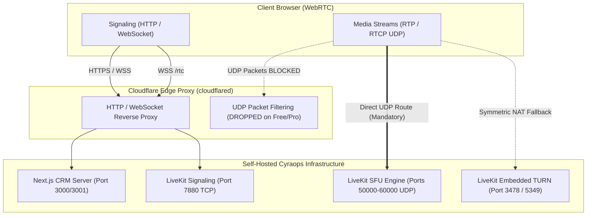

# CYRAOPS CALLING INFRASTRUCTURE & COST ANALYSIS
## Self-Hosting Media Topology · Cloudflare Tunnel Assessment · Port Matrix · Capacity & Cost Projections

> [!IMPORTANT]
> **Audit & Infrastructure Finding**: This evaluation details the exact hosting requirements, networking topologies, firewall rules, and financial cost projections for self-hosting LiveKit. No cloud servers, DNS records, or Docker containers were created during this audit.

---

## 1. Network Topology & The Cloudflare Tunnel Problem

### Can Cloudflare Tunnel Alone Support WebRTC Media?
**NO. Cloudflare Tunnel (`cloudflared`) ALONE is fundamentally insufficient for WebRTC media traffic.**

### Detailed Technical Reasons:
1. **UDP Packet Dropping**: Standard Cloudflare Tunnels proxy layer-7 HTTP, HTTPS, and WebSocket traffic. WebRTC audio, video, and screen sharing use real-time RTP/RTCP packets over **UDP**. Cloudflare Tunnel does not route arbitrary UDP port ranges unless subscribed to Cloudflare Magic Transit or Spectrum (enterprise plans starting at thousands of dollars per month).
2. **Buffer Latency & Head-of-Line Blocking**: Forcing WebRTC over TCP proxying (e.g. through a WebSocket tunnel) introduces packet retransmission delays. If a single packet drops on TCP, the entire audio stream stalls until retransmitted, causing severe stuttering and robot audio. Real-time calling requires unreliable, low-latency UDP where dropped packets are simply interpolated.
3. **Architectural Resolution**:
   - **Signaling (`call.cyraops.com` on port 443/7880)**: Can be routed through standard Nginx, Caddy, or Cloudflare Tunnel (with WebSocket proxying enabled).
   - **Media (`50000–60000/udp` & `3478/udp`)**: **MUST have direct, unproxied UDP connectivity** directly to the public IP address of the LiveKit server host.

---

## 2. Ports & Firewall Security Matrix

To achieve seamless connectivity across home networks, mobile data, and corporate firewalls, the host server must configure the following firewall rules:

| Port / Range | Protocol | Service / Purpose | Traffic Direction | Required? | Official Guidance Reference |
| :--- | :--- | :--- | :--- | :--- | :--- |
| **`443`** (or `7880`) | **TCP** | LiveKit Signaling & REST API | Inbound | **YES** | `BASED ON OFFICIAL DOCUMENTATION` |
| **`7881`** | **TCP** | WebRTC over TCP Fallback | Inbound | **YES** | `BASED ON OFFICIAL DOCUMENTATION` |
| **`50000–60000`** | **UDP** | WebRTC Media Streams (RTP/RTCP) | Inbound/Outbound | **YES** | `BASED ON OFFICIAL DOCUMENTATION` |
| **`3478`** | **UDP & TCP** | STUN & Standard TURN Relay | Inbound | **YES** | `BASED ON OFFICIAL DOCUMENTATION` |
| **`5349`** | **TCP** | TURN over TLS (TURNS for Strict Firewalls) | Inbound | **RECOMMENDED** | `BASED ON OFFICIAL DOCUMENTATION` |

### Domain Names & DNS Architecture
- **`call.cyraops.com`**: Points to the server's public IP. Uses Let's Encrypt SSL/TLS. Handles client WebSocket connections (`wss://call.cyraops.com/rtc`) and token validation.
- **`turn.cyraops.com`**: Points to the same public IP. Used by WebRTC ICE agents to resolve public IP mappings (STUN) and relay media when clients are behind symmetric enterprise NATs (TURN).

---

## 3. Capacity & Bandwidth Analysis Across Participant Scales

### Theoretical Bandwidth & Resource Consumption Model

Bandwidth is calculated using standard WebRTC codecs:
- **Audio (Opus)**: $32\text{--}48\text{ kbps}$ per active participant.
- **Video (VP8 / H.264 @ 720p)**: Up to $1.5\text{ Mbps}$ per publisher.
- **Thumbnail Feeds (Simulcast Low @ 180p)**: $\sim 150\text{ kbps}$ per participant.
- **Screen Share (1080p @ 15 fps)**: $1.0\text{--}2.5\text{ Mbps}$ per publisher.

$$\text{Egress Bandwidth} \approx N_{\text{subscribers}} \times \left( \text{ActiveSpeaker}_{\text{high}} + (N_{\text{thumbnails}} \times \text{Thumb}_{\text{low}}) + \text{Audio} \right)$$

### Participant Scaling Matrix

| Scale | Scenario | Inbound Bitrate (Server In) | Outbound Bitrate (Server Egress) | Server CPU Cores | Server RAM | Estimated Monthly Egress (20 hrs/mo) |
| :--- | :--- | :--- | :--- | :--- | :--- | :--- |
| **2 Users** | 1:1 Audio Call | $64\text{ kbps}$ | $64\text{ kbps}$ | $< 0.1$ core | $< 50\text{ MB}$ | $\sim 0.6\text{ GB}$ |
| **2 Users** | 1:1 Video Call (720p) | $3.0\text{ Mbps}$ | $3.0\text{ Mbps}$ | $0.2$ core | $100\text{ MB}$ | $\sim 27\text{ GB}$ |
| **5 Users** | Group Video (1 speaker, 4 thumbs) | $7.5\text{ Mbps}$ | $9.8\text{ Mbps}$ | $0.5$ core | $250\text{ MB}$ | $\sim 88\text{ GB}$ |
| **10 Users** | Team Meeting (Dynacast active) | $15.0\text{ Mbps}$ | $28.5\text{ Mbps}$ | $1.0$ core | $500\text{ MB}$ | $\sim 256\text{ GB}$ |
| **20 Users** | All-Hands Meeting | $30.0\text{ Mbps}$ | $45.0\text{ Mbps}$ | $2.0$ cores | $1.0\text{ GB}$ | $\sim 405\text{ GB}$ |
| **50 Users** | Company Townhall (1 speaker, 49 view) | $4.0\text{ Mbps}$ | $75.0\text{ Mbps}$ | $3.0$ cores | $2.0\text{ GB}$ | $\sim 675\text{ GB}$ |
| **100 Users** | Large Broadcast (SFU egress only) | $5.0\text{ Mbps}$ | $150.0\text{ Mbps}$ | $4.0$ cores | $3.0\text{ GB}$ | $\sim 1.35\text{ TB}$ |

*Classifications: Server Bitrates based on `ENGINEERING ESTIMATE` with Dynacast enabled; CPU/RAM based on `OFFICIAL VENDOR BENCHMARKS`.*

---

## 4. Deployment Topology Comparison & Recommendation

### Option A: LiveKit on the Same Server as Cyraops (Colocated Docker)
- **Architecture**: Next.js CRM and LiveKit container running on the same Linux host.
- **Pros**: Zero additional server cost; shared localhost networking for API token validation.
- **Cons**: LiveKit UDP media traffic competes directly with Next.js CPU and memory; port binding conflicts on 443/80 unless using a reverse proxy (Caddy/Nginx) for SSL multiplexing.
- **Suitability**: Suitable for initial alpha testing with $< 10$ team members.

### Option B: Dedicated Cloud Linux VM (Recommended Initial Production Architecture)
- **Architecture**: A dedicated virtual machine (e.g. Hetzner Cloud, DigitalOcean, or AWS EC2) with a dedicated static public IPv4 address.
- **Configuration**:
  - OS: Ubuntu 24.04 LTS
  - Specs: 4 vCPU, 8 GB RAM, 80 GB NVMe SSD
  - Dedicated LiveKit Docker container with `network_mode: host` (ensures optimal UDP kernel packet processing).
  - Caddy / Nginx reverse proxy for automatic Let's Encrypt SSL on `call.cyraops.com`.
- **Pros**: Complete compute and networking isolation; zero risk of audio lag during heavy CRM builds or database queries; unhindered UDP ports.
- **Suitability**: **STRONGLY RECOMMENDED for enterprise production.**

### Option C: Kubernetes Deployment
- **Architecture**: LiveKit Helm chart on a managed Kubernetes cluster (EKS / GKE).
- **Cons**: Substantial operational complexity; requires complex HostPort or LoadBalancer node mapping for UDP port ranges (50000-60000); excessive cost for an internal company CRM.
- **Suitability**: Over-engineered. Not recommended.

---

## 5. Realistic Monthly Cost Breakdown

| Component | Provider / Specification | Monthly Cost (USD) | Notes |
| :--- | :--- | :--- | :--- |
| **Dedicated Compute Host** | Hetzner Cloud CPX31 (4 vCPU AMD, 8 GB RAM) OR DigitalOcean Droplet | **\$14.00 – \$24.00** | Dedicated VM with static public IPv4. |
| **Outbound Bandwidth Egress** | Included 20 TB / month (Hetzner) or 4 TB (DigitalOcean) | **\$0.00** | Bandwidth for normal company operations (< 2 TB) is 100% covered in standard VM allowance. |
| **DNS & Routing** | Cloudflare DNS (`call.cyraops.com` DNS-only mode) | **\$0.00** | Free tier (must set to DNS-only / grey cloud to allow UDP). |
| **SSL Certificates** | Let's Encrypt via automated Caddy / Certbot | **\$0.00** | Free automatic renewal. |
| **TURN Relay Service** | LiveKit embedded TURN server on the same host | **\$0.00** | Zero third-party fees (Twilio TURN charges \$0.40/GB; self-hosting saves hundreds). |
| **Total Estimated Monthly Cost** | | **\$14.00 – \$24.00 / mo** | Comprehensive enterprise self-hosted calling at minimal operational cost. |
