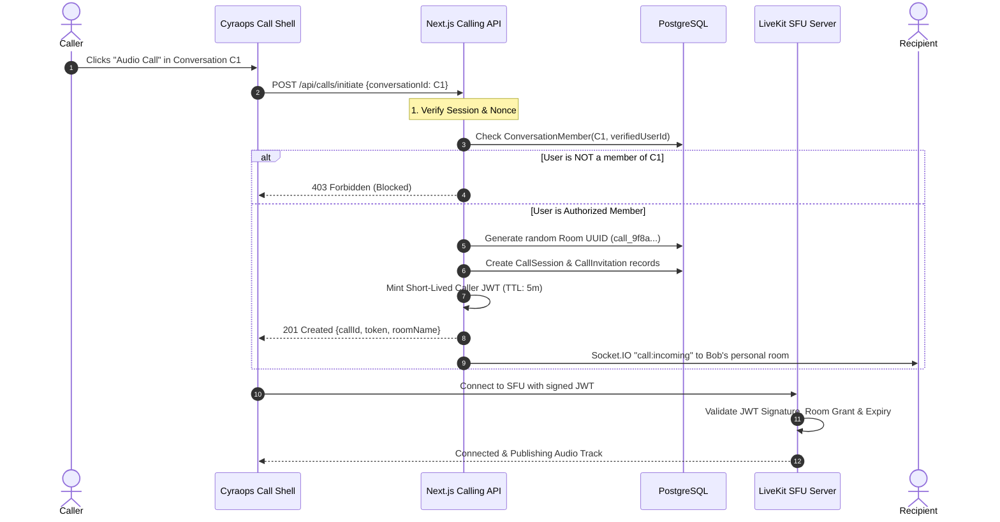

# CYRAOPS CALLING SECURITY & AUTHENTICATION DESIGN
## Threat Modeling · Verified Identity Enforcement · LiveKit Token Architecture · Privacy Controls

> [!CAUTION]
> **Primary Security Risk Identified**: Cyraops currently uses a shared workspace password model with an unrestricted profile-switching endpoint (`POST /api/profile/active`). If calling permissions are bound naively to the active profile in the session cookie, any employee can impersonate company executives, eavesdrop on private executive calls, or forge call invitations. This document establishes the mandatory security boundaries required to eliminate this vulnerability.

---

## 1. Threat Model & Root Cause Analysis

### The Existing Vulnerability ([src/app/api/profile/active/route.ts](file:///Users/tanveersinghsaini/Desktop/locally%20hosted%20app%20dev/src/app/api/profile/active/route.ts))
In the existing implementation, switching profiles executes:
```typescript
await db.session.updateMany({
  where: { tokenHash: sha256(token), expiresAt: { gt: new Date() } },
  data: { userId: profile.id }, // Mutates session pointer without credential challenge
});
```
Any user who has the workspace password can switch their session pointer to the Owner or an Admin at any time.

### Attack Scenarios in Real-Time Calling
1. **Executive Impersonation**: Attacker switches profile to "Tanveer Singh Saini" (Owner) and initiates a video call with a client or team member. The recipient's screen displays "Incoming call from Tanveer Singh Saini", establishing false authority.
2. **Unauthorized Call Eavesdropping**: An executive and a client are on a 1-to-1 call in a direct conversation. An unprivileged user switches their profile to the executive's ID, requests a LiveKit token for the room, and joins the media session invisibly or overtly.
3. **Room Hijacking & Forced Disconnection**: An attacker acquires an administrative LiveKit token and ejects legitimate participants or mutes their tracks remotely.

---

## 2. Calling Identity & Verification Model

To make calling enterprise-grade and secure without forcing an immediate overhaul of the entire CRM login system, calling **must enforce an explicit Identity Verification Barrier**:



### Core Security Rules

1. **Strict Conversation Membership Isolation**:
   - A user may **only** initiate or join a call associated with a `conversationId` where they are an active, non-disabled member in `ConversationMember`.
   - The backend strictly verifies:
     ```typescript
     const membership = await db.conversationMember.findUnique({
       where: { conversationId_userId: { conversationId, userId: verifiedUserId } }
     });
     if (!membership) throw new ForbiddenError("Not a member of this conversation");
     ```
2. **Cryptographically Unpredictable Room Names**:
   - Room names must **never** equal the predictable conversation ID or human-readable names (e.g. `room_general`).
   - Every call session generates a cryptographically random, collision-resistant room name:
     $$\text{roomName} = \text{"call\_"} + \text{crypto.randomUUID()}$$
   - This ensures that knowing a conversation's database ID grants zero ability to guess or connect to an active or past media room.
3. **Short-Lived Access Tokens (TTL)**:
   - LiveKit access tokens minted by the backend must have a Time-To-Live (TTL) of **no more than 5 to 10 minutes** (`ttl: "10m"`).
   - Once connected, the WebRTC peer connection remains active. However, if the token is leaked or intercepted, it cannot be reused to join later.
4. **Backend-Only Secret Key Custody**:
   - The frontend never receives `LIVEKIT_API_KEY` or `LIVEKIT_API_SECRET`.
   - Tokens are minted exclusively on the Node.js server inside authenticated Next.js route handlers.

---

## 3. LiveKit Token Permissions & Grants Matrix

LiveKit uses fine-grained Video Grants encoded inside the signed JWT. Below is the strict grant policy for Cyraops:

| Role / Context | `roomJoin` | `canPublish` | `canSubscribe` | `canPublishData` | `roomAdmin` | `roomRecord` | Token TTL |
| :--- | :--- | :--- | :--- | :--- | :--- | :--- | :--- |
| **Normal Participant (1:1 or Group)** | `true` | `true` (Camera/Mic) | `true` | `true` | `false` | `false` | 10 minutes |
| **Screen Share Publisher** | `true` | `true` (Screen) | `true` | `true` | `false` | `false` | 10 minutes |
| **View-Only Participant (Audience)** | `true` | `false` | `true` | `false` | `false` | `false` | 10 minutes |
| **Call Host / Group Creator** | `true` | `true` | `true` | `true` | `false`* | `false` | 10 minutes |

> [!NOTE]
> `*` **Room Administration**: Room termination and participant ejection are performed **exclusively via backend API calls using the `RoomServiceClient`**, never via client-side admin grants. This prevents compromised clients from kicking participants directly through the SFU.

---

## 4. Participant Privacy & Media Protection Policies

1. **Zero Media Storage (Ephemeral Transmission)**:
   - WebRTC media packets (RTP audio/video) travel through the LiveKit SFU memory directly to subscribed peers.
   - **No media is recorded, buffered to disk, or stored in PostgreSQL**.
   - The SFU acts solely as a real-time UDP packet forwarder.
2. **Explicit User Consent & Hardware Permissions**:
   - The browser strictly prompts the user for camera and microphone permissions via standard Web APIs (`navigator.mediaDevices.getUserMedia`).
   - If the user denies permission, the call gracefully continues in audio-only mode or view-only mode; it does not crash or loop.
3. **Screen Sharing Privacy Protection**:
   - Screen sharing requires a distinct user gesture and browser OS-level approval (`getDisplayMedia`).
   - When screen sharing starts, LiveKit broadcasts `Track.Source.ScreenShare`. The Cyraops UI visually alerts all participants with a prominent status banner: *"Alice is sharing their screen"*.
4. **No Egress Recording Policy**:
   - LiveKit Egress (recording/compositing) is **strictly disabled** in the initial configuration.
   - No meeting recordings or voice transcripts will be generated unless authorized in a future governance update.

---

## 5. Eliminating the Profile-Switching Vulnerability for Calling

To ensure calling is 100% trustworthy without disrupting the rest of the CRM:

### Proposed Calling Security Architecture
1. **Session Binding**:
   - In addition to checking `session.userId`, the calling initiation endpoint records the `initiatorSessionId` from `session.id`.
2. **Active Participant Verification**:
   - When a call token is requested (`POST /api/calls/[id]/token`), the backend verifies that the requesting user's ID matches the invited participant in the database record `CallInvitation`.
   - If User A switches their profile to User B, User A cannot join an invitation specifically issued to User C, because User C's unique invitation token and ID check will fail.
3. **Recommended Phase 0 Security Gate**:
   - For sensitive calling operations, require either:
     - (A) Dedicated user logins (the long-term architectural solution recommended in the Usability Audit), OR
     - (B) A session-locked caller pin or re-confirmation secret before dispatching external company calls.
