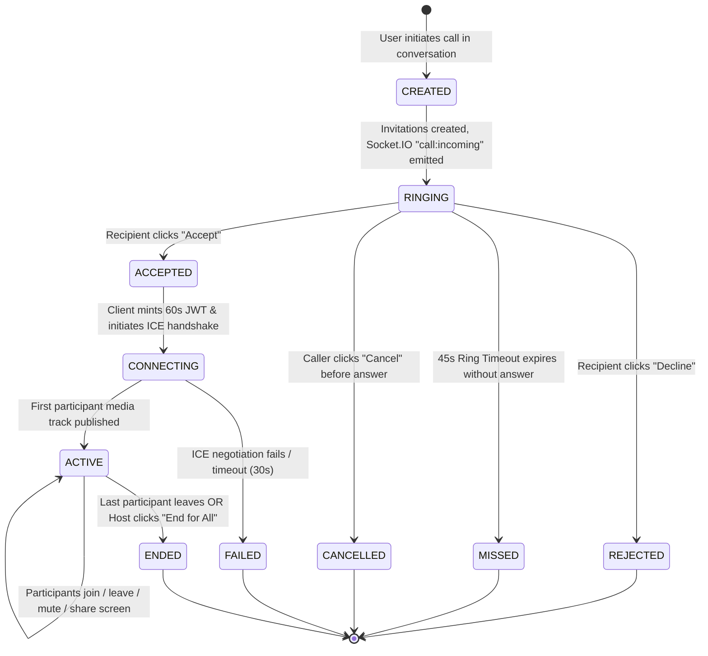

# CYRAOPS CALLING — STATE MACHINE & API DESIGN
## Backend-Authoritative State Engine · Edge Case Handling · Group Call Rules · REST & Webhook APIs

> [!IMPORTANT]
> **Engineering Specification**: This document finalizes the call lifecycle state machine, race condition handlers, group call governance rules, and API contracts for Cyraops calling.

---

## 1. Backend-Authoritative Call State Machine



### Detailed State Transitions & Invariants

| State | Allowed Transitions To | Trigger / Guard Condition | Server Action |
| :--- | :--- | :--- | :--- |
| **`CREATED`** | `RINGING`, `FAILED` | Initiator clicks call icon; membership verified. | Allocates cryptographic room UUID; creates `CallSession` and `CallInvitation` records. |
| **`RINGING`** | `ACCEPTED`, `REJECTED`, `MISSED`, `CANCELLED` | Telephony signaling dispatched. | Emits `call:incoming` to recipient user rooms; starts 45-second ringback timer. |
| **`ACCEPTED`** | `CONNECTING`, `FAILED` | Recipient invokes `POST /api/calls/[id]/accept`. | Cancels ringback timer; emits `call:accepted` to caller; returns 60-second join JWT. |
| **`CONNECTING`**| `ACTIVE`, `FAILED` | Browser connects to LiveKit SFU WebSocket `/rtc`. | ICE negotiation; WebRTC peer connection established. Timeout guard: 30s. |
| **`ACTIVE`** | `ENDED` | LiveKit webhook `room_started` or track published. | Room is live. Audio/video flowing. Duration timer ticking. |
| **`REJECTED`** | `[*]` (Terminal) | Recipient invokes `POST /api/calls/[id]/reject`. | If 1:1, ends session; if group, marks individual participant `DECLINED`. |
| **`MISSED`** | `[*]` (Terminal) | 45-second server-side ring timer expires. | Sets status `MISSED`; emits `call:missed`; creates unread badge notification. |
| **`CANCELLED`**| `[*]` (Terminal) | Initiator invokes `POST /api/calls/[id]/cancel`. | Sets status `CANCELLED`; emits `call:cancelled` to dismiss ringing dialogs on all devices. |
| **`FAILED`** | `[*]` (Terminal) | ICE connection error or LiveKit unreachable. | Records technical diagnostic error; cleans up orphaned room resources. |
| **`ENDED`** | `[*]` (Terminal) | All participants depart OR Host ends call. | Calculates `durationSeconds`; writes summary card to conversation chat; closes SFU room. |

---

## 2. Edge Case Resolution & Race Condition Safeguards

### 2.1. Simultaneous Calling (Alice calls Bob while Bob calls Alice)
* **The Race Condition**: Alice clicks "Call Bob" in conversation `C1` at 10:00:00. At 10:00:01, before Alice's call notification reaches Bob, Bob clicks "Call Alice" in `C1`.
* **Resolution**:
  1. The call initiation endpoint uses a database transaction with serializable isolation:
     ```typescript
     const existingCall = await tx.callSession.findFirst({
       where: { conversationId, status: { in: ["CREATED", "RINGING"] } }
     });
     ```
  2. If an active `RINGING` call already exists in `C1`, Bob's request is **automatically merged into the existing call as an `ACCEPTED` action** rather than creating a competing call!
  3. The server cancels Bob's outgoing invitation, mints a join token for Bob, and joins Bob to Alice's room. Both users connect instantly with zero deadlock.

### 2.2. Duplicate Requests & Concurrent Double-Clicks
* **Safeguard**: All transition endpoints (`accept`, `reject`, `cancel`) accept an optional `idempotencyKey` and enforce atomic state checks:
  ```typescript
  const updated = await db.callSession.updateMany({
    where: { id: callId, status: "RINGING" }, // Guard condition prevents double-transitions
    data: { status: "ACCEPTED", startedAt: new Date() }
  });
  if (updated.count === 0) {
    // Return current state safely without re-processing
    return Response.json({ call: await db.callSession.findUnique({ where: { id: callId } }) });
  }
  ```

### 2.3. Disconnected Participants & Network Flapping
* **Temporary Network Loss (e.g. Wi-Fi drop for 5–15 seconds)**:
  - LiveKit client SDK automatically initiates WebRTC ICE restart.
  - The participant status remains `CONNECTED` in PostgreSQL.
  - The UI displays a non-blocking toast: *"Reconnecting..."*.
  - When connection resumes, video and audio restore seamlessly without re-minting a token.
* **Permanent Disconnection (Browser closed or power lost)**:
  - If the client fails to reconnect within **30 seconds**, the LiveKit SFU fires a `participant_left` webhook.
  - The Next.js webhook handler marks `CallParticipant.leftAt = now()`.
  - If no participants remain in the room, LiveKit fires `room_finished`, authoritatively closing the `CallSession`.

### 2.4. Duplicate Webhook Deliveries
* **Safeguard**: LiveKit webhooks include a unique UUID `event.id`. The Next.js webhook endpoint stores processed event IDs in an `EventDeduplication` cache or table. If an event ID was already processed within the past 10 minutes, the endpoint returns **HTTP 200 OK** immediately without modifying database timestamps.

---

## 3. Group Call Governance & Collaboration Rules

### 3.1. Who Receives Group Call Invitations?
- When a group call is initiated in a group conversation (`type: GROUP`), an invitation is dispatched to **all members** currently in `ConversationMember` for that conversation (excluding disabled users and the caller).
- Members currently in other active calls receive a subtle in-app notification badge rather than an audible ringing modal.

### 3.2. Late Joiners (Joining After a Call Starts)
- Any authorized member of the group conversation can join an ongoing call at any time.
- The conversation header displays a live green indicator: *"Meeting in progress (3 participants) · Join"*.
- Clicking "Join" calls `POST /api/calls/[id]/accept`, which mints a fresh 60-second token and connects the user without disturbing active speakers.

### 3.3. Call Survivability (Initiator Departure)
- **Rule**: If the call initiator leaves or disconnects, **the group call DOES NOT terminate**.
- The call continues uninterrupted as long as at least **2 participants** remain connected.
- When only 1 participant remains, a 60-second countdown begins. If no one joins, the call terminates automatically to prevent phantom empty rooms.

### 3.4. Administrative Termination ("End Call for All")
- Only the **Conversation Creator**, an **Admin**, or the **Workspace Owner** possesses the authority to click "End Call for Everyone".
- When triggered, the backend invokes `RoomServiceClient.deleteRoom(roomName)`.
- The SFU tears down all WebRTC tracks simultaneously. All participants are cleanly returned to the chat view.

### 3.5. Participant Ejection
- If a participant is disruptive, an Admin/Owner can click "Remove Participant".
- The server records `CallParticipant.status = "EJECTED"`, calls `RoomServiceClient.removeParticipant()`, and refuses to issue future tokens for that session.

### 3.6. In-Call Chat Synchronization
- During a video call, participants can toggle the **In-Call Chat Drawer**.
- The drawer does **not** create a disconnected temporary chat. It renders the **actual conversation message feed** using existing endpoints (`GET /api/conversations/[id]/messages` and `POST /api/conversations/[id]/messages`).
- Messages, file links, and code snippets posted during the call remain permanently preserved in the team's chat history after the call ends.

---

## 4. REST API Endpoint Contracts

### 1. `POST /api/calls/initiate`
* **Request**:
  ```json
  {
    "conversationId": "cmv123abc...",
    "type": "AUDIO_DIRECT" // "VIDEO_DIRECT" | "AUDIO_GROUP" | "VIDEO_GROUP"
  }
  ```
* **Response (201 Created)**:
  ```json
  {
    "callId": "call_clx1...",
    "roomName": "call_9f8a32d1-4b12-4c8d-8e7f-1a2b3c4d5e6f",
    "token": "eyJhbGciOi...",
    "serverUrl": "wss://call.cyraops.com"
  }
  ```

### 2. `POST /api/calls/[id]/accept`
* **Request**: `{}`
* **Response (200 OK)**:
  ```json
  {
    "callId": "call_clx1...",
    "roomName": "call_9f8a32d1-4b12-4c8d-8e7f-1a2b3c4d5e6f",
    "token": "eyJhbGciOi...",
    "serverUrl": "wss://call.cyraops.com"
  }
  ```

### 3. `POST /api/calls/[id]/reject`
* **Request**: `{"reason": "declined"}` (or `"busy"`)
* **Response (200 OK)**: `{"ok": true}`

### 4. `POST /api/calls/[id]/cancel`
* **Request**: `{}`
* **Response (200 OK)**: `{"ok": true}`

### 5. `POST /api/calls/[id]/end`
* **Request**: `{"endForAll": false}`
* **Response (200 OK)**: `{"ok": true, "durationSeconds": 482}`

### 6. `POST /api/calls/[id]/kick` (Admin Only)
* **Request**: `{"userId": "user_bad_actor_id"}`
* **Response (200 OK)**: `{"ok": true}`

### 7. `POST /api/calls/webhook` (LiveKit Event Receiver)
* **Headers**: `Authorization: Bearer <LiveKit-HMAC-SHA256-JWT>`
* **Payload**:
  ```json
  {
    "id": "EV_8f9a2b...",
    "event": "participant_left",
    "room": { "name": "call_9f8a32d1..." },
    "participant": { "identity": "cmv_user_123", "name": "Alice" },
    "createdAt": 1730681200
  }
  ```
* **Response (200 OK)**: `{"received": true}`
