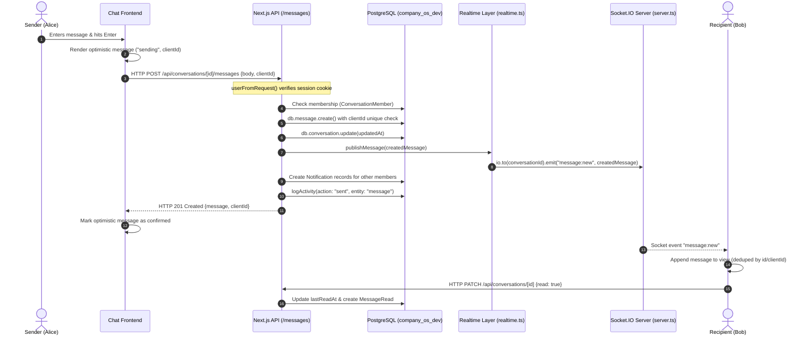

# CYRAOPS CHAT & REAL-TIME ARCHITECTURE AUDIT
## Existing Messaging System Inspection · Socket.IO Signalling Compatibility Assessment

> [!IMPORTANT]
> **Audit-Only Verification**: This assessment was conducted exclusively through static code analysis, architectural inspection, and database schema examination within the development environment at `/Users/tanveersinghsaini/Desktop/locally hosted app dev`. No code was modified, no packages were installed, and no production data was accessed.

---

## 1. Executive Summary & Audit Verification Matrix

The previous application audit made several claims regarding the real-time capabilities of the Cyraops Chat module. Below is the independent, code-level verification of those claims against the current codebase:

| Claimed Feature | Actual Codebase Reality | Verification Finding & Evidence | Evidence Classification |
| :--- | :--- | :--- | :--- |
| **Socket.IO for Real-Time** | **Partially Present (One-Way Broadcast Only)** | Socket.IO server runs in [server.ts](file:///Users/tanveersinghsaini/Desktop/locally%20hosted%20app%20dev/server.ts#L21) and connects via [chat.tsx](file:///Users/tanveersinghsaini/Desktop/locally%20hosted%20app%20dev/src/components/modules/chat.tsx#L14). However, it is used strictly for server-to-client broadcasts (`message:new`). Outbound client messages use HTTP `POST`. | `CONFIRMED FROM SOURCE CODE` |
| **HTTP Polling Fallback** | **Present & Verified** | In [chat.tsx](file:///Users/tanveersinghsaini/Desktop/locally%20hosted%20app%20dev/src/components/modules/chat.tsx#L16), when `!socketReady`, an active `setInterval` executes `GET /api/conversations/[id]/messages?limit=100` every 3,000ms. | `CONFIRMED FROM SOURCE CODE` |
| **Persistent Messages** | **Present & Verified** | Messages are persisted in PostgreSQL via Prisma model `Message` in [prisma/schema.prisma](file:///Users/tanveersinghsaini/Desktop/locally%20hosted%20app%20dev/prisma/schema.prisma#L230). | `CONFIRMED FROM SOURCE CODE` |
| **Message History Across Refreshes** | **Present & Verified** | [chat.tsx](file:///Users/tanveersinghsaini/Desktop/locally%20hosted%20app%20dev/src/components/modules/chat.tsx#L13) fetches message history from `GET /api/conversations/[id]/messages` on component mount and conversation selection. | `CONFIRMED FROM SOURCE CODE` |
| **Conversations Associated with Users** | **Present & Verified** | Managed via Prisma relational join model `ConversationMember` linking `User` and `Conversation` in [prisma/schema.prisma](file:///Users/tanveersinghsaini/Desktop/locally%20hosted%20app%20dev/prisma/schema.prisma#L218). | `CONFIRMED FROM SOURCE CODE` |
| **Online User Presence** | **DOES NOT EXIST** | **Genuinely Missing**. There is no socket presence tracker, heartbeat table, or online status cache for human teammates. (Codebase references to "presence" refer only to AI agent status and company website SEO/GitHub audits). | `CONFIRMED FROM SOURCE CODE` |
| **Typing Indicators** | **DOES NOT EXIST** | **Genuinely Missing**. No typing socket events (`typing:start`, `typing:stop`) or UI indicators exist anywhere in client or server code. | `CONFIRMED FROM SOURCE CODE` |
| **User Personal Socket Rooms** | **DOES NOT EXIST** | **Critical Architectural Gap**. Socket.IO only joins conversation rooms (`socket.join(conversationId)`). Sockets do **not** join personal user rooms (e.g. `user:${userId}`), making out-of-chat call ringing impossible without modifications. | `CONFIRMED FROM SOURCE CODE` |

---

## 2. Frontend Chat Architecture Inspection

### Source Files Inspected
- Main Page Container: [src/app/(workspace)/chat/page.tsx](file:///Users/tanveersinghsaini/Desktop/locally%20hosted%20app%20dev/src/app/(workspace)/chat/page.tsx)
- Chat Module Implementation: [src/components/modules/chat.tsx](file:///Users/tanveersinghsaini/Desktop/locally%20hosted%20app%20dev/src/components/modules/chat.tsx)

### Client-Side Mechanics

1. **Initialization & Identity Resolution**:
   - In [chat.tsx](file:///Users/tanveersinghsaini/Desktop/locally%20hosted%20app%20dev/src/components/modules/chat.tsx#L11), `loadConversations` performs a parallel HTTP fetch:
     - `GET /api/conversations` (returns active user's conversations and unread counts)
     - `GET /api/team` (returns active workspace members for group creation/lookup)
     - `GET /api/auth/me` (resolves active `currentUser` object)
2. **Socket.IO Client Setup**:
   - In [chat.tsx](file:///Users/tanveersinghsaini/Desktop/locally%20hosted%20app%20dev/src/components/modules/chat.tsx#L14):
     ```typescript
     const socket = io({
       autoConnect: true,
       transports: ["websocket", "polling"]
     });
     ```
   - Connection state is tracked in React state `socketReady`:
     - `"connect"` -> `setSocketReady(true)`
     - `"disconnect"` / `"connect_error"` -> `setSocketReady(false)`
   - When a conversation is selected and `socketReady === true`, the client emits:
     ```typescript
     socketRef.current?.emit("conversation:join", selectedId);
     ```
3. **Event Subscriptions**:
   - `"message:new"`: Validates `message.conversationId === selectedRef.current`. Deduplicates against optimistic `clientId` or database `id`. If the message is from another user, automatically dispatches an HTTP `PATCH /api/conversations/[id]` with `{ read: true }`.
   - `"conversation:member-removed"`: If `event.userId === currentUser?.id`, leaves the socket room, resets selection, displays error toast, and redirects to `/chat`.
4. **Message Dispatching (Hybrid Approach)**:
   - In [chat.tsx](file:///Users/tanveersinghsaini/Desktop/locally%20hosted%20app%20dev/src/components/modules/chat.tsx#L19), sending a message does **not** emit over Socket.IO. Instead:
     1. Creates an optimistic message with status `"sending"` and a unique `clientId` (`crypto.randomUUID()`).
     2. Dispatches HTTP `POST /api/conversations/[id]/messages` with `{ body, clientId }`.
     3. On success (200/201), updates the optimistic entry with the server response.
     4. On failure, updates status to `"failed"` and shows a retry button.
5. **Fallback Synchronization**:
   - In [chat.tsx](file:///Users/tanveersinghsaini/Desktop/locally%20hosted%20app%20dev/src/components/modules/chat.tsx#L16), an active fallback timer runs every 3 seconds whenever `!socketReady` or when re-syncing unread message boundaries.

---

## 3. Backend Socket.IO & Real-Time Architecture

### Source Files Inspected
- Custom HTTP/Socket Server: [server.ts](file:///Users/tanveersinghsaini/Desktop/locally%20hosted%20app%20dev/server.ts)
- Real-Time Broadcast Layer: [src/lib/realtime.ts](file:///Users/tanveersinghsaini/Desktop/locally%20hosted%20app%20dev/src/lib/realtime.ts)
- Conversation API Routes:
  - [src/app/api/conversations/route.ts](file:///Users/tanveersinghsaini/Desktop/locally%20hosted%20app%20dev/src/app/api/conversations/route.ts)
  - [src/app/api/conversations/[id]/route.ts](file:///Users/tanveersinghsaini/Desktop/locally%20hosted%20app%20dev/src/app/api/conversations/[id]/route.ts)
  - [src/app/api/conversations/[id]/messages/route.ts](file:///Users/tanveersinghsaini/Desktop/locally%20hosted%20app%20dev/src/app/api/conversations/[id]/messages/route.ts)

### Backend Mechanics

1. **Server Initialization**:
   - In [server.ts](file:///Users/tanveersinghsaini/Desktop/locally%20hosted%20app%20dev/server.ts#L20-L22):
     ```typescript
     const httpServer = createServer((req, res) => handle(req, res));
     const io = new SocketServer(httpServer, {
       cors: { origin: false },
       maxHttpBufferSize: 64 * 1024
     });
     setRealtimeServer(io);
     ```
2. **Socket Authentication Middleware**:
   - In [server.ts](file:///Users/tanveersinghsaini/Desktop/locally%20hosted%20app%20dev/server.ts#L23-L35):
     - Parses `company_session` cookie from `socket.handshake.headers.cookie`.
     - Queries `db.session.findUnique({ where: { tokenHash: sha256(sessionToken) } })`.
     - Verifies session is not expired (`expiresAt > now`) and user is not soft-deleted (`!user.disabledAt`).
     - Injects `socket.data.userId = session.userId`.
3. **Room Management & Authorization**:
   - In [server.ts](file:///Users/tanveersinghsaini/Desktop/locally%20hosted%20app%20dev/server.ts#L36-L45):
     - `"conversation:join"`: Validates `typeof conversationId === "string"` and length $\le 64$.
     - Verifies user membership in database: `db.conversationMember.findUnique({ where: { conversationId_userId: { conversationId, userId: socket.data.userId } } })`.
     - If authorized, executes `socket.join(conversationId)`.
     - `"conversation:leave"`: Executes `socket.leave(conversationId)`.
4. **Publishing Layer**:
   - In [src/lib/realtime.ts](file:///Users/tanveersinghsaini/Desktop/locally%20hosted%20app%20dev/src/lib/realtime.ts#L8-L14):
     - Stores singleton `globalThis.__companyIO`.
     - `publishMessage`: Emits `"message:new"` to room `message.conversationId`.
     - `publishMemberRemoval`: Emits `"conversation:member-removed"` to room `conversationId`.

---

## 4. End-to-End Message Lifecycle Diagram

The following sequence diagram illustrates the complete, confirmed lifecycle of a chat message in the Cyraops system:



---

## 5. Database Schema Analysis

### Schema Verification ([prisma/schema.prisma](file:///Users/tanveersinghsaini/Desktop/locally%20hosted%20app%20dev/prisma/schema.prisma))

```prisma
model Conversation {
  id          String               @id @default(cuid())
  type        ConversationType     @default(DIRECT) // DIRECT | GROUP
  name        String?
  createdById String?
  createdAt   DateTime             @default(now())
  updatedAt   DateTime             @updatedAt
  createdBy   User?                @relation("ConversationCreator", fields: [createdById], references: [id])
  members     ConversationMember[]
  messages    Message[]
}

model ConversationMember {
  conversationId String
  userId         String
  joinedAt       DateTime     @default(now())
  lastReadAt     DateTime?
  conversation   Conversation @relation(fields: [conversationId], references: [id], onDelete: Cascade)
  user           User         @relation(fields: [userId], references: [id], onDelete: Cascade)

  @@id([conversationId, userId])
  @@index([userId, lastReadAt])
}

model Message {
  id             String        @id @default(cuid())
  clientId       String?
  body           String
  conversationId String
  senderId       String
  createdAt      DateTime      @default(now())
  conversation   Conversation  @relation(fields: [conversationId], references: [id], onDelete: Cascade)
  sender         User          @relation(fields: [senderId], references: [id])
  reads          MessageRead[]

  @@unique([senderId, clientId])
  @@index([conversationId, createdAt])
}
```

### Key Architectural Strengths
1. **Idempotency**: Strict unique constraint on `[senderId, clientId]` prevents duplicate messages even during network flapping or multiple rapid clicks.
2. **Relational Isolation**: Join table `ConversationMember` enforces explicit membership checks on every read and write operation.
3. **Cascade Integrity**: Conversations clean up child messages, reads, and memberships automatically upon deletion.

### Limitations for Calling
1. **No Call Metadata Storage**: The schema has zero models for calls, sessions, participant durations, media tracks, or call disposition (missed, rejected, answered).
2. **No User Status Table**: There is no table or Redis cache tracking whether a user is currently `IN_CALL`, `OFFLINE`, `AVAILABLE`, or `BUSY`.

---

## 6. Socket.IO Signalling Compatibility Assessment

### What Works Today
- Handshake session authentication successfully extracts and validates `userId`.
- Stable WebSocket connection exists between active chat browser tabs and Node.js.
- Clean room joining and leaving mechanism based on database authorization.

### Critical Gaps Requiring Resolution Before Calling Can Work
1. **Missing User Personal Rooms**:
   - Currently, a socket only joins `socket.join(conversationId)`.
   - **Problem**: If Bob is in the CRM viewing the Cost module (`/cost`) or Dashboard (`/dashboard`), or is in a different chat conversation, Alice cannot ring Bob because Bob is not subscribed to `conversationId`!
   - **Solution Required**: Upon connection in `server.ts`, the socket MUST execute `socket.join(`user:${socket.data.userId}`)`. This allows call invitations (`call:incoming`) to reach the target user regardless of what page they are viewing.
2. **Profile-Switching Reconnection**:
   - If a user switches profile via `/api/profile/active`, the existing socket connection maintains its old `socket.data.userId` until disconnected. Re-authentication on profile change is mandatory.
3. **No Dynamic Signalling Handlers**:
   - The current `server.ts` ignores all socket events other than `conversation:join` and `conversation:leave`. All calling events (`call:invite`, `call:accept`, `call:reject`, etc.) must be added to the server-side event dispatcher.
