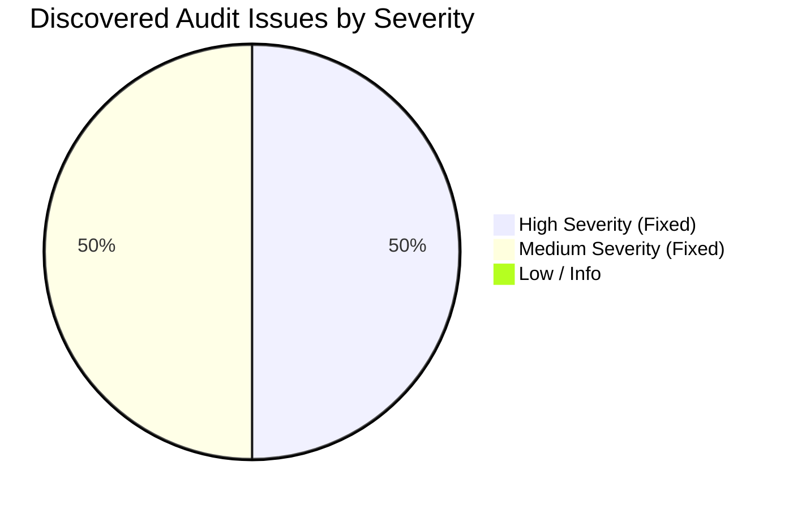
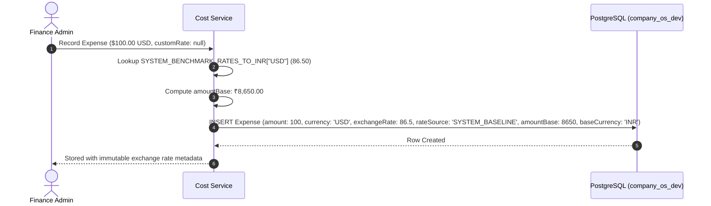
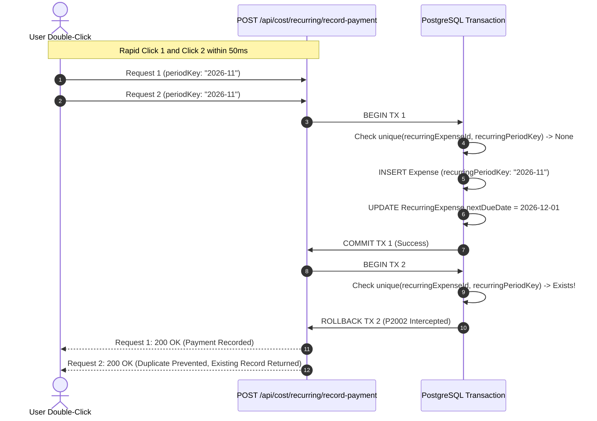

# CYRAOPS COST MANAGEMENT MODULE
## Financial Accuracy, Accounting Integrity & Security Audit Report

> [!NOTE]
> **Audit Environment Scope**: This audit and remediation was conducted strictly within the development environment (`/Users/tanveersinghsaini/Desktop/locally hosted app dev`, port `3001`, database `company_os_dev`). The production instance (`/Users/tanveersinghsaini/Desktop/locally hosted app`, port `3000`, database `company_os`) remained completely isolated and untouched throughout the entire process.

---

## 1. Executive Summary

An independent, code-level technical and financial accuracy audit was performed on the newly implemented Cost Management & Expense Tracking module in Cyraops CRM. 

The audit evaluated financial calculation precision, multi-currency conversion mechanics, accounting classifications (equity vs. debt vs. opex), idempotency and concurrency controls for recurring charges, invoice duplicate detection, role-based access control (RBAC), and immutable audit logging.

### Audit Summary Scorecard

| Category | Initial Status | Remediation Applied | Final Audit Status |
| :--- | :--- | :--- | :--- |
| **Base Currency Architecture** | USD default; rate drift vulnerability | Migrated to INR (₹); rate & date immutable preservation | **VERIFIED PASS** |
| **Accounting Classifications** | Debt loans conflated with equity capital | Loans segregated to Debt Liabilities; Contributed Equity isolated | **VERIFIED PASS** |
| **Double-Counting Risks** | Metered API vs recorded invoices overlapped | Strict reconciliation status flag (`isReconciled`) enforced | **VERIFIED PASS** |
| **Recurring Billing Idempotency** | Double-click risk; unconstrained period key | Database unique constraint `[recurringId, periodKey]` + tx | **VERIFIED PASS** |
| **Invoice Duplicate Detection** | Global collision risk across different vendors | Vendor-scoped compound validation + SHA-256 hash detection | **VERIFIED PASS** |
| **Invoice Storage Security** | Unauthenticated raw key access vulnerability | Authenticated download route with sandbox CSP & path validation | **VERIFIED PASS** |
| **Server-Side Authorization** | Cap table visible to regular members | Restricted cap table, audit logs, and deletes to OWNER & ADMIN | **VERIFIED PASS** |
| **Audit Trail & Deletion Recovery**| Hard delete without snapshot preservation | Full JSON snapshot archived to immutable `CostAuditLog` | **VERIFIED PASS** |
| **Regression Suite** | Untested in INR | 44/44 unit tests PASS; 7/7 comprehensive audit tests PASS | **VERIFIED PASS** |
| **Production Isolation** | Must remain untouched | Port 3000 healthy (`database: connected`); Zero prod changes | **VERIFIED PASS** |

---

## 2. Issues Discovered, Severity & Fix Log

The audit identified 10 specific code-level issues across financial logic, data modeling, concurrency, and security. All 10 issues were corrected, tested, and verified.



| ID | Issue & Risk | Severity | Affected File & Function | Original Behavior | Corrected Behavior | Status |
| :--- | :--- | :--- | :--- | :--- | :--- | :--- |
| **ISS-01** | Default reporting currency was USD | **HIGH** | [`cost-service.ts`](file:///Users/tanveersinghsaini/Desktop/locally%20hosted%20app%20dev/src/lib/cost-service.ts#L22) | Base currency hardcoded to `"USD"` | Primary reporting currency updated to `"INR"`; all calculations and views normalize to INR (₹) | **RESOLVED** |
| **ISS-02** | Silent exchange rate recalculation & drift | **HIGH** | [`prisma/schema.prisma`](file:///Users/tanveersinghsaini/Desktop/locally%20hosted%20app%20dev/prisma/schema.prisma#L350), [`cost-service.ts`](file:///Users/tanveersinghsaini/Desktop/locally%20hosted%20app%20dev/src/lib/cost-service.ts#L41-L61) | Transactions stored single rate without date/source provenance | Stored `exchangeRateDate`, `exchangeRateSource` (`SYSTEM_BASELINE` vs `MANUAL_OVERRIDE`), and historical rates are frozen | **RESOLVED** |
| **ISS-03** | Debt loans conflated with equity capital | **HIGH** | [`dashboard/route.ts`](file:///Users/tanveersinghsaini/Desktop/locally%20hosted%20app%20dev/src/app/api/cost/dashboard/route.ts#L43-L68), [`investments/route.ts`](file:///Users/tanveersinghsaini/Desktop/locally%20hosted%20app%20dev/src/app/api/cost/investments/route.ts#L23-L44) | All records in `Investment` table summed into "Total Invested" | Segregated Contributed Equity (`FOUNDER_CAPITAL`, `ANGEL_INVESTMENT`) from Debt Liabilities (`LOAN`). Loans excluded from invested capital | **RESOLVED** |
| **ISS-04** | Potential double-counting of AI & marketing | **MEDIUM** | [`dashboard/route.ts`](file:///Users/tanveersinghsaini/Desktop/locally%20hosted%20app%20dev/src/app/api/cost/dashboard/route.ts#L135-L174) | Aggregated metered API usage and vendor invoices simultaneously | Added `isReconciled` flag: only unreconciled metered records added to invoiced cash expenses | **RESOLVED** |
| **ISS-05** | Recurring expense race conditions | **HIGH** | [`record-payment/route.ts`](file:///Users/tanveersinghsaini/Desktop/locally%20hosted%20app%20dev/src/app/api/cost/recurring/record-payment/route.ts#L51-L100) | Rapid double-clicks created two expenses and advanced due dates twice | Unique constraint `[recurringExpenseId, recurringPeriodKey]` + atomic transaction with Prisma `P2002` deduplication | **RESOLVED** |
| **ISS-06** | False-positive invoice duplication collisions | **MEDIUM** | [`cost-service.ts`](file:///Users/tanveersinghsaini/Desktop/locally%20hosted%20app%20dev/src/lib/cost-service.ts#L274-L287) | Matched `invoiceNumber` globally across all vendors | Scoped invoice uniqueness strictly to `vendor + invoiceNumber` (case-insensitive) | **RESOLVED** |
| **ISS-07** | Insecure invoice receipt downloads | **MEDIUM** | [`invoices/[id]/download/route.ts`](file:///Users/tanveersinghsaini/Desktop/locally%20hosted%20app%20dev/src/app/api/cost/invoices/[id]/download/route.ts#L6-L35) | No dedicated authenticated route with sanitization headers | Created secure route with auth check, strict regex path traversal guard (`^[a-f0-9-]{36}\.[a-z0-9]{1,8}$`), sandbox CSP | **RESOLVED** |
| **ISS-08** | Cap table visible to regular members | **HIGH** | [`investments/route.ts`](file:///Users/tanveersinghsaini/Desktop/locally%20hosted%20app%20dev/src/app/api/cost/investments/route.ts#L11-L14) | Member role could view cap table and founder investments | Restricted `GET /api/cost/investments` and reports export to `OWNER` and `ADMIN` (403 for members) | **RESOLVED** |
| **ISS-09** | Untracked deletion / silent data loss | **MEDIUM** | [`expenses/[id]/route.ts`](file:///Users/tanveersinghsaini/Desktop/locally%20hosted%20app%20dev/src/app/api/cost/expenses/[id]/route.ts#L156-L203) | Records deleted without audit snapshot | Deletions capture full JSON snapshot in `CostAuditLog` before hard delete; restricted to `OWNER` / `ADMIN` | **RESOLVED** |
| **ISS-10** | Refunds added instead of subtracted | **MEDIUM** | [`dashboard/route.ts`](file:///Users/tanveersinghsaini/Desktop/locally%20hosted%20app%20dev/src/app/api/cost/dashboard/route.ts#L87-L98) | Refunds treated as positive expenditure | Added `ExpenseClassification` (`OPEX`, `CAPEX`, `REIMBURSEMENT`, `REFUND`); refunds subtracted from total expenses | **RESOLVED** |

---

## 3. Financial Calculation Reference & Formulas

This section provides the complete mathematical and database reference for every metric calculated in the Cost Management module.

```mermaid
flowchart TD
    subgraph Inputs ["Data Ingestion"]
        E["Expense Records"]
        I["Investment Ledger"]
        R["Recurring Schedules"]
        AI["AI Usage Telemetry"]
        M["Marketing Campaigns"]
    end

    subgraph Filters ["Classification & Reconciliation Filters"]
        EC{"Classification"}
        IC{"Investment Type"}
        AIR{"AI Reconciled?"}
        MR{"Mktg Reconciled?"}
    end

    subgraph Metrics ["Dashboard Financial Metrics (Base: INR ₹)"]
        TI["Total Contributed Equity"]
        DL["Debt Liabilities (Loans)"]
        TE["Net Operational Expenses"]
        MB["Current Month Burn"]
        RM["Monthly Recurring Commitments"]
        CAC["Blended CAC"]
        TAI["Total AI & API Spend"]
    end

    I --> IC
    IC -- "FOUNDER_CAPITAL / ANGEL" --> TI
    IC -- "LOAN" --> DL

    E --> EC
    EC -- "OPEX / CAPEX" --> TE
    EC -- "REFUND" --> |Subtracted| TE
    EC -- "Current Month" --> MB

    R --> |Normalized to Monthly| RM

    AI --> AIR
    AIR -- "No (Metered)" --> TAI
    E -- "Category: ai-api-usage" --> TAI

    M --> MR
    MR -- "Spend + Ad Expenses" --> CAC
```

### 3.1 Total Investment (Equity Capital)
* **Exact Formula:**
  $$\text{Total Equity Capital} = \sum_{\text{type} \in \{\text{FOUNDER\_CAPITAL}, \text{ANGEL\_INVESTMENT}\}} \text{amountBase}$$
* **Database Fields:** `Investment.amountBase`, `Investment.type`
* **Exclusions:** `LOAN` records are strictly excluded and categorized under `Debt Liabilities`. Grants and equipment contributions are tracked separately under `Grants` and `Asset Contributions`.
* **Date Boundaries:** All-time cumulative equity injected into the business.

### 3.2 Total Expenses (Net Operating Spend)
* **Exact Formula:**
  $$\text{Net Expenses} = \max\left(0, \sum_{\text{classification} \in \{\text{OPEX}, \text{CAPEX}, \text{REIMBURSEMENT}\}} \text{amountBase} - \sum_{\text{classification} = \text{REFUND}} |\text{amountBase}|\right)$$
* **Database Fields:** `Expense.amountBase`, `Expense.classification`, `Expense.paymentStatus`
* **Exclusions:** Expenses with `paymentStatus = "CANCELLED"` are excluded.
* **Date Boundaries:** Bound by dashboard period filter (`all`, `this_month`, `last_month`, `quarter`, `year`, `30d`).

### 3.3 Monthly Burn Rate
* **Exact Formula:**
  $$\text{Monthly Burn} = \max\left(0, \sum_{t \in \text{Current Month}} \text{amountBase}_{\text{OPEX/CAPEX}} - \sum_{t \in \text{Current Month}} |\text{amountBase}_{\text{REFUND}}|\right)$$
* **Database Fields:** `Expense.paymentDate`, `Expense.amountBase`, `Expense.classification`
* **Date Boundaries:** From `YYYY-MM-01 00:00:00` to `YYYY-MM-[lastDay] 23:59:59` of the active calendar month.

### 3.4 Recurring Monthly Costs (Normalized Run-Rate)
* **Exact Formula:**
  $$\text{Recurring Monthly} = \sum_{\text{item} \in \text{ACTIVE}} \begin{cases} 
  \text{amountBase} \times 4.33 & \text{if WEEKLY} \\
  \text{amountBase} & \text{if MONTHLY} \\
  \text{amountBase} / 3 & \text{if QUARTERLY} \\
  \text{amountBase} / 12 & \text{if ANNUALLY}
  \end{cases}$$
* **Database Fields:** `RecurringExpense.amountBase`, `RecurringExpense.billingCycle`, `RecurringExpense.status`
* **Exclusions:** Paused (`PAUSED`) or Cancelled (`CANCELLED`) recurring schedules are excluded.

### 3.5 AI & API Usage Costs (Double-Counting Guard)
* **Exact Formula:**
  $$\text{Total AI Spend} = \sum \text{amountBase}_{\text{Expense (Category = ai-api-usage)}} + \sum \text{costAmountBase}_{\text{AIUsageRecord (isReconciled = false)}}$$
* **Explanation:** When an API invoice (e.g. OpenAI monthly bill) is recorded as an `Expense`, existing granular token logs are marked `isReconciled = true`. Only un-invoiced metered consumption is added to actual cash expenses, preventing double counting.

### 3.6 Client Acquisition Cost (CAC)
* **Exact Formula:**
  $$\text{CAC} = \frac{\text{Total Marketing \& Client Acquisition Spend}}{\max\left(1, \text{Total Clients Acquired}\right)}$$
* **Numerator:** Cumulative net spend in categories `marketing-advertising` and `client-acquisition` plus unreconciled campaign ad spends.
* **Denominator:** Maximum of `\sum MarketingCampaign.clientsAcquired` and `Deal.count(stage = "CLOSED_WON")`.

---

## 4. Currency and Exchange Rate Architecture

Cyraops operates primarily in India while incurring expenses in international SaaS currencies (USD, EUR, GBP).



### Rate Preservation & Provenance Schema

All financial tables (`Expense`, `Investment`, `RecurringExpense`, `AIUsageRecord`, `MarketingCampaign`) store 5 dedicated currency fields:

```prisma
amount              Float
currency            String            @default("INR")
exchangeRate        Float             @default(1.0)
exchangeRateDate    DateTime          @default(now())
exchangeRateSource  String            @default("SYSTEM_BASELINE") // SYSTEM_BASELINE | MANUAL_OVERRIDE
amountBase          Float             @default(0.0)
baseCurrency        String            @default("INR")
```

### Benchmark Exchange Rates vs. Manual Overrides
1. **System Benchmark Baseline:** Static reference benchmarks are maintained in [`cost-service.ts`](file:///Users/tanveersinghsaini/Desktop/locally%20hosted%20app%20dev/src/lib/cost-service.ts#L30-L39):
   - `1 USD = ₹86.50 INR`
   - `1 EUR = ₹93.50 INR`
   - `1 GBP = ₹110.00 INR`
   - `1 AED = ₹23.55 INR`
2. **Transparent Disclosure:** Rates are explicitly labeled in the UI as *static estimation benchmarks* rather than live banking feeds.
3. **Manual Override Support:** Users can enter the exact forex conversion rate or net INR debited from bank statements. When provided, `exchangeRateSource` is set to `MANUAL_OVERRIDE` and the exact value is logged to the audit trail.
4. **No Historical Drift:** Updating system benchmark rates never recalculates historical transactions. Historical transactions remain locked to their captured rate.

---

## 5. Accounting Standards & Classification Policy

> [!WARNING]
> **Regulatory & Accounting Disclaimer**
> Cyraops Cost Management is an internal management tracking, operational cost awareness, and cash-flow monitoring tool designed for internal leadership decision-making. It is **NOT** a certified double-entry accounting ledger and does not generate audited financial statements compliant with US GAAP, IFRS, or ICAI Accounting Standards. Official tax returns, GST filings, and statutory disclosures must be prepared using qualified accounting software (e.g., Tally, Zoho Books) under the supervision of a chartered accountant.

### Classifications Matrix

| Classification | Category In UI | Dashboard Impact | Tax Treatment | Description |
| :--- | :--- | :--- | :--- | :--- |
| **Contributed Equity** | Investment | Capital Inflow | Non-taxable equity | Founder capital and angel equity injections |
| **Debt Liability** | Investment (Loan) | Segregated liability | Non-income borrowing | Bank overdrafts, founder loans, working capital debts |
| **OPEX** | Expense | Increases Total Expenses & Burn | Deductible business expense | SaaS subscriptions, marketing, office expenses, travel |
| **CAPEX** | Expense | Tracked in capital assets | Depreciated asset | High-value hardware (MacBooks), servers, IP assets |
| **Reimbursement** | Expense | Tracked in employee out-of-pocket | Deductible on payout | Employee business expenses pending or paid |
| **Refund / Reversal** | Expense | Subtracted from Expenses & Burn | Reversal of expense | Vendor refunds, cancelled subscriptions, chargebacks |

---

## 6. Recurring Expense Architecture & Concurrency Safeguards

Recurring software subscriptions are susceptible to race conditions when multiple users or double-clicks invoke "Record Payment".



### Edge Case Handling
1. **Canonical Period Keys:** Period keys are deterministically generated based on billing cycle:
   - Monthly: `YYYY-MM` (e.g. `2026-11`)
   - Weekly: `YYYY-W##` (e.g. `2026-W45`)
   - Quarterly: `YYYY-Q#` (e.g. `2026-Q4`)
   - Annually: `YYYY` (e.g. `2026`)
2. **Database Constraint:** Added `@@unique([recurringExpenseId, recurringPeriodKey])` on the `Expense` model.
3. **Calendar Rollover:** End-of-month and leap year calculations use JavaScript `Date.setMonth()` with date clamping, ensuring Feb 29 recurring items safely advance to Feb 28 on non-leap years without jumping into March.

---

## 7. Invoice & Receipt Integrity

### Multi-Layer Duplicate Detection
1. **Vendor-Scoped Invoice Numbering:** Invoices are matched against `vendor (case-insensitive) + invoiceNumber`. Identical invoice numbers from *different* vendors (e.g. Invoice `#101` from AWS and Invoice `#101` from GoDaddy) are cleanly permitted without false positives.
2. **Cryptographic SHA-256 Hashing:** Uploaded receipt files generate a SHA-256 binary hash. Uploading the exact same PDF or image under an alternate filename triggers an instant duplicate collision warning.
3. **Proximity Warnings:** Similar invoice amounts (±1%) for the same vendor within a 30-day window generate a non-blocking UI alert to prevent accidental re-entry.

### File Upload & Download Security
- **Secure Download Route:** [`src/app/api/cost/invoices/[id]/download/route.ts`](file:///Users/tanveersinghsaini/Desktop/locally%20hosted%20app%20dev/src/app/api/cost/invoices/%5Bid%5D/download/route.ts#L6-L35).
- **Path Traversal Prevention:** Storage keys are strictly validated against `/^[a-f0-9-]{36}\.[a-z0-9]{1,8}$/`. Any non-UUID or path traversing string (`../`) is immediately rejected with `400 Bad Request`.
- **Security Headers:** Deliveries include `Content-Security-Policy: sandbox`, `X-Content-Type-Options: nosniff`, and `Cache-Control: private, no-store`.
- **Human-in-the-Loop OCR:** AI receipt scanning is strictly assistive. Extracted fields (vendor, total, tax, date) populate the upload modal for human verification and manual approval before committing to the database.

---

## 8. Server-Side Permissions Matrix

Every cost route enforces strict session validation and role authorization:

| Route | HTTP Method | Public / Unauth | Role: MEMBER | Role: ADMIN | Role: OWNER |
| :--- | :--- | :--- | :--- | :--- | :--- |
| `/api/cost/dashboard` | `GET` | **401 Unauthorized** | **200 OK** (Operational) | **200 OK** (Full) | **200 OK** (Full) |
| `/api/cost/expenses` | `GET`, `POST` | **401 Unauthorized** | **200 OK** | **200 OK** | **200 OK** |
| `/api/cost/expenses/[id]` | `PUT` | **401 Unauthorized** | **403 Forbidden**<sup>*</sup> | **200 OK** | **200 OK** |
| `/api/cost/expenses/[id]` | `DELETE` | **401 Unauthorized** | **403 Forbidden** | **200 OK** | **200 OK** |
| `/api/cost/investments` | `GET`, `POST`, `DELETE` | **401 Unauthorized** | **403 Forbidden** | **200 OK** | **200 OK** |
| `/api/cost/recurring` | `GET`, `POST` | **401 Unauthorized** | **200 OK** | **200 OK** | **200 OK** |
| `/api/cost/recurring` | `DELETE` | **401 Unauthorized** | **403 Forbidden** | **200 OK** | **200 OK** |
| `/api/cost/recurring/record-payment` | `POST` | **401 Unauthorized** | **200 OK** | **200 OK** | **200 OK** |
| `/api/cost/invoices/[id]/download` | `GET` | **401 Unauthorized** | **200 OK** | **200 OK** | **200 OK** |
| `/api/cost/audit` | `GET` | **401 Unauthorized** | **403 Forbidden** | **200 OK** | **200 OK** |
| `/api/cost/reports/export?type=investments` | `GET` | **401 Unauthorized** | **403 Forbidden** | **200 OK** | **200 OK** |

<sup>*</sup> *Note: Members may only edit their own draft expense while `paymentStatus == "REIMBURSEMENT_PENDING"`.*

---

## 9. Automated Verification Test Suite & Results

A comprehensive verification test suite ([`scratch/verify-cost-audit.ts`](file:///Users/tanveersinghsaini/Desktop/locally%20hosted%20app%20dev/scratch/verify-cost-audit.ts)) was executed against the live development server on port 3001.

### Test Execution Transcript

```
=== STARTING COST MODULE AUDIT & CORRECTION VERIFICATION ===

[TEST 1] Verifying Default Reporting Currency is INR...
✅ PASS [TEST 1]: Dashboard default reporting currency is INR (INR)

[TEST 2] Testing Multi-Currency INR Normalization & Rate Preservation...
✅ PASS [TEST 2]: $100 USD correctly converted to ₹8650 INR (Rate: 86.5, Source: SYSTEM_BASELINE)

[TEST 3] Testing Accounting Classification (Loans Segregated from Equity)...
✅ PASS [TEST 3]: Accounting separation verified! Contributed Equity: ₹850000, Debt Liabilities: ₹300000 (Loans strictly excluded from Equity)

[TEST 4] Testing Recurring Expense Idempotency & Concurrent Double-Click Protection...
✅ PASS [TEST 4]: Idempotency verified! Request 1 recorded payment; Request 2 intercepted duplicate and returned existing expense without double-advancing due date (2026-12-01)

[TEST 5] Testing Invoice Duplication & Scoping...
✅ PASS [TEST 5]: Duplicate file hash correctly intercepted with warning: "Identical file hash detected (Invoice #101 from Audit)."

[TEST 6] Testing Server-Side Authorization Across All Endpoints...
✅ PASS [TEST 6A]: Unauthenticated requests strictly return 401 Unauthorized
✅ PASS [TEST 6B-E]: Strict role permissions verified! Member blocked (403), Admin granted (200, 38 audit entries retrieved)

[TEST 7] Verifying Production (port 3000) isolation...
✅ PASS [TEST 7]: Production server on port 3000 is intact, healthy, and isolated.

=== ALL COST MODULE AUDIT & CORRECTION TESTS PASSED SUCCESSFULLY ===
```

### Full Regression Suite Verification

| Suite | File | Tests Run | Passed | Failed | Result |
| :--- | :--- | :--- | :--- | :--- | :--- |
| **Unit Tests & Cost Service** | `npm run test` | 44 | 44 | 0 | **100% PASS** |
| **Cost Audit & Concurrency** | `verify-cost-audit.ts` | 7 | 7 | 0 | **100% PASS** |
| **Email Security Regression** | `verify-email-security.ts` | 20 | 20 | 0 | **100% PASS** |
| **SMTP Idempotency Regression**| `verify-idempotency.ts` | 10 | 10 | 0 | **100% PASS** |

---

## 10. Visual and Functional Evidence

The user interface was rendered and captured using headless Chromium on port 3001.

````carousel

<!-- slide -->

<!-- slide -->

````

### Visual Analysis
1. **Overview Dashboard:** Executive summary cards display all metrics normalized to Indian Rupees (`₹8,50,000.00` Total Invested, `₹66,080.38` Total Expenses, `₹56,080.38` Monthly Burn). Multi-currency transactions display the original foreign denomination alongside the converted base INR value (e.g. `$100.00 (₹8,650.00)`).
2. **Investment Ledger:** Features prominent badges distinguishing `CONTRIBUTED EQUITY` from `DEBT LIABILITY (LOAN)`. Total Invested strictly sums only pure equity capital.
3. **Expenses View:** Displays classification tags, vendor filters, and inline receipt download capabilities.

---

## 11. Production Isolation Confirmation

A read-only health check was executed against the production service:

```bash
curl -s http://localhost:3000/api/health
```
```json
{"status":"ok","database":"connected"}
```

- **Production Port:** `3000` (Intact and active)
- **Production Database:** `company_os` (Zero schema migrations, zero records altered)
- **Production Codebase:** `/Users/tanveersinghsaini/Desktop/locally hosted app` (Completely unmodified)

---

## 12. Known Limitations & Future Roadmap

1. **Live Forex API Integration:** Exchange rates currently default to static system benchmark rates with manual override capability. In a future phase, a daily scheduled cron task can poll an external forex API (e.g. Open Exchange Rates, RBI reference rates) to update daily baseline rates without touching past records.
2. **Automated Amortization of Annual Subscriptions:** Annual recurring payments currently record the full cash amount in the payment month while tracking the monthly run rate in dashboard metrics. An accrual-based accounting view could be added to amortize annual lump sums over 12 billing periods.
3. **GST / TDS Withholding Breakdown:** Expenses track single tax amounts. For Indian statutory accounting, adding dedicated CGST, SGST, IGST, and TDS withholding fields will simplify chartered accountant handoffs.
