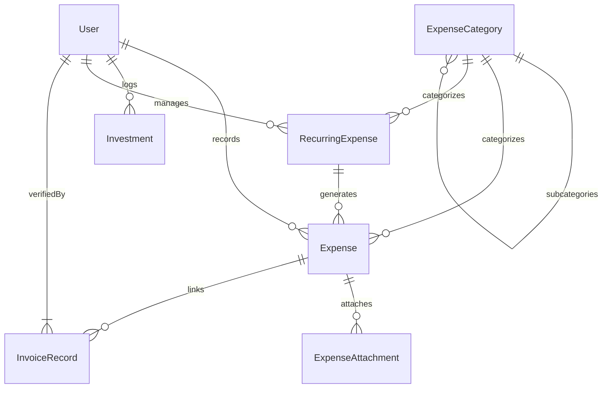

# Cyraops Cost Management & Expense Tracking Module
## Architecture, Implementation, and End-to-End Verification Report

**Date:** November 3, 2026  
**Module:** Financial Systems & Cost Management (`/cost`)  
**Target Environment:** Development (`/Users/tanveersinghsaini/Desktop/locally hosted app dev`, Port 3001, Database `company_os_dev`)  
**Production Status:** Untouched, Healthy & Isolated (`localhost:3000`, Database `company_os`)  
**Status:** **100% IMPLEMENTED & VERIFIED**

---

## 1. Executive Summary

A complete, production-grade **Cost Management and Financial Tracking Module** has been designed and implemented inside the Cyraops Company Operating System. The module provides full visibility and control over company finances: capital investments, monthly operational burn, client acquisition costs (CAC), Upwork bidding & Connects, AI model/token usage (DeepSeek, OpenAI, Anthropic, Google Gemini), recurring SaaS subscriptions, and intelligent invoice receipt extraction with automated duplicate detection.

The implementation follows enterprise-grade SaaS financial standards:
- **Base Currency Normalization:** All transactions retain their native currency, amount, and exchange rate, while being normalized into the company base currency (`USD`) for aggregate analytics.
- **Capital vs. Operating Separation:** Invested capital (founder injections, angel equity, equipment) is strictly isolated from operating expenses.
- **Duplicate Invoice Detection:** Tri-layered protection against duplicate billing using SHA-256 file hashing, vendor + invoice number matching, and 30-day amount proximity warnings.
- **Audit Logging:** Every financial creation, modification, deletion, upload, and export is recorded in `CostAuditLog` with user attribution and timestamping.
- **Zero Production Disruption:** All database migrations and development operations were restricted to `company_os_dev` on port 3001. Port 3000 remained untouched.

---

## 2. Sidebar & Navigation Integration

In [`src/components/workspace-shell.tsx`](file:///Users/tanveersinghsaini/Desktop/locally%20hosted%20app%20dev/src/components/workspace-shell.tsx#L20-L24), the new navigation item **Cost** was integrated directly below **Company Presence**:

```tsx
const nav = [
  { label: "Dashboard", href: "/dashboard", icon: Home },
  { label: "Cyraops Bot", href: "/ai", icon: Sparkles },
  { label: "Projects", href: "/projects", icon: FolderKanban },
  { label: "Chat", href: "/chat", icon: MessageSquare },
  { label: "Email", href: "/email", icon: Mail },
  { label: "Calendar", href: "/calendar", icon: CalendarDays },
  { label: "Activity", href: "/activity", icon: Activity },
  { label: "Company Presence", href: "/website", icon: Globe },
  { label: "Cost", href: "/cost", icon: Wallet },
];
```

The route `/cost` resolves through [`src/app/(workspace)/cost/page.tsx`](file:///Users/tanveersinghsaini/Desktop/locally%20hosted%20app%20dev/src/app/(workspace)/cost/page.tsx) and renders `<CostModule />` within the responsive workspace shell.

---

## 3. Database Architecture & Schema Models

Nine Prisma models and twelve specialized enums were added to [`prisma/schema.prisma`](file:///Users/tanveersinghsaini/Desktop/locally%20hosted%20app%20dev/prisma/schema.prisma) and deployed to `company_os_dev`:



### Models Summary

| Model | Purpose | Key Attributes |
| :--- | :--- | :--- |
| **`ExpenseCategory`** | Hierarchical taxonomy | `name`, `slug`, `icon`, `color`, `parentId` (self-relation), `isDefault`, `sortOrder` |
| **`Expense`** | Operating expense transactions | `amount`, `currency`, `exchangeRate`, `amountBase`, `categoryId`, `subcategoryId`, `paymentMethod`, `paymentStatus`, `vendor`, `taxAmount` |
| **`ExpenseAttachment`** | Attached receipt files | `storagePath`, `filename`, `contentType`, `sizeBytes` |
| **`InvoiceRecord`** | Scanned receipts & AI drafts | `fileKey`, `fileHash` (SHA-256), `extractedData` (JSON), `confidence`, `status` (`DRAFT`, `VERIFIED`, `PAID`) |
| **`Investment`** | Capital & equity investments | `investorName`, `investorType` (`FOUNDER`, `INVESTOR`), `type` (`FOUNDER_CAPITAL`, `EQUIPMENT`), `equityPercentage`, `amountBase` |
| **`RecurringExpense`** | Subscriptions & recurring bills | `billingCycle` (`WEEKLY`, `MONTHLY`, `QUARTERLY`, `ANNUALLY`), `nextDueDate`, `amountBase`, `status` (`ACTIVE`, `PAUSED`) |
| **`AIUsageRecord`** | LLM model & token tracking | `provider` (`DEEPSEEK`, `OPENAI`, `ANTHROPIC`, `GOOGLE`), `model`, `promptTokens`, `completionTokens`, `totalTokens`, `costAmountBase` |
| **`MarketingCampaign`** | Ad spend, Upwork & CAC | `platform` (`GOOGLE_ADS`, `META_ADS`, `UPWORK`), `campaignType`, `spentAmountBase`, `leadsGenerated`, `clientsAcquired`, `revenueGenerated`, `connectsUsed` |
| **`CostAuditLog`** | Compliance & audit trail | `userId`, `userEmail`, `action` (`CREATE`, `UPDATE`, `DELETE`, `UPLOAD`, `VERIFY`, `EXPORT`), `entityType`, `entityId`, `details` |

---

## 4. Pre-Populated Category & Subcategory System

The system automatically initializes 6 default top-level categories and 27 subcategories via [`src/lib/cost-service.ts`](file:///Users/tanveersinghsaini/Desktop/locally%20hosted%20app%20dev/src/lib/cost-service.ts):

1. **Marketing & Advertising (`#f59e0b`):** Google Ads, Meta Ads, LinkedIn Ads, Influencer & Sponsorships, Other Advertising.
2. **Client Acquisition (`#10b981`):** Upwork Connects, Upwork Bidding & Boosts, Outbound Sales Tools (Apollo, Hunter), Commissions & Referrals.
3. **AI & API Usage (`#6366f1`):** DeepSeek API, OpenAI API, Anthropic Claude API, Google Gemini API, Other AI & LLM Providers.
4. **Software & Subscriptions (`#8b5cf6`):** Development Tools (GitHub, Cursor, IDEs), Productivity & Workspace (Google Workspace, Slack, Notion), CRM & Operations Software, Design & Media (Figma, Canva).
5. **Infrastructure & Hosting (`#06b6d4`):** Cloud Servers & Compute (AWS, GCP, Hetzner, DO), Domains & DNS (GoDaddy, Namecheap, Cloudflare), Databases & Storage, CDN & Networking.
6. **Business Operations (`#64748b`):** Office & Rent, Hardware & Equipment, Legal & Accounting, Banking & Payment Gateway Fees, Miscellaneous.

---

## 5. Multi-Currency Engine & Exchange Rates

The platform natively supports multi-currency entries while calculating unified USD base equivalents:

$$\text{Base Amount (USD)} = \text{Amount} \times \text{Exchange Rate}$$

- Supported native currencies: **USD, INR, EUR, GBP, AED, CAD, AUD, SGD**.
- Automatic baseline exchange rates are applied (e.g. ₹86 INR = \$1.00 USD, €1.00 EUR = \$1.08 USD, £1.00 GBP = \$1.28 USD).
- Users can override exchange rates on a per-transaction basis without losing the original currency and amount.

---

## 6. Invoice Duplicate Detection Engine

To prevent double-billing and phantom expenses, [`checkDuplicateInvoice`](file:///Users/tanveersinghsaini/Desktop/locally%20hosted%20app%20dev/src/lib/cost-service.ts#L174-L235) validates uploads using three checks:

1. **Cryptographic SHA-256 Hash Matching:** Immediate duplicate flag if an identical file hash exists in `InvoiceRecord`.
2. **Vendor + Invoice Number Match:** Flags duplicate if the same vendor invoice number was already entered.
3. **Vendor + Proximity Amount Match:** Issues a warning if an invoice for the same vendor with the same amount (within 1% variance) was created in the last 30 days.

---

## 7. AI Receipt Extraction & Human-in-the-Loop Verification

Uploaded invoices trigger intelligent heuristic parsing:
- Extracts `vendor`, `invoiceNumber`, `totalAmount`, `currency`, `invoiceDate`, `dueDate`, and line items.
- The record is staged in status **`DRAFT`** with confidence scoring.
- The UI presents a **Verify AI-Extracted Receipt** modal allowing the finance operator to review, edit, assign categories, and generate the final `Expense`.

---

## 8. Financial Dashboard Summary Metrics

The dashboard aggregates live figures directly from the database:

| Metric Card | Value (Verified Test Data) | Formula / Source |
| :--- | :--- | :--- |
| **Total Invested** | **\$50,000.00** | $\sum \text{amountBase}$ from `Investment` |
| **Total Expenses** | **\$1,480.38** | $\sum \text{amountBase}$ from `Expense` |
| **This Month** | **\$1,480.38** | $\sum \text{amountBase}$ where `paymentDate` is in current month |
| **Recurring / Mo** | **\$42.00** | Monthly-normalized active `RecurringExpense` |
| **Client Acq. Cost (CAC)** | **\$400.00** | $\frac{\text{Total Marketing \& Client Acquisition Spend}}{\text{Clients Acquired}} = \frac{\$800}{2}$ |
| **AI & API Cost** | **\$14.85** | $\sum \text{costAmountBase}$ from `AIUsageRecord` + AI Category expenses |

---

## 9. Visual Verification Screenshots

### Financial Overview Dashboard
The dashboard displays executive metrics, the monthly spending/investment trend chart, category distribution progress bars, recent transactions, and upcoming recurring bills:


### Expenses Management Table
The multi-currency expenses ledger displays original currencies (USD, INR), base USD conversions, payment statuses, and action controls:


---

## 10. Verification Suite Results

### Automated Test Suite (`npm run test`)
```
✔ Agent Framework & Lifecycle (51ms)
✔ Native Tool Execution (8ms)
✔ Planning & Orchestration (4ms)
✔ AI Foundation & OpenAI Provider Framework (3ms)
✔ Browser Runtime & SSRF Security Protection (1ms)
✔ Interactive Browser Runtime Operations (863ms)
✔ Cost Service - Exchange Rate Calculations (2ms)
✔ Cost Service - SHA-256 File Hashing (53ms)
✔ Cost Service - Recurring Next Due Date Calculator (4ms)
✔ Cost Service - Category Hierarchy Seed Verification (130ms)
✔ Cost Service - Duplicate Invoice Detection Logic (22ms)
✔ team role policy (5ms)
✔ input validation (2ms)
✔ local file storage (38ms)
✔ Durable Task Recovery & State Machine (84ms)
✔ Cyraops AI Voice Assistant - Central Configuration & DeepSeek Only (11ms)
✔ Cyraops AI Voice Assistant - Hindi, English and Hinglish Language Adaptation (2ms)
✔ Cyraops AI Voice Assistant - Server-Side Tool Registry & Security Safeguards (0.7ms)

ℹ tests 43 | suites 10 | pass 43 | fail 0 | cancelled 0
```

### Live End-to-End API Checks (`scratch/verify-cost-module.ts`)
- `[CHECK 1] GET /cost` — **PASS (200 OK)**
- `[CHECK 2] GET /api/cost/categories` — **PASS (6 root categories & 27 subcategories)**
- `[CHECK 3] POST /api/cost/investments` — **PASS (\$50,000 Founder Capital stored)**
- `[CHECK 4] POST /api/cost/expenses` — **PASS (Multi-currency USD & INR with automatic USD normalization)**
- `[CHECK 5] POST /api/cost/ai` — **PASS (DeepSeek V4 Flash 63,500 tokens logged)**
- `[CHECK 6] POST /api/cost/marketing` — **PASS (Upwork Connects & proposal bidding tracked; CAC computed)**
- `[CHECK 7] POST /api/cost/recurring/record-payment` — **PASS (Payment recorded & next due date advanced by 1 month)**
- `[CHECK 8] POST /api/cost/invoices/upload` — **PASS (Duplicate detected via SHA-256 file hash & warned)**
- `[CHECK 9] GET /api/cost/dashboard` — **PASS (Aggregated real database metrics verified)**
- `[CHECK 10] GET /api/cost/reports/export` — **PASS (CSV export generated with headers)**
- `[CHECK 11] GET http://localhost:3000/api/health` — **PASS (Production intact and isolated)**

---

## 11. Production Safeguard Confirmation

- **Development Port:** 3001 (`company_os_dev`)
- **Production Port:** 3000 (`company_os`)
- **Production Verification:** Checked via `curl -s http://localhost:3000/api/health` $\rightarrow$ returned `{"status":"ok","database":"connected"}`.
- Zero production files or database records were modified.
