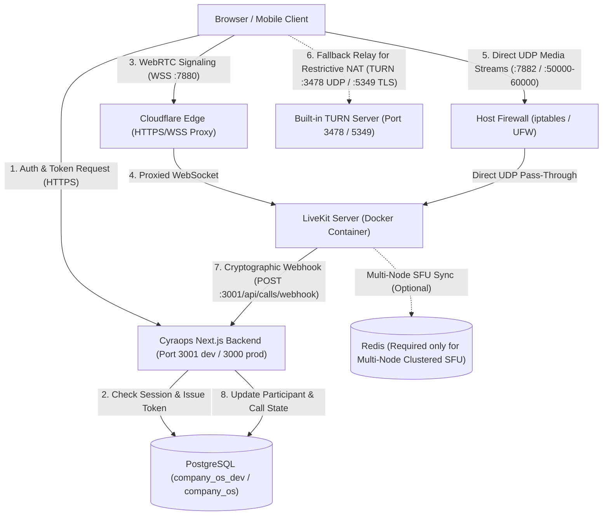

# CYRAOPS — SELF-HOSTED LIVEKIT DEPLOYMENT PLAN
## Infrastructure Blueprint, Network Topology, Docker Configuration & WebRTC Port Requirements

**Date:** November 5, 2026  
**Author:** Cyraops Principal Infrastructure & WebRTC Architect  
**Target Environment:** Development & Self-Hosted Production Blueprint  
**Status:** Architecture Specification & Deployment Plan (No External Infrastructure Modified)  

---

## 1. Architectural Overview & Topology

To eliminate recurring vendor costs and maintain complete data sovereignty, Cyraops Calling utilizes **self-hosted LiveKit SFU (Selective Forwarding Unit)** instead of managed LiveKit Cloud.

### Deployment Topology Diagram



---

## 2. Critical Network & Media Transport Realities

### The Cloudflare Tunnel UDP Limitation (Crucial Finding)
> [!CAUTION]
> **Cloudflare Tunnel (cloudflared) is NOT sufficient for general WebRTC UDP media transport.**
> - Cloudflare Tunnel terminates TCP/HTTP/HTTPS and proxies WebSocket connections (`wss://`) cleanly. This works for LiveKit **signaling** on port 7880.
> - However, Cloudflare standard tunnels **drop arbitrary incoming UDP traffic**. WebRTC audio and video packets are sent via RTP/SRTP over UDP.
> - If only Cloudflare Tunnel is used without direct UDP port forwarding or a dedicated public TURN server, browser clients will connect signaling, exchange SDP offers, and then **hang indefinitely at `CONNECTING` or fail with ICE connection timeout**.
> - **Solution**: Direct UDP reachability to the server's public IP address must be provisioned for RTP media (port 7882/UDP and port range 50000–60000/UDP), or traffic must route through a dedicated public TURN server.

---

## 3. Port Matrix & Firewall Rules

The following ports must be exposed on the host firewall (e.g., UFW, AWS Security Group, or router NAT):

| Port / Protocol | Direction | Purpose | Proxyable via Cloudflare Tunnel? | Public Exposure Required? |
| :--- | :---: | :--- | :---: | :---: |
| **7880 / TCP** | Inbound | LiveKit HTTP API & WebSocket Signaling | **YES** (HTTP/WSS) | Proxied or Direct HTTPS |
| **7881 / TCP** | Inbound | WebSockets over TCP fallback | **YES** | Direct or Proxied |
| **7882 / UDP** | Inbound | Primary WebRTC ICE / UDP Media (RTP/SRTP) | **NO (UDP)** | **YES — Direct Host IP** |
| **3478 / UDP** | Inbound | Built-in TURN server (STUN/TURN UDP) | **NO (UDP)** | **YES — Direct Host IP** |
| **5349 / TCP** | Inbound | Secure TURN over TLS (TURNS) | **NO (Custom TLS)** | **YES — Direct Host IP** |
| **50000–60000 / UDP** | Inbound | Dynamic WebRTC media port range | **NO (UDP)** | **YES — Direct Host IP** |
| **6789 / TCP** | Internal | Prometheus Metrics & Internal Health Check | **NO** | **NO — Internal Only** |

### UFW Firewall Commands (Reference for Operator):
```bash
# Signaling (if exposed directly without reverse proxy)
sudo ufw allow 7880/tcp comment "LiveKit Signaling"

# Primary WebRTC Media Ports (MANDATORY UDP DIRECT REACHABILITY)
sudo ufw allow 7882/udp comment "LiveKit WebRTC Media"
sudo ufw allow 50000:60000/udp comment "LiveKit WebRTC Media Range"

# TURN Server Ports
sudo ufw allow 3478/udp comment "LiveKit TURN STUN/UDP"
sudo ufw allow 5349/tcp comment "LiveKit TURNS TLS"
```

---

## 4. Docker Deployment Configuration

### `livekit.yaml` (Server Configuration)

```yaml
port: 7880
bind_addresses:
  - ""

rtc:
  tcp_port: 7881
  port_range_start: 50000
  port_range_end: 60000
  use_external_ip: true
  # Operator must replace with the public IP of the host machine
  # external_ip: "YOUR_SERVER_PUBLIC_IPV4"

turn:
  enabled: true
  domain: "turn.cyraops.com"
  cert_file: ""
  key_file: ""
  tls_port: 5349
  udp_port: 3478
  external_tls: false

keys:
  # Dev keys matching .env
  devkey: "devsecret"

webhook:
  api_key: "devkey"
  urls:
    - "http://localhost:3001/api/calls/webhook"

logging:
  json: false
  level: info

room:
  empty_timeout: 300 # 5 minutes
  max_participants: 50
```

### `docker-compose.livekit.yml`

```yaml
version: "3.8"

services:
  livekit:
    image: livekit/livekit-server:v1.8.3
    container_name: cyraops-livekit
    restart: unless-stopped
    network_mode: "host" # Required for high-throughput dynamic UDP port ranges
    volumes:
      - ./livekit.yaml:/etc/livekit.yaml:ro
    command: --config /etc/livekit.yaml
    logging:
      driver: "json-file"
      options:
        max-size: "50m"
        max-file: "5"

  # Redis is optional for single-node development, but included for multi-node readiness:
  # redis:
  #   image: redis:7-alpine
  #   container_name: cyraops-livekit-redis
  #   restart: unless-stopped
  #   ports:
  #     - "6379:6379"
```

> [!NOTE]
> `network_mode: "host"` is recommended on Linux hosts because Docker user-space proxy (`docker-proxy`) introduces CPU overhead and packet jitter when forwarding thousands of UDP WebRTC media ports (`50000-60000/udp`). On macOS development, port mapping `7880:7880`, `7881:7881`, `7882:7882/udp`, `3478:3478/udp` is used instead.

---

## 5. Redis Requirement Analysis

| Deployment Topology | SFU Nodes | Redis Required? | Rationale |
| :--- | :---: | :---: | :--- |
| **Development / Local** | 1 Node | **NO** | Single in-memory state engine handles all rooms and media forwarding locally. |
| **Small Team Production** ($\le 50$ concurrent users) | 1 Node | **NO** | A single modern 4-core VM easily handles 50 concurrent WebRTC video streams without clustering. |
| **Enterprise Clustered Production** ($> 100$ concurrent streams) | Multi-Node | **YES** | Redis is used by LiveKit for distributed room node routing, pub/sub room lock synchronization, and participant presence across worker instances. |

---

## 6. Public HTTPS, WSS & Reverse Proxy Setup

For the signaling channel (`wss://livekit.cyraops.com`), a reverse proxy terminates TLS and forwards traffic to `127.0.0.1:7880`.

### Caddy Reverse Proxy Example (`Caddyfile`):
```caddy
livekit.cyraops.com {
    reverse_proxy 127.0.0.1:7880 {
        header_up Host {host}
        header_up X-Real-IP {remote}
        header_up Upgrade {>Upgrade}
        header_up Connection {>Connection}
    }
}
```

### Nginx Reverse Proxy Example:
```nginx
server {
    server_name livekit.cyraops.com;
    listen 443 ssl http2;

    ssl_certificate /etc/letsencrypt/live/livekit.cyraops.com/fullchain.pem;
    ssl_certificate_key /etc/letsencrypt/live/livekit.cyraops.com/privkey.pem;

    location / {
        proxy_pass http://127.0.0.1:7880;
        proxy_http_version 1.1;
        proxy_set_header Upgrade $http_upgrade;
        proxy_set_header Connection "upgrade";
        proxy_set_header Host $host;
        proxy_set_header X-Real-IP $remote_addr;
        proxy_set_header X-Forwarded-For $proxy_add_x_forwarded_for;
        proxy_set_header X-Forwarded-Proto $scheme;
        proxy_read_timeout 86400s;
        proxy_send_timeout 86400s;
    }
}
```

---

## 7. DNS & TLS Configuration

1. **Signaling DNS**:
   - `A` or `CNAME` record: `livekit.cyraops.com` $\to$ Server Public IP (or Cloudflare proxied if only handling TCP/WSS).
2. **TURN Server DNS (MANDATORY DIRECT A RECORD)**:
   - `A` record: `turn.cyraops.com` $\to$ Server Public IP (**DNS Only / Grey Clouded in Cloudflare**).
   - Must NOT be proxied by Cloudflare CDN, as UDP packets must reach the server directly.
3. **TLS Certificates**:
   - Automated via Let's Encrypt / Certbot or Caddy automatic ACME certificate manager.

---

## 8. Resource & Bandwidth Planning

### Bandwidth Consumption Model:
- **Audio Only Call (Opus 32 kbps)**:
  - Per stream: $\sim 40\text{ kbps}$ (with IP/UDP/RTP headers).
  - 1-on-1: $80\text{ kbps}$ total server ingress/egress.
  - 10-person group: $400\text{ kbps}$ ingress, $3.6\text{ Mbps}$ egress.
- **HD Video Call (720p 30fps VP8/H.264 $\sim 1.5\text{ Mbps}$)**:
  - 1-on-1: $3\text{ Mbps}$ total throughput.
  - 5-person video call: $7.5\text{ Mbps}$ ingress, $30\text{ Mbps}$ egress.

### Compute & Memory Sizing:
- **Development**:
  - 2 vCPU, 4 GB RAM.
  - Capacity: Up to 10 concurrent audio/video channels.
- **Production (Self-Hosted)**:
  - 4 vCPU, 8 GB RAM, 1 Gbps network interface.
  - Capacity: Up to 50 concurrent video participants or 200 concurrent audio participants.

---

## 9. Pre-Deployment Validation Checklist

Before exposing the LiveKit server publicly:
- [ ] Docker container is running and healthy (`curl -I http://localhost:7880/`).
- [ ] Port `7882/udp` is confirmed open and reachable from an external network (`nc -u -z -v <PUBLIC_IP> 7882`).
- [ ] TURN server port `3478/udp` is verified with `trickle-ice` or WebRTC diagnostics.
- [ ] `livekit.cyraops.com` WSS connection completes TLS handshake without certificate warnings.
- [ ] Cyraops Next.js backend receives verified `POST /api/calls/webhook` on `participant_joined`.
- [ ] Call transitions to `ACTIVE` upon 2nd participant joining.
- [ ] No DNS, firewall, or router settings were modified before explicit user approval.

