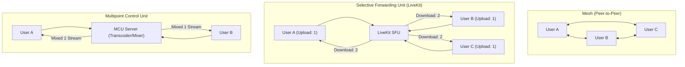

# CYRAOPS LIVEKIT SELF-HOSTING FEASIBILITY ASSESSMENT
## Open-Source SFU Architecture · Group Calling · Screen Sharing · Framework Compatibility

> [!IMPORTANT]
> **Audit-Only Evaluation**: This document evaluates the feasibility, system requirements, architectural fit, and technology trade-offs of self-hosting the open-source LiveKit Selective Forwarding Unit (SFU) for Cyraops. No media servers were deployed or initialized during this audit.

---

## 1. Executive Feasibility Verdict

| Evaluation Dimension | Rating | Finding Summary |
| :--- | :--- | :--- |
| **Architectural Fit for Cyraops** | **Excellent (9.5/10)** | Dedicated Go-based SFU completely decouples heavy WebRTC UDP packet forwarding from Next.js / Node.js application logic. |
| **One-to-One & Group Scalability** | **Excellent (10/10)** | Built-in simulcast, dynacast, and adaptive bitrate streaming allow seamless scaling from 2-person direct calls to 20-50+ person meetings. |
| **Screen Sharing Support** | **Native & Robust** | Full support for dual-track publishing (camera + screen share) with native resolution adaptation and system audio capture. |
| **Node.js & Next.js Integration** | **Native (`livekit-server-sdk`)** | Zero C++ build toolchain required on the Next.js server; tokens minted via pure Node.js JWT signing. |
| **Self-Hosting Operational Overhead** | **Moderate (Single Binary / Container)** | LiveKit is distributed as a single static Go binary or lightweight Docker image with built-in STUN/TURN server. |
| **Overall Recommendation** | **STRONGLY RECOMMENDED** | **LiveKit is the superior self-hosted media platform for Cyraops**, outperforming mediasoup (too low-level) and Jitsi (too heavyweight/monolithic). |

---

## 2. WebRTC Media Architecture Comparison: SFU vs Mesh vs MCU

To justify the selection of an SFU over alternative topologies, consider how each architecture handles media routing for $N$ call participants:



### Detailed Topology Comparison

| Metric | Peer-to-Peer (Mesh) | MCU (Multipoint Control Unit) | SFU (LiveKit) — **Recommended** |
| :--- | :--- | :--- | :--- |
| **Upstream Connections per User** | $N - 1$ (Each user uploads to every other user) | $1$ (Upload to MCU) | **$1$ (Upload to SFU)** |
| **Downstream Connections per User** | $N - 1$ | $1$ (Server composites all feeds into 1 canvas) | **$N - 1$ (Selective streams)** |
| **Client Uplink Bandwidth (5 Users @ 1.5 Mbps)** | $6.0\text{ Mbps}$ (Causes mobile uplink collapse) | $1.5\text{ Mbps}$ | **$1.5\text{ Mbps}$ (Fixed, constant)** |
| **Server CPU Utilization** | Zero (No server) | Extreme (Transcodes/mixes video in real time) | **Minimal (Pure UDP packet routing, no transcoding)** |
| **Latency** | Lowest for 2 peers ($\sim 30\text{ ms}$) | High ($200\text{--}400\text{ ms}$ due to mixing buffers) | **Very Low ($40\text{--}80\text{ ms}$)** |
| **Simulcast & Dynamic Resolution** | No | Managed by server compositor | **Native (Client gets high/med/low based on layout)** |
| **Suitability for Cyraops** | Fails for $> 3$ users; poor screen sharing | Prohibitively expensive infrastructure costs | **Optimal balance of quality, scalability & low cost** |

---

## 3. LiveKit Core Media Capabilities

### 3.1. One-to-One and Group Audio/Video Calling
- **Simulcast**: When a user publishes a video track, the browser automatically publishes three quality tiers simultaneously:
  1. High: $1280 \times 720$ @ $30\text{ fps}$, $\sim 1.5\text{ Mbps}$
  2. Medium: $640 \times 360$ @ $30\text{ fps}$, $\sim 500\text{ kbps}$
  3. Low: $320 \times 180$ @ $15\text{ fps}$, $\sim 150\text{ kbps}$
- **Dynacast**: LiveKit's SFU inspects every participant's viewport and subscription state. If Participant C is viewing a small thumbnail grid, LiveKit forwards only the Low tier. If Participant D minimizes their browser tab or is viewing screen share, LiveKit pauses forwarding video packets entirely, saving up to 80% downlink bandwidth.
- **Active Speaker Detection**: LiveKit performs real-time audio volume analysis on the RTP packets directly in the SFU and dispatches lightweight active speaker events to all clients. The Cyraops UI can immediately spotlight the speaker without client-side audio analysis loops.

### 3.2. Screen Sharing Architecture
- **Dual-Track Publishing**: LiveKit treats screen sharing as an independent secondary video track (`Track.Source.ScreenShare`) alongside the camera track (`Track.Source.Camera`).
- **Content Hints**: When capturing screen shares via browser `navigator.mediaDevices.getDisplayMedia()`, LiveKit sets the WebRTC content hint to `detail` (for text, documents, code editors) or `motion` (for videos/presentations), prioritizing sharpness over frame rate when static.
- **Screen Audio Sharing**: LiveKit supports publishing the system/tab audio track captured with the display stream.
- **Browser Constraints**:
  - Chrome / Edge (Chromium): Full support for entire screen, application window, or browser tab, with system audio.
  - Safari (macOS): Supports screen and window sharing; tab-only sharing and system audio capture are restricted by WebKit security policies.
  - Mobile Browsers (iOS / Android): Screen sharing is typically restricted or requires native OS broadcast extensions; camera and audio work natively.

---

## 4. Next.js, Node.js & React 19 Compatibility

### 4.1. Server-Side Compatibility (`livekit-server-sdk`)
- **Node.js Engines in Cyraops**: [package.json](file:///Users/tanveersinghsaini/Desktop/locally%20hosted%20app%20dev/package.json#L68) specifies `"node": ">=22 <25"`.
- **SDK Installation**: `livekit-server-sdk` is written in TypeScript and runs natively on Node 18, 20, and 22. It has zero native binary dependencies (unlike mediasoup which requires `node-gyp` and a C++ compiler).
- **Token Generation in Next.js App Router**:
  Tokens are minted in standard Next.js route handlers (`src/app/api/calls/token/route.ts`):
  ```typescript
  import { AccessToken } from "livekit-server-sdk";

  const at = new AccessToken(process.env.LIVEKIT_API_KEY, process.env.LIVEKIT_API_SECRET, {
    identity: user.id,
    name: user.name,
    ttl: "15m", // Short-lived token
  });
  at.addGrant({
    roomJoin: true,
    room: callSession.liveKitRoomName,
    canPublish: true,
    canSubscribe: true,
    canPublishData: true,
  });
  const jwt = await at.toJwt();
  ```

### 4.2. Client-Side Compatibility (`livekit-client` & React 19)
- **Cyraops React Version**: [package.json](file:///Users/tanveersinghsaini/Desktop/locally%20hosted%20app%20dev/package.json#L46) specifies `"react": "^19.3.1"`.
- **Client SDK (`livekit-client`)**: Pure TypeScript/JavaScript browser library handling WebRTC peer connections, SDP negotiation, and ICE candidate exchange. It has **no framework dependencies** and is 100% compatible with React 19.
- **UI Components (`@livekit/components-react`)**: Pre-built UI widgets may carry React 18 peer dependencies.
  - **Engineering Recommendation**: For Cyraops, **do not import pre-built UI components**. Instead, build custom calling controls using the vanilla `livekit-client` SDK and standard React hooks (`useState`, `useEffect`, `useRef`). This guarantees zero peer-dependency conflicts with React 19 and ensures that all video call windows strictly match the existing Cyraops visual design system.

---

## 5. Alternatives Comparison Matrix

| Technology | Self-Hosting Complexity | Dev Experience in Next.js | Group Scalability | Resource Overhead | Verdict for Cyraops |
| :--- | :--- | :--- | :--- | :--- | :--- |
| **LiveKit SFU** | **Low** (Single Go binary or Docker container; built-in STUN/TURN) | **High** (Official TypeScript SDKs for Node.js and Browser) | **High** (Tested to thousands of tracks per instance) | **Low** ($\sim 1\text{ CPU core}$, $1\text{ GB RAM}$ for 50 concurrent streams) | **STRONGLY RECOMMENDED** |
| **mediasoup** | **Very High** (Requires C++ compiler, `node-gyp`, custom signalling protocol, custom WebSockets) | **Low** (Extremely low-level C++ bindings; must write complete signalling from scratch) | **High** | **Low** | **Rejected** (Enormous engineering maintenance burden; reinventing the wheel) |
| **Jitsi Meet** | **Very High** (Monolithic Java/Prosody/XMPP/Jicofo/JVB stack; heavy Docker Compose) | **Poor** (Pre-baked iframe widget or complex lib-jitsi-meet) | **Moderate** | **High** (Requires at least 4 GB RAM just to idle) | **Rejected** (Too bloated; impossible to embed cleanly into existing chat without an ugly iframe) |
| **Pure Mesh WebRTC (P2P)** | **Very Low** (Only needs STUN/TURN) | **Moderate** (Must write RTCPeerConnection mesh management) | **Fails at $> 3$ users** (Bandwidth collapses exponentially) | **Zero server CPU** (Clients bear all load) | **Rejected** (Cannot support group meetings or multi-party screen sharing) |
