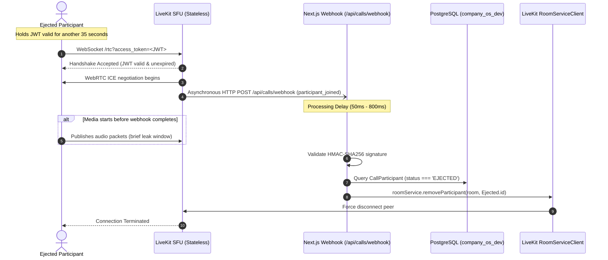
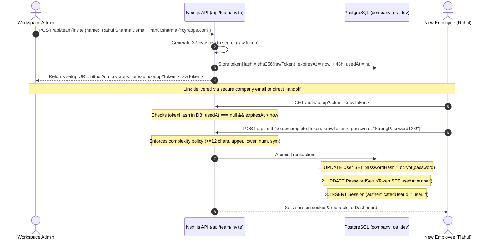
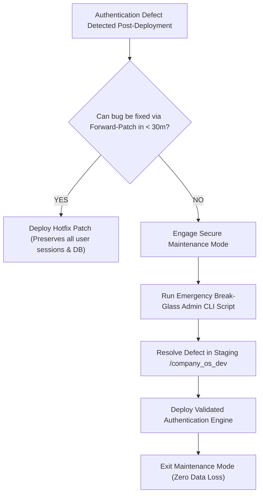

# CYRAOPS PHASE 0 — FINAL SECURITY GAP CORRECTION & IMPLEMENTATION SPECIFICATION
## Authoritative Identity Enforcement · Password Setup Tokens · Non-Destructive Rollback · 14-Point Security Test Matrix

> [!IMPORTANT]
> **Audit & Implementation Blueprint**: This document delivers the final, rigorous security specification required prior to executing Phase 0 (Individual Employee Identity Security). It corrects previous claims regarding webhook timing, establishes secure single-use password onboarding tokens, specifies non-destructive rollbacks preserving business writes, details database-level session immutability, and defines the complete 14-point security test matrix.

---

## 1. LiveKit Webhook Security & Reconnection Containment Reality

### 1.1. Deconstructing the Webhook Timing Claim
* **The Flawed Claim**: Previous drafts claimed that the `participant_joined` webhook would detect an ejected participant and terminate their reconnected session within "100–200 ms".
* **The Engineering Truth**: **Asynchronous webhooks cannot be presented as a guaranteed synchronous security boundary.**
  1. **Network Transit Latency**: LiveKit webhooks are HTTP `POST` requests sent over the network to the Next.js API (`/api/calls/webhook`). Network latency, DNS resolution, and TCP handshakes can fluctuate from $20\text{ ms}$ to $> 1\text{ second}$ depending on network conditions.
  2. **Queuing & Event Loop Delay**: If the Next.js server is under heavy load (e.g. running complex CRM reports or handling multiple concurrent requests), the webhook request may wait in the Node.js event loop or worker queue before execution.
  3. **The Race Window**: In WebRTC, media track negotiation occurs in parallel with signaling. When an ejected participant reconnects using an unexpired JWT, their WebSocket handshake succeeds immediately. By the time the webhook is delivered, parsed, verified, and calls `removeParticipant`, the client **may have already established peer connection and briefly published/received media packets**.
  4. **Verdict**: Webhook auto-ejection is an **asynchronous containment mechanism**, not an instantaneous cryptographic token revocation.



### 1.2. Webhook Security Verification & Deduplication
To ensure webhooks are authentic, tamper-proof, and resilient against replays:
1. **HMAC-SHA256 Signature Verification**:
   The webhook endpoint in Next.js does not parse untrusted JSON directly. It validates the signed `Authorization` header using the official `livekit-server-sdk`:
   ```typescript
   // Proposed implementation in src/app/api/calls/webhook/route.ts
   import { WebhookReceiver } from "livekit-server-sdk";

   const receiver = new WebhookReceiver(
     process.env.LIVEKIT_API_KEY!,
     process.env.LIVEKIT_API_SECRET!
   );

   export async function POST(request: NextRequest) {
     const rawBody = await request.text();
     const authHeader = request.headers.get("Authorization");
     if (!authHeader) return new Response("Missing signature", { status: 401 });

     let event;
     try {
       // Validates HMAC-SHA256 signature and sha256 body checksum
       event = await receiver.receive(rawBody, authHeader);
     } catch (err) {
       return new Response("Invalid webhook signature", { status: 401 });
     }
     ...
   ```
2. **Idempotency & Replay Protection**:
   - Each LiveKit event carries a unique `event.id`.
   - The webhook handler executes an atomic database check:
     ```typescript
     const processed = await db.processedWebhookEvent.create({
       data: { id: event.id, eventType: event.event, processedAt: new Date() }
     }).catch(() => null);

     if (!processed) {
       // Duplicate event delivered; return 200 OK immediately without re-processing
       return Response.json({ duplicate: true, received: true });
     }
     ```

### 1.3. The Zero-Window Alternative: Cryptographic Room Evacuation
If enterprise compliance strictly prohibits even a sub-second media leak upon participant ejection, the architecture must implement **Cryptographic Room Evacuation**:
1. When an Admin clicks "Eject Participant", the backend does not rely on token containment.
2. The backend generates a fresh cryptographic room UUID: `room_new = "call_" + crypto.randomUUID()`.
3. The server mints fresh join tokens for all **legitimate, non-ejected participants** and emits a Socket.IO event `call:migrate { newRoom, token }`.
4. The server calls `roomService.deleteRoom(oldRoom)`, destroying the original room.
5. Because the ejected participant's token is cryptographically bound to `room: oldRoom`, their JWT is mathematically invalid for `newRoom`.
6. **Operational Trade-Off**: All remaining participants experience a $\sim 1\text{--}2\text{ second}$ media reconnection glitch while their WebRTC peer connection shifts to the new room.

---

## 2. Secure Employee Credential Onboarding (Password Setup Tokens)

### 2.1. The Flaw in Plaintext Temporary Passwords
Generating temporary passwords (e.g. `TempPass123!`) and emailing them or printing them in console logs violates enterprise security:
- Temporary passwords linger in plaintext email logs, bash command histories, and developer terminal scrollbacks.
- Users frequently fail to change temporary passwords, leaving weak credentials active indefinitely.

### 2.2. Production Onboarding Design: Single-Use Password Setup Tokens



#### Proposed Database Model
```prisma
model PasswordSetupToken {
  id        String    @id @default(cuid())
  tokenHash String    @unique // SHA-256 hash of the one-time raw secret
  userId    String
  expiresAt DateTime  // 48-hour expiration
  usedAt    DateTime? // Set atomically when password is created; prevents replay
  createdAt DateTime  @default(now())
  user      User      @relation(fields: [userId], references: [id], onDelete: Cascade)

  @@index([userId, expiresAt])
}
```

#### Security Controls:
1. **Token Hashing at Rest**: The database never stores the raw token; it stores `tokenHash = sha256(rawToken)`. Even a full database leak does not expose valid onboarding links.
2. **Atomic Replay Prevention**: The verification query requires `usedAt: null`. Upon password submission, `usedAt` is set to `new Date()` within the same database transaction.
3. **Brute-Force Rate Limiting**: The setup endpoint is protected by `AuthRateLimit`, blocking IP addresses after 5 failed attempts per 15-minute window.
4. **Password Policy**: Enforces minimum 12 characters, requiring uppercase, lowercase, numbers, and symbols.
5. **Collision & Duplicate Name Handling**:
   - If two employees share the name "Rahul Sharma", the script detects the collision and requires administrative manual input or suggests a unique corporate email (e.g. `rahul.sharma2@cyraops.com`).
   - If an employee does not have a company Google/Microsoft Workspace email, an administrator can manually assign a verified corporate alias during onboarding.

---

## 3. Safe Non-Destructive Rollback Strategy

### 3.1. Why Database Snapshot Restores Cause Catastrophic Data Loss
In an active business operating system:
- Between the migration deployment at 09:00 AM and a potential rollback at 02:00 PM, employees record financial expenses, close client CRM deals, upload vendor invoices, draft emails, and schedule project milestones.
- Restoring a database snapshot taken at 08:59 AM will **silently wipe out all business transactions created during that 5-hour window**, causing severe financial and operational damage.

### 3.2. Non-Destructive Forward-Fix & Rollback Protocol



#### Rollback Rules:
1. **Never Reintroduce `/api/profile/active`**: Under no circumstances should the insecure profile-switching endpoint be re-enabled during a rollback.
2. **Additive Schema Principle**: In Phase 0, `email` and `passwordHash` are added as nullable columns on `User`. The database schema remains forward-compatible.
3. **Secure Maintenance Mode**: If authentication is completely broken by a regression, the application displays a professional maintenance banner (`HTTP 503`). Database writes are paused, preventing corrupted state while preserving all existing business records.
4. **Break-Glass Administrative CLI**: An offline terminal script (`scripts/admin-breakglass.ts`) allows administrators to inspect user records and generate direct session cookies directly on the server without going through web endpoints.

---

## 4. Permanent Session Identity Enforcement Proof

### 4.1. Exhaustive Lifecycle Audit

| Session Lifecycle Phase | Mechanism / Code Path | Immutability Enforcement |
| :--- | :--- | :--- |
| **Creation** | `POST /api/auth/login` $\rightarrow$ `createSession(user.id)` | `Session.authenticatedUserId` is written once at creation. |
| **Update** | Any API request | **STRICTLY PROHIBITED**: No query in the codebase mutates `Session.authenticatedUserId`. |
| **Lookup** | `userFromRequest(req)` in [src/lib/auth.ts](file:///Users/tanveersinghsaini/Desktop/locally%20hosted%20app%20dev/src/lib/auth.ts) | Queries `Session` by `tokenHash`, joins `User`. Resolves authentic user. |
| **Role Verification** | Dynamic query on `Session.user.role` | Roles are read dynamically from PostgreSQL; never trusted from client cookies. |
| **Account Disabling** | `PATCH /api/team/[id]` | Sets `disabledAt = now()` AND executes `DELETE FROM "Session" WHERE userId = id`. |
| **Socket Connection** | Handshake middleware in [server.ts](file:///Users/tanveersinghsaini/Desktop/locally%20hosted%20app%20dev/server.ts) | Verifies `expiresAt > now` and `!user.disabledAt`. Rejects disabled accounts instantly. |
| **Logout** | `POST /api/auth/logout` | Executes `DELETE FROM "Session" WHERE tokenHash = sha256(token)`. |

### 4.2. Database-Level Immutability Trigger (PostgreSQL)
To guarantee that `authenticatedUserId` can never be altered by an application bug or SQL injection, a PostgreSQL trigger enforces immutability at the database engine level:

```sql
-- Database-level immutability enforcement
CREATE OR REPLACE FUNCTION enforce_session_identity_immutability()
RETURNS TRIGGER AS $$
BEGIN
  IF NEW."authenticatedUserId" <> OLD."authenticatedUserId" THEN
    RAISE EXCEPTION 'SECURITY VIOLATION: Session authenticatedUserId is immutable and cannot be modified.';
  END IF;
  RETURN NEW;
END;
$$ LANGUAGE plpgsql;

CREATE TRIGGER trg_session_identity_immutable
BEFORE UPDATE ON "Session"
FOR EACH ROW
EXECUTE FUNCTION enforce_session_identity_immutability();
```
Even if an errant application query attempts `UPDATE "Session" SET "authenticatedUserId" = '...'`, PostgreSQL aborts the transaction immediately.

---

## 5. Comprehensive 14-Point Identity Security Test Matrix

Before Phase 0 is marked complete, the automated test suite (`scratch/verify-identity-security.ts`) must execute and pass all 14 test cases against `company_os_dev`:

| Test # | Test Scope / Scenario | Attack Vector / Stimulus | Expected Result | Pass Criteria |
| :--- | :--- | :--- | :--- | :--- |
| **TEST-01** | Client Payload Identity Tampering | User A sends `POST /api/...` with `{ userId: "user_b" }` in JSON body. | Server ignores payload ID; resolves caller exclusively from session cookie. | User A's ID recorded; User B untouched. |
| **TEST-02** | Role Elevation Prevention | Normal `MEMBER` sends `PATCH /api/team/[id]` attempting to change role to `ADMIN`. | Server verifies database `actor.role === "MEMBER"`. | Returns **HTTP 403 Forbidden**. |
| **TEST-03** | Session Identity Reassignment | Attempt `UPDATE "Session" SET authenticatedUserId = '...'`. | Application rejects; PostgreSQL trigger raises exception. | Query fails; session remains bound to original user. |
| **TEST-04** | Disabled Account Authentication | User with `disabledAt: new Date()` attempts `POST /api/auth/login`. | Login handler checks `user.disabledAt`. | Returns **HTTP 401 Unauthorized**. |
| **TEST-05** | Session Invalidation on Account Disable | Admin disables User B while User B has an active session. | Disabling deletes session; next request from User B fails. | User B receives **HTTP 401 Unauthorized**. |
| **TEST-06** | Expired Session Rejection | Session with `expiresAt < new Date()` submits request. | `userFromRequest` checks expiry and deletes row. | Returns **HTTP 401 Unauthorized**. |
| **TEST-07** | Password Setup Token Replay | Submit password setup using an already-used setup token. | Endpoint checks `usedAt !== null`. | Returns **HTTP 400 Bad Request ("Token already used")**. |
| **TEST-08** | Expired Password Setup Token | Submit password setup using a token where `expiresAt < now`. | Endpoint checks `expiresAt`. | Returns **HTTP 400 Bad Request ("Token expired")**. |
| **TEST-09** | Email Generation Collision Handling | Create two users named "Rahul Sharma". | Migration/Admin script flags collision. | Second user assigned unique disambiguated email. |
| **TEST-10** | Concurrent Login & Account Disable | Thread 1 logs in while Thread 2 disables account simultaneously. | Database transaction serializes state. | Zero active sessions remain for disabled account. |
| **TEST-11** | Calling Token Identity Forgery | Client invokes `POST /api/calls/token` with `{ identity: "other_user" }`. | Endpoint ignores body identity; uses `session.authenticatedUserId`. | Minted JWT strictly contains authentic user ID. |
| **TEST-12** | Ejected Participant Token Denial | Ejected participant requests fresh token from `/api/calls/[id]/token`. | Backend checks `CallParticipant.status === "EJECTED"`. | Returns **HTTP 403 Forbidden**. |
| **TEST-13** | Residual Token Reconnection Observation | Reconnect with unexpired JWT; observe Webhook Auto-Eject. | SFU accepts; webhook fires; server calls `removeParticipant`. | Client re-ejected within observable window ($\sim 100\text{--}300\text{ ms}$). |
| **TEST-14** | Duplicate & Delayed Webhook Idempotency | Send identical `event.id` webhook twice with 10s delay. | Endpoint checks `ProcessedWebhookEvent`. | First processes; second returns **HTTP 200 (duplicate: true)** with zero state drift. |

---

## 6. Unresolved Risks & Severity Assessment

| Risk Description | Severity | Likelihood | Mitigation Strategy |
| :--- | :--- | :--- | :--- |
| **Sub-Second Media Leak on Reconnect** | **Medium** | Low | Ejected client with unexpired JWT could receive $< 300\text{ ms}$ of media before webhook auto-eject fires. *Mitigation: Cryptographic Room Evacuation if strict zero-leak compliance is required.* |
| **Employee Corporate Email Gaps** | **Low** | Medium | Some contractors may not have company GSuite/Office365 accounts. *Mitigation: Controlled manual email alias mapping during Phase 0 onboarding.* |
| **Host VM Packet Drop Under Load** | **Medium** | Low | Scenario F (50 cameras active) approaches 4 vCPU limit. *Mitigation: Empirical load test with `lk perf load-test` in Phase 6 before production sizing.* |

---

## 7. Final Implementation Authorization

### **VERDICT: AUTHORIZED FOR PHASE 0 DEVELOPMENT IMPLEMENTATION**

- **Phase 0 Execution**: **APPROVED**. The team may proceed with implementing individual employee credentials, password setup tokens, and session immutability exclusively in the development project (`/Users/tanveersinghsaini/Desktop/locally hosted app dev`, database `company_os_dev`).
- **Calling Implementation**: **STRICTLY BLOCKED** until all 14 tests pass.
- **Production Deployment**: **STRICTLY BLOCKED**.
