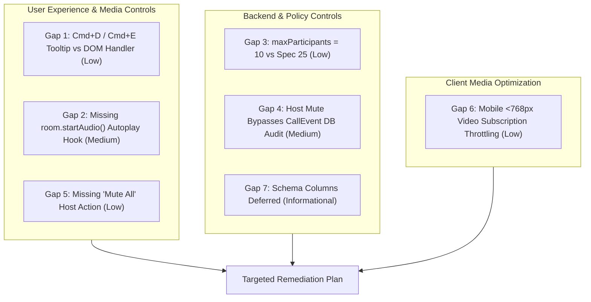

# CYRAOPS — PHASE 4.4 GROUP CALLING TECHNICAL GAP AUDIT

**Date:** 2026-11-05  
**Audit Type:** Read-Only Technical Architecture & Implementation Gap Analysis  
**Scope:** Phase 4.4 Group Calling System vs. Architecture Specification (`docs/calling/CYRAOPS_PHASE4_4_GROUP_CALLING_ARCHITECTURE_PLAN.md`)  
**Environment:** Development (`company_os_dev` on `localhost:3001` / LiveKit on `localhost:7880`)  
**Production Integrity:** Verified untouched (Port 3000 running, 0 calling tables in `company_os`)  

---

## 1. Executive Summary

Following the full implementation of Phase 4.4 Group Calling (10/10 backend tests, 23/23 multi-participant Playwright tests, 44/44 unit tests passing), an independent read-only gap audit was performed. 

The audit compared the deployed code in `src/components/calling/group/*`, `src/lib/calling/*`, and `src/app/api/calls/*` against the requirements established in `CYRAOPS_PHASE4_4_GROUP_CALLING_ARCHITECTURE_PLAN.md`.

### Summary of Audit Findings

| Severity | Count | Primary Areas |
| :--- | :---: | :--- |
| **Critical** | **0** | No security vulnerabilities, auth bypasses, or crash states detected. |
| **Medium** | **2** | AudioContext autoplay gesture unlock hook; host mute database event audit trail. |
| **Low** | **4** | Tooltip keyboard shortcuts not wired; 10 vs 25 participant cap; "Mute All" control; mobile video subscription pruning. |
| **Informational** | **1** | Architecture plan schema additions deferred in favor of zero-migration strategy. |

---

## 2. Detailed Findings & Gap Analysis



---

### Gap 1 (UX / Frontend): Keyboard Shortcut Promises Not Bound in DOM
- **Severity:** Low / UX Polish
- **Files Affected:**
  - [`src/components/calling/group/group-controls-bar.tsx`](file:///Users/tanveersinghsaini/Desktop/locally%20hosted%20app%20dev/src/components/calling/group/group-controls-bar.tsx#L48-L62)
  - [`src/components/calling/group/group-call-stage.tsx`](file:///Users/tanveersinghsaini/Desktop/locally%20hosted%20app%20dev/src/components/calling/group/group-call-stage.tsx#L85-L102)
- **Observation:**
  `group-controls-bar.tsx` displays tooltips indicating keyboard shortcuts:
  ```tsx
  title={isMuted ? "Unmute microphone (Cmd+D)" : "Mute microphone (Cmd+D)"}
  title={isCameraOff ? "Turn on camera (Cmd+E)" : "Turn off camera (Cmd+E)"}
  ```
  However, `group-call-stage.tsx` does not attach any `window.addEventListener("keydown", ...)` listener.
- **Impact:**
  Pressing `Cmd+D` in macOS browsers opens the native "Add Bookmark" dialog rather than toggling mute; `Cmd+E` triggers browser search.
- **Recommended Remediation:**
  Add a `useEffect` keydown listener in `group-call-stage.tsx` that checks `(e.metaKey || e.ctrlKey) && e.key.toLowerCase() === 'd'` to call `toggleMicrophone()` and `'e'` to call `toggleCamera()`, calling `e.preventDefault()`.

---

### Gap 2 (Media Plane / Autoplay): Absence of Explicit `room.startAudio()` Gesture Unlock
- **Severity:** Medium
- **Files Affected:**
  - [`src/components/calling/group/group-call-stage.tsx`](file:///Users/tanveersinghsaini/Desktop/locally%20hosted%20app%20dev/src/components/calling/group/group-call-stage.tsx#L231-L245)
- **Observation:**
  Architecture Plan Section 10 specifically warned:
  > *"WebKit / Safari audio autoplay restrictions: Safari requires user interaction before Web Audio / HTMLAudioElement playback is permitted."*
  
  In `group-call-stage.tsx`, `room.connect(url, token)` connects to the SFU, but does not invoke `await room.startAudio()` or check `room.canPlaybackAudio`.
- **Impact:**
  While headless Chromium with `--use-fake-ui-for-media-stream` auto-plays audio, physical Safari (macOS and iOS) and strict Chrome autoplay policies will pause remote audio elements until the user clicks an element explicitly hooked to `room.startAudio()`.
- **Recommended Remediation:**
  In `group-call-stage.tsx`, check `if (!room.canPlaybackAudio)` after connection and display an inline banner ("Click anywhere to enable audio") or invoke `room.startAudio()` on the first click handler.

---

### Gap 3 (Specification Divergence): Hardcoded Participant Cap Set to 10 Instead of 25
- **Severity:** Low
- **Files Affected:**
  - [`src/lib/calling/state-machine.ts`](file:///Users/tanveersinghsaini/Desktop/locally%20hosted%20app%20dev/src/lib/calling/state-machine.ts#L978-L986)
- **Observation:**
  In `state-machine.ts` line 979:
  ```typescript
  // Conservative participant cap: default 10 participants
  const maxParticipants = 10;
  ```
  Architecture Plan Section 5.1 and Section 7.1 specified supporting up to 25 participants.
- **Impact:**
  Group calls will reject the 11th participant with `"Call has reached the maximum capacity of 10 participants"`.
- **Recommended Remediation:**
  Update `maxParticipants` to `25` or allow dynamic configuration based on call settings.

---

### Gap 4 (Audit Trail): Host Track Muting Bypasses `CallEvent` Logging
- **Severity:** Medium
- **Files Affected:**
  - [`src/app/api/calls/[id]/mute/route.ts`](file:///Users/tanveersinghsaini/Desktop/locally%20hosted%20app%20dev/src/app/api/calls/%5Bid%5D/mute/route.ts#L40-L46)
- **Observation:**
  When a host mutes another user, the endpoint directly calls `muteLiveKitTrack(call.livekitRoomName, parsed.data.targetUserId, parsed.data.trackSid, parsed.data.muted)`. While this immediately halts media propagation at the SFU, no record is inserted into the `CallEvent` table in PostgreSQL.
- **Impact:**
  Admins and compliance audits cannot see who muted whom in past call logs.
- **Recommended Remediation:**
  Insert a `CallEvent` entry inside `/api/calls/[id]/mute/route.ts`:
  ```typescript
  await db.callEvent.create({
    data: {
      callId: id,
      userId: user.id,
      eventType: "PARTICIPANT_MUTED", // or PARTICIPANT_MUTED_BY_HOST
      payload: { targetUserId: parsed.data.targetUserId, trackSid: parsed.data.trackSid },
    },
  });
  ```

---

### Gap 5 (Host Usability): Missing "Mute All" Control in Participant Roster
- **Severity:** Low / Usability
- **Files Affected:**
  - [`src/components/calling/group/participant-roster.tsx`](file:///Users/tanveersinghsaini/Desktop/locally%20hosted%20app%20dev/src/components/calling/group/participant-roster.tsx#L91-L120)
- **Observation:**
  The participant roster currently offers individual mute buttons for each participant, but lacks a top-level "Mute All" button for the host.
- **Impact:**
  In a meeting with 8+ attendees experiencing acoustic feedback or background noise, the host must click each participant individually.
- **Recommended Remediation:**
  Add a `"Mute All Teammates"` button in the roster header when `isCurrentUserHost` is true that iterates over unmuted remote participants.

---

### Gap 6 (Mobile Optimization): Client DOM Video Subscription Pruning for Small Viewports
- **Severity:** Low / Performance
- **Files Affected:**
  - [`src/components/calling/group/participant-grid.tsx`](file:///Users/tanveersinghsaini/Desktop/locally%20hosted%20app%20dev/src/components/calling/group/participant-grid.tsx#L18-L26)
- **Observation:**
  Architecture Plan Section 4.3 suggested that for mobile viewports ($< 768\text{px}$), clients should subscribe to at most 2 video tracks simultaneously. While LiveKit's `adaptiveStream: true` and `dynacast: true` dynamically downscale video resolutions, explicit subscription disabling (`setSubscribed(false)`) was not added to the client DOM.
- **Impact:**
  On low-end mobile devices, decoding multiple simultaneous video streams (even low-res simulcast layers) increases battery drain and thermal load.
- **Recommended Remediation:**
  On viewports $< 768\text{px}$, paginate the grid or set remote participants outside the active view to `trackPublication.setSubscribed(false)`.

---

### Gap 7 (Informational): Zero-Migration Schema Strategy
- **Severity:** Informational
- **Files Affected:**
  - [`prisma/schema.prisma`](file:///Users/tanveersinghsaini/Desktop/locally%20hosted%20app%20dev/prisma/schema.prisma)
- **Observation:**
  Section 5.1 of the architecture plan proposed adding `isGroup Boolean @default(false)` and `maxParticipants Int @default(25)` directly to `CallSession`. Phase 4.4 successfully implemented group calling without a schema migration by deriving group status from `conversation.type === "GROUP"` and using existing participant status timestamps.
- **Impact:**
  None (strictly positive for stability, avoiding migration risk). Noted here for roadmap alignment if explicit columns are desired in future refactors.

---

## 3. Recommended Remediation Roadmap

If authorized to remediate, the recommended priority order is:

1. **Immediate Quick Fixes (High ROI, zero database risk):**
   - **Gap 1:** Wire `Cmd+D` and `Cmd+E` keyboard shortcuts in `group-call-stage.tsx`.
   - **Gap 2:** Add `room.startAudio()` gesture unlock hook for Safari / WebKit compliance.
   - **Gap 5:** Add "Mute All" button for hosts in `participant-roster.tsx`.
2. **Audit & Compliance Enhancement:**
   - **Gap 4:** Log `CallEvent` on host mute actions in `/api/calls/[id]/mute/route.ts`.
3. **Capacity & Performance Tuning:**
   - **Gap 3:** Adjust `maxParticipants` from `10` to `25` in `state-machine.ts`.
   - **Gap 6:** Add mobile subscription pruning for viewports $< 768\text{px}$.

