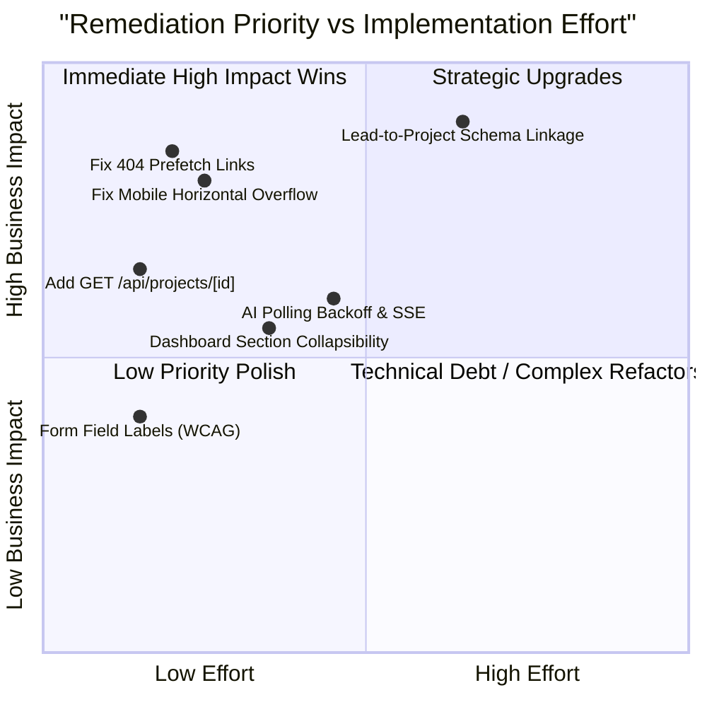

# CYRAOPS USABILITY & FUNCTIONAL REMEDIATION ROADMAP
## Ranked Engineering Action Plan for Production Readiness

> [!NOTE]
> **Audit Status:** This roadmap presents the prioritized remediation proposals based on the code-level findings documented in [`CYRAOPS_COMPLETE_APPLICATION_USABILITY_AUDIT.md`](file:///Users/tanveersinghsaini/.gemini/antigravity/brain/4672ddc8-7ba6-4169-838e-e32f51f54d73/CYRAOPS_COMPLETE_APPLICATION_USABILITY_AUDIT.md). In accordance with the audit guidelines, **no code changes or database modifications have been applied yet**. Implementation requires separate explicit approval.

---

## 1. Prioritized Improvement Matrix



---

## 2. Ranked Action Items

### Phase 1: Immediate Critical Wins (P1 — Stability & Polish)

#### REM-01: Fix 404 Route Prefetching on `/leads`, `/deals`, and `/companies`
* **What needs to change:** 
  In [`src/components/modules/ai-workspace.tsx`](file:///Users/tanveersinghsaini/Desktop/locally%20hosted%20app%20dev/src/components/modules/ai-workspace.tsx) and [`src/components/modules/dashboard.tsx`](file:///Users/tanveersinghsaini/Desktop/locally%20hosted%20app%20dev/src/components/modules/dashboard.tsx), replace unrouted `<Link href="/leads">`, `<Link href="/deals">`, and `<Link href="/companies">` tags with either:
  1. Temporary modal triggers or disabled pills with "Coming Soon" tooltips, or
  2. Implement lightweight `/leads`, `/deals`, and `/companies` page placeholders under `src/app/(workspace)/`.
* **Why it matters:** 
  Next.js router prefetch aggressively scans all links in viewport and issues background HTTP GET requests. When these return `404 Not Found`, it floods the browser console with error noise and creates a jarring user experience.
* **Files Affected:** 
  - `src/components/modules/ai-workspace.tsx`
  - `src/components/modules/dashboard.tsx`
* **Risk of Regression:** **Very Low** (presentation/routing adjustment).
* **Estimated Complexity:** **Low** (30–45 minutes).
* **Dependencies:** None.

---

#### REM-02: Fix Mobile Horizontal Scroll Overflow on `/dashboard` (9px)
* **What needs to change:** 
  In [`src/components/modules/dashboard.tsx`](file:///Users/tanveersinghsaini/Desktop/locally%20hosted%20app%20dev/src/components/modules/dashboard.tsx), add `overflow-x-auto` wrappers and `min-w-0` styles around the Capability Gap table, Business Weakness cards, and Acquisition Engine metrics. Ensure the root container enforces `max-w-full overflow-hidden`.
* **Why it matters:** 
  On mobile devices (390px viewport width), the page currently expands to 399px, causing horizontal sliding during vertical scrolling, which feels unpolished on iOS Safari and mobile Chrome.
* **Files Affected:** 
  - `src/components/modules/dashboard.tsx`
* **Risk of Regression:** **Low** (CSS/layout classes only).
* **Estimated Complexity:** **Low** (30–45 minutes).
* **Dependencies:** None.

---

#### REM-03: Implement `GET /api/projects/[id]` Route
* **What needs to change:** 
  In [`src/app/api/projects/[id]/route.ts`](file:///Users/tanveersinghsaini/Desktop/locally%20hosted%20app%20dev/src/app/api/projects/%5Bid%5D/route.ts), export a standard `GET` handler returning the requested project with its tasks, discussion posts, files, and member permissions.
* **Why it matters:** 
  Currently, `GET /api/projects/[id]` returns `405 Method Not Allowed`. This prevents external integrations, notifications, and direct deep-linking from fetching a single project directly.
* **Files Affected:** 
  - `src/app/api/projects/[id]/route.ts`
* **Risk of Regression:** **None** (adding a previously missing HTTP verb).
* **Estimated Complexity:** **Low** (20–30 minutes).
* **Dependencies:** Project access policy in `src/app/api/projects/[id]/route.ts`.

---

### Phase 2: Core CRM Integration (P1/P2 — Data Cohesion)

#### REM-04: Implement Relational Linkage Between Leads, Deals, and Projects
* **What needs to change:** 
  1. In `prisma/schema.prisma`, add optional foreign key `projectId String?` to `model Lead`, and `leadId String?` to `model Project`.
  2. In `src/components/modules/projects.tsx`, add a "Converted from Lead" badge when a project originates from a sales inquiry.
  3. In `src/app/api/projects/route.ts`, accept an optional `leadId` parameter and automatically transition the lead status to `WON` upon project creation.
* **Why it matters:** 
  Closes the loop on Workflow A (Lead to Project). Allows leadership to track project profitability against original sales acquisition costs (CAC).
* **Files Affected:** 
  - `prisma/schema.prisma`
  - `src/app/api/projects/route.ts`
  - `src/components/modules/projects.tsx`
* **Risk of Regression:** **Medium** (requires dev schema migration `prisma db push` in `company_os_dev`).
* **Estimated Complexity:** **Medium** (2–3 hours).
* **Dependencies:** Database schema update.

---

#### REM-05: AI Workspace Polling Backoff & Inactivity Throttle
* **What needs to change:** 
  In [`src/components/modules/ai-workspace.tsx`](file:///Users/tanveersinghsaini/Desktop/locally%20hosted%20app%20dev/src/components/modules/ai-workspace.tsx), attach window visibility listeners (`document.hidden`). When the tab is in the background or no agent is actively executing, increase the polling interval from 2 seconds to 30 seconds, or transition to a WebSocket push model.
* **Why it matters:** 
  Continuous 2-second polling wastes network bandwidth, keeps browser threads awake, and prevents test automation harnesses from reaching `networkidle`.
* **Files Affected:** 
  - `src/components/modules/ai-workspace.tsx`
* **Risk of Regression:** **Low** (timing adjustments).
* **Estimated Complexity:** **Medium** (1–2 hours).
* **Dependencies:** None.

---

### Phase 3: Usability & Accessibility Refinements (P3 — Polish)

#### REM-06: Explicit Form Input Labels for WCAG 2.2 AA Compliance
* **What needs to change:** 
  In [`src/components/modules/cost.tsx`](file:///Users/tanveersinghsaini/Desktop/locally%20hosted%20app%20dev/src/components/modules/cost.tsx) and [`src/components/modules/ai-workspace.tsx`](file:///Users/tanveersinghsaini/Desktop/locally%20hosted%20app%20dev/src/components/modules/ai-workspace.tsx), ensure all search inputs and filter select dropdowns include an explicit `aria-label` or `<label>` tag rather than relying solely on `placeholder`.
* **Why it matters:** 
  Screen readers cannot reliably treat placeholder text as a label substitute for visually impaired operators.
* **Files Affected:** 
  - `src/components/modules/cost.tsx`
  - `src/components/modules/ai-workspace.tsx`
* **Risk of Regression:** **None**.
* **Estimated Complexity:** **Low** (20 minutes).
* **Dependencies:** None.

---

#### REM-07: Section Collapsibility & Sticky Sub-Nav on Dashboard
* **What needs to change:** 
  In [`src/components/modules/dashboard.tsx`](file:///Users/tanveersinghsaini/Desktop/locally%20hosted%20app%20dev/src/components/modules/dashboard.tsx), add a horizontal jump-to navigation bar (e.g. `[Health Overview] [Weaknesses] [Acquisition] [Capability Gap] [Revenue]`) or collapsible accordions for secondary sections.
* **Why it matters:** 
  The Command Center is currently over 4,000 pixels tall, requiring extensive scrolling to reach the Chief of Staff AI advisor at the bottom.
* **Files Affected:** 
  - `src/components/modules/dashboard.tsx`
* **Risk of Regression:** **Low**.
* **Estimated Complexity:** **Medium** (1.5 hours).
* **Dependencies:** None.

---

## 3. Recommended Execution Order

```
[Sprint 1: Quick Polish & Error Elimination]
  ├── REM-01: Fix 404 Route Prefetches (/leads, /deals, /companies)
  ├── REM-02: Fix Mobile 9px Horizontal Overflow
  ├── REM-03: Implement GET /api/projects/[id]
  └── REM-06: Fix Unlabeled Form Inputs (WCAG)

[Sprint 2: Architecture & Integration Upgrades]
  ├── REM-04: Relational Lead-to-Project Linkage (Workflow A)
  ├── REM-05: AI Workspace Polling Backoff
  └── REM-07: Dashboard Sticky Jump Navigation
```

*Total Estimated Remediation Time:* **6 to 8 engineering hours** to achieve complete operational polish.
