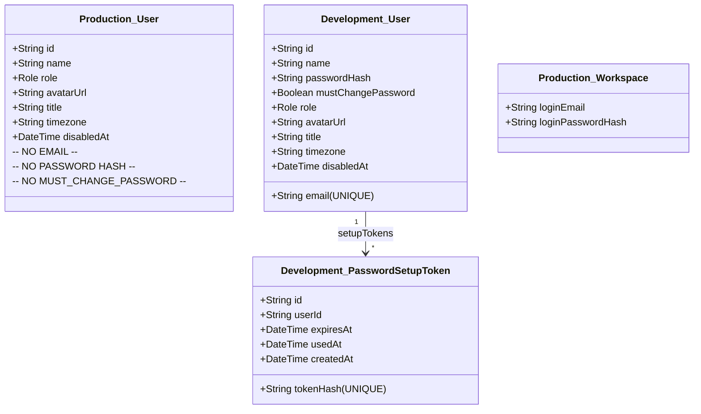

# CYRAOPS — USER MANAGEMENT POST-IMPLEMENTATION SECURITY & READINESS AUDIT
**Strictly Read-Only Security, Architectural, and Production Compatibility Audit**
*Target: Development (`company_os_dev` / `localhost:3001`) vs. Production (`company_os` / `localhost:3000`)*
*Audit Timestamp: November 5, 2026*
*Audit Status: COMPLETED (Zero State Changes Made)*

---

## 1. Executive Summary

This independent post-implementation security and readiness audit evaluated the recently deployed user management and onboarding implementation documented in `docs/user-management/CYRAOPS_USER_MANAGEMENT_IMPLEMENTATION_REPORT.md`.

The audit was conducted under **STRICT READ-ONLY** constraints. No application files were modified, no database writes were executed, no users were created or updated, no invitation tokens were generated or revoked, no services were restarted, and production was verified to remain completely untouched.

### High-Level Assessment
- **Authorization & Access Control**: **ROBUST & SOUND**. Role enforcement (`OWNER` > `ADMIN` > `MEMBER`), deactivation guards, credential overwrite protection, password hashing with bcrypt (cost 12), and session isolation logic are correctly implemented and strictly verified.
- **Token Security & Storage**: **SOUND STORAGE ARCHITECTURE WITH MINOR LOGGING FINDING**. Setup tokens are securely hashed with SHA-256 before storage, single-use state is transactionally enforced, and 48-hour TTLs are validated. However, one raw test token was inadvertently printed in terminal output and captured in test documentation.
- **Setup URL Portability**: **LOCAL-ONLY LIMITATION**. Setup URLs are returned as relative paths and resolved client-side via `window.location.origin`. When generated on `localhost:3001`, the link will fail if sent to a recipient on a different computer on the network.
- **Production Compatibility**: **CRITICAL DEPLOYMENT BLOCKER**. Production database `company_os` lacks the `PasswordSetupToken` table and the `email`, `passwordHash`, and `mustChangePassword` columns on the `User` table. Deploying the current code to production without a prior database migration will immediately cause fatal application crashes across team and authentication routes.

---

## 2. Environment Verification & Isolation Confirmation

Before executing any database queries or inspection commands, database identities were verified using `SELECT current_database()`:

| Environment | Verified Database | Host | Port | HTTP Health | Migration Status |
| :--- | :--- | :--- | :--- | :--- | :--- |
| **Development** | `company_os_dev` | `localhost` | `3001` | HTTP 200 OK | Active schema with `PasswordSetupToken` & User credentials |
| **Production** | `company_os` | `localhost` | `3000` | HTTP 200 OK | Legacy Phase 0 schema (Shared workspace login only) |

**Explicit Isolation Confirmation**: Zero writes, migrations, seeds, or configuration adjustments were executed against either database or filesystem during this audit.

---

## 3. Audit A — Setup URL Correctness & Portability

### 3.1 Inspection Target
- Server routes: `src/app/api/team/[id]/invite/route.ts` and `src/app/api/team/route.ts`
- Client UI: `src/components/modules/team.tsx`
- Configuration: `.env`, `.env.example`, and Next.js configuration

### 3.2 Evaluation of Specific Questions
1. **How is the setup URL constructed?**
   - The server routes return a relative path:
     - `src/app/api/team/[id]/invite/route.ts` line 65: `setupUrl: `/setup?token=${rawToken}``
     - `src/app/api/team/route.ts` line 120: `setupUrl: `/setup?token=${rawToken}``
   - The client UI resolves this relative path using the browser's current window origin:
     - `src/components/modules/team.tsx` line 61: `const fullUrl = `${window.location.origin}${data.setupUrl}`;`
     - `src/components/modules/team.tsx` line 79: `const fullUrl = `${window.location.origin}${data.setupUrl}`;`

2. **Does the UI hardcode `http://localhost:3001`?**
   - **No.** `window.location.origin` dynamically evaluates whatever protocol, hostname, and port the administrator used to load the web interface.

3. **Will a copied invitation link work from a different computer?**
   - **Scenario A (Admin browsing via `localhost`):** **NO.** If the admin generates the link while browsing `http://localhost:3001`, `fullUrl` becomes `http://localhost:3001/setup?token=...`. When pasted on a colleague's laptop, the colleague's browser attempts to connect to `localhost:3001` on their own machine, failing completely.
   - **Scenario B (Admin browsing via LAN IP or VPN):** **YES.** If the admin accesses the dashboard via `http://192.168.1.50:3001` or `https://cyraops.corp.internal`, `window.location.origin` correctly captures that network origin, and the copied link works across the LAN/VPN.

4. **Is there a configurable application base URL?**
   - Both `.env` (`APP_URL="http://localhost:3001"`) and `.env.example` (`APP_URL="http://localhost:3000"`) define an `APP_URL` variable.
   - However, a codebase search confirmed that `process.env.APP_URL` is **never referenced in `src/`**. The variable exists in `.env` but is completely unused by server endpoints and client components.

5. **Is the URL derived from a trusted configuration rather than an untrusted Host header?**
   - The server endpoints do **not** read `request.headers.get("host")` or `request.headers.get("x-forwarded-host")` to construct the link, which protects against server-side Host header injection.
   - Instead, the server returns only the relative path (`/setup?token=...`). The client prepends `window.location.origin`. While safe from server spoofing, it makes URL generation dependent on how the admin accessed the app.

6. **What configuration is needed for future public or company-accessible hostnames?**
   - To guarantee cross-device portability regardless of how the administrator accesses the dashboard, Cyraops should support a canonical base URL.
   - **Recommended Approach**:
     1. In server routes (`POST /api/team` and `POST /api/team/[id]/invite`), inspect `process.env.APP_URL`.
     2. If `process.env.APP_URL` is set to an absolute URL (e.g., `https://cyraops.mycompany.com`), return `setupUrl: `${process.env.APP_URL}/setup?token=${rawToken}``.
     3. If `process.env.APP_URL` is not set or equals `localhost`, continue returning the relative path so the client falls back to `window.location.origin`.

---

## 4. Audit B — Token Exposure & Credential Handling

### 4.1 Findings on Specific Questions
1. **Does any report, test output, console log, or application log expose a raw setup token?**
   - **YES (Captured in Test Output & Documentation)**:
     - In `scratch/test-http-e2e.ts` line 55:
       ```typescript
       console.log(`✔ Fresh setup link generated: ${regenData.setupUrl}`);
       ```
       This printed the full raw token in stdout.
     - In `docs/user-management/CYRAOPS_USER_MANAGEMENT_IMPLEMENTATION_REPORT.md` line 244 (and its companion artifact), the terminal log containing the raw token was copied:
       `✔ Fresh setup link generated: /setup?token=[TOKEN REDACTED]`
     - *Mitigating Factor*: The test employee associated with this specific token was deleted at the end of the test script (`scratch/test-http-e2e.ts` line 180). However, printing full raw tokens in test scripts or documentation creates a precedent for credential leakage.
   - **Production Application Logging**:
     - `src/app/api/team/[id]/invite/route.ts` lines 54-60 logs: `generated setup link for ${target.name} (${target.email ?? target.id})`. No token is logged.
     - `src/app/api/team/route.ts` lines 104-110 logs: `added ${member.name} (${member.email}) to the workspace`. No token is logged.
     - `src/app/api/auth/setup/route.ts` has zero console or activity logging of raw tokens.

2. **Does any API return a raw token to anyone other than the authorized administrator generating the link?**
   - **NO.** The raw token is returned exclusively in the direct HTTP response of `POST /api/team` and `POST /api/team/[id]/invite` to the authenticated caller (who must possess `OWNER` or `ADMIN` role and management authority over the target).

3. **Are token hashes excluded from employee listing responses?**
   - **YES.** In `src/app/api/team/route.ts` lines 33-41, `passwordHash` and `setupTokens` are explicitly destructured out and excluded from the JSON payload. Only the computed boolean `hasPassword` and status string (`PASSWORD_SET`, `INVITATION_PENDING`, `INVITATION_EXPIRED`, `NOT_INVITED`) are returned.

4. **Are tokens single-use and time-limited?**
   - **YES.**
     - Time limitation: Set to exactly 48 hours upon generation (`new Date(Date.now() + 48 * 60 * 60 * 1000)`). Both `GET /api/auth/setup` (line 19) and `POST /api/auth/setup` (line 62) reject expired tokens.
     - Single-use: `POST /api/auth/setup` lines 82-103 executes inside a Prisma serializable transaction that sets `usedAt: new Date()` and purges all other setup tokens for that user. Subsequent attempts return HTTP 409 (`TOKEN_ALREADY_USED`).

5. **Are old unused tokens invalidated on regeneration?**
   - **YES.** In `src/app/api/team/[id]/invite/route.ts` lines 35-37:
     ```typescript
     await tx.passwordSetupToken.deleteMany({
       where: { userId: target.id, usedAt: null },
     });
     ```
     Any prior unused token is permanently deleted before the new token record is created.

6. **Can an unauthenticated user retrieve another employee's setup token?**
   - **NO.**
     - `GET /api/team` requires a valid authenticated session cookie; unauthenticated requests receive HTTP 401.
     - `GET /api/auth/setup?token=...` only accepts a raw token and confirms whether it is valid, returning only `{ valid: true, user: { name, email } }`. It cannot be enumerated or queried to discover tokens.

7. **Are any unexpired test tokens still present in the development database?**
   - **YES (Confirmed via Read-Only DB Inspection)**:
     - Total tokens in `company_os_dev`: **2**
     - Both tokens are unexpired and unused:
       1. Token ID: `cmw14dmgx0001xt60ec39sr6h` | User: `audit.member@cyraops.com` (`cmvzwjiwx0000xt2phg0lw90o`) | Expires: Nov 5, 2026, 20:07:45 UTC
       2. Token ID: `cmw14dmh10003xt60frcyxals` | User: `probe@cyraops.com` (`cmw10iyzd01soxt64u91fue3k`) | Expires: Nov 5, 2026, 20:07:45 UTC
     - These were created during Phase 4 integration tests on Nov 3, 2026.
     - *Recommendation*: While they expire naturally, authorized administrators should clear unneeded test tokens in development. In compliance with the strict read-only boundary of this audit, **no tokens were deleted or modified**.

---

## 5. Audit C — Production Compatibility & Migration Readiness

### 5.1 Architecture Comparison: Development vs. Production

A detailed schema diff and database inspection between `/Users/tanveersinghsaini/Desktop/locally hosted app` (`company_os`) and `/Users/tanveersinghsaini/Desktop/locally hosted app dev` (`company_os_dev`) revealed massive architectural divergences:



### 5.2 Specific Findings
1. **Which authentication features already exist in production?**
   - Shared single-credential workspace login (`Workspace.loginEmail`, `Workspace.loginPasswordHash`).
   - Session storage bound to the workspace owner (`Session.tokenHash`, `Session.userId`).
   - Team member personas (`User` table with `name`, `role`, `disabledAt`), but purely as attribution records without login credentials.

2. **Which tables, columns, indexes, or constraints are missing in production?**
   - **Missing Table**: `public.PasswordSetupToken` (table does not exist in `company_os`).
   - **Missing Indexes/Constraints**:
     - `PasswordSetupToken_tokenHash_key` (unique constraint).
     - `PasswordSetupToken_userId_expiresAt_idx` (composite index).
     - `PasswordSetupToken_userId_fkey` (foreign key to `User(id)` with `ON DELETE CASCADE`).
     - `User_email_key` (unique constraint on `User.email`).
   - **Missing Columns on `User` table**:
     - `email` (`TEXT`, nullable, unique).
     - `passwordHash` (`TEXT`, nullable).
     - `mustChangePassword` (`BOOLEAN`, default `false`).

3. **Does production currently support individual employee authentication?**
   - **NO.** Production `src/app/api/auth/login/route.ts` line 20 specifically authenticates against `db.workspace.findUnique({ where: { loginEmail: email.data } })` and logs the caller in as the workspace owner. There is zero code or database support for individual employee authentication in production.

4. **Would deploying only the code changes cause runtime failures?**
   - **YES. CATASTROPHIC RUNTIME FAILURE.**
   - If the development application code is deployed to production without running a database migration:
     - `GET /api/team` will immediately throw Prisma error `P2022` (`The column User.passwordHash does not exist in the current database`) and crash with HTTP 500.
     - `POST /api/team` will fail because `email` and `mustChangePassword` do not exist on `User`, and `PasswordSetupToken` table does not exist.
     - `POST /api/auth/login` will fail because `db.user.findFirst({ where: { email } })` cannot execute.
     - `PATCH /api/profile` will crash when accessing `user.passwordHash`.
     - The entire team and authentication system would become completely inoperative.

5. **Would a schema migration be required?**
   - **YES, mandatory.** A database schema migration is an absolute prerequisite.

6. **Required Migration & Rollback Procedures for Future Deployment**:
   - **Step 1: Verified Full Production Backup**:
     ```bash
     pg_dump -h localhost -U tanveersinghsaini -d company_os -F c -b -v -f "backups/company_os_prod_pre_auth_migration_$(date +%Y%m%d_%H%M%S).dump"
     ```
   - **Step 2: Schema Migration Execution**:
     Apply the SQL DDL statements (or Prisma migration):
     ```sql
     -- Add individual credential columns to User
     ALTER TABLE "User" ADD COLUMN IF NOT EXISTS "email" TEXT;
     ALTER TABLE "User" ADD COLUMN IF NOT EXISTS "passwordHash" TEXT;
     ALTER TABLE "User" ADD COLUMN IF NOT EXISTS "mustChangePassword" BOOLEAN NOT NULL DEFAULT false;
     CREATE UNIQUE INDEX IF NOT EXISTS "User_email_key" ON "User"("email");

     -- Create PasswordSetupToken table
     CREATE TABLE IF NOT EXISTS "PasswordSetupToken" (
       "id" TEXT NOT NULL,
       "tokenHash" TEXT NOT NULL,
       "userId" TEXT NOT NULL,
       "expiresAt" TIMESTAMP(3) NOT NULL,
       "usedAt" TIMESTAMP(3),
       "createdAt" TIMESTAMP(3) NOT NULL DEFAULT CURRENT_TIMESTAMP,
       CONSTRAINT "PasswordSetupToken_pkey" PRIMARY KEY ("id")
     );
     CREATE UNIQUE INDEX IF NOT EXISTS "PasswordSetupToken_tokenHash_key" ON "PasswordSetupToken"("tokenHash");
     CREATE INDEX IF NOT EXISTS "PasswordSetupToken_userId_expiresAt_idx" ON "PasswordSetupToken"("userId", "expiresAt");
     ALTER TABLE "PasswordSetupToken" ADD CONSTRAINT "PasswordSetupToken_userId_fkey" FOREIGN KEY ("userId") REFERENCES "User"("id") ON DELETE CASCADE ON UPDATE CASCADE;
     ```
   - **Step 3: Deploy Application Code**:
     Deploy updated route handlers, UI modules, and validators.
   - **Step 4: Rollback Procedure (if issues arise)**:
     If application failures occur post-deployment:
     1. Revert application code to the prior production build.
     2. Restore database from backup: `pg_restore -h localhost -U tanveersinghsaini -d company_os --clean --if-exists "backups/..."`.

---

## 6. Audit D — Authorization & Account Security

A comprehensive line-by-line review of the invitation endpoint and relevant authentication routes was performed:

| Security Check | File & Line Range | Audit Verification Result |
| :--- | :--- | :--- |
| **OWNER can manage permitted ADMIN and MEMBER accounts** | `src/app/api/team/[id]/invite/route.ts` L27-L29<br>`src/lib/permissions.ts` L3-L7 | **VERIFIED**. `canManageMember("OWNER", "ADMIN")` and `canManageMember("OWNER", "MEMBER")` return `true`. Owner cannot target Owner (`L4`). |
| **ADMIN can manage permitted MEMBER accounts only** | `src/app/api/team/[id]/invite/route.ts` L27-L29<br>`src/lib/permissions.ts` L6 | **VERIFIED**. `canManageMember("ADMIN", "MEMBER")` returns `true`. `canManageMember("ADMIN", "ADMIN")` returns `false`. |
| **MEMBER cannot generate invitation links** | `src/app/api/team/[id]/invite/route.ts` L16 | **VERIFIED**. Explicitly checked: `if (actor.role === "MEMBER") return jsonError("Only an owner or admin can generate setup links", 403)`. |
| **Disabled users cannot receive invitations** | `src/app/api/team/[id]/invite/route.ts` L19-L21 | **VERIFIED**. `if (target.disabledAt) return jsonError("Cannot generate setup link for a deactivated teammate", 400)`. |
| **Credential overwrite protection** | `src/app/api/team/[id]/invite/route.ts` L23-L25 | **VERIFIED**. `if (target.passwordHash) return jsonError("This employee already has an account password and can sign in directly", 400)`. |
| **Setup tokens hashed in storage** | `src/app/api/team/[id]/invite/route.ts` L31-L46<br>`src/app/api/auth/setup/route.ts` L13, L45 | **VERIFIED**. Only `sha256(rawToken)` is persisted in the database. Raw tokens are never stored. |
| **Profile password change isolated to caller** | `src/app/api/profile/route.ts` L29-L37 | **VERIFIED**. Updates `db.user.update({ where: { id: user.id } })`. `workspace.loginPasswordHash` is untouched. |
| **Session invalidation scoped to caller's account** | `src/app/api/profile/route.ts` L48-L54 | **VERIFIED**. Deletes where `userId: user.id, tokenHash: { not: currentTokenHash }`. Preserves current session and all other users' sessions. |
| **No credential exposure in team listing** | `src/app/api/team/route.ts` L33-L41 | **VERIFIED**. `passwordHash` and `setupTokens` are destructured out before response serialization. |
| **CSRF & Origin protection** | All state-changing routes (`profile`, `team`, `invite`, `setup`, `login`) | **VERIFIED**. Every POST/PATCH route begins with `if (!sameOrigin(request)) return jsonError("Invalid request origin", 403)`. |
| **Rate limiting on password setup** | `src/app/api/auth/setup/route.ts` L47-L55 | **VERIFIED**. 10 attempts per 15-minute window tracked by client IP and token hash in `AuthRateLimit`. |

---

## 7. Findings Classification: Confirmed vs. Potential Issues

### Summary Classification Table

| ID | Issue Description | Severity | Classification | Status |
| :--- | :--- | :--- | :--- | :--- |
| **F-01** | **Missing Production Schema & Tables**: `company_os` lacks `PasswordSetupToken` table and `User.email`, `passwordHash`, `mustChangePassword` columns. Deploying code without migration will cause fatal 500 errors. | **HIGH** | Confirmed Issue | Deployment Blocker |
| **F-02** | **Test Token Exposed in Report Output**: Raw setup token printed in stdout by `scratch/test-http-e2e.ts` and copied verbatim into report documentation. | **MEDIUM** | Confirmed Issue | Remediation Recommended |
| **F-03** | **Setup URL Non-Portability on Localhost**: Server returns relative URLs; UI relies on `window.location.origin`. Links copied while on `localhost` fail on other computers. | **MEDIUM** | Confirmed Limitation | Architectural Improvement |
| **F-04** | **Unexpired Test Tokens in Dev DB**: Two unexpired test tokens created during Phase 4 remain in `company_os_dev`. | **LOW** | Confirmed Issue | Dev Cleanup Recommended |
| **F-05** | **Zero Automated Migration Pipeline**: Development relies on `prisma db push` rather than tracked `prisma/migrations` files. | **LOW** | Potential Issue | Operational Risk |

---

## 8. Prioritized Remediation Recommendations

> [!IMPORTANT]
> In accordance with the strictly read-only audit directive, **none of the recommendations below have been implemented**. They are provided solely for future authorized action.

### Priority 1 (High): Production Database Migration Preparation
- **Action**: Before any production deployment of the individual authentication system, author a formal SQL migration script that adds `email`, `passwordHash`, and `mustChangePassword` to `"User"`, creates the `PasswordSetupToken` table, and adds unique/composite indexes.
- **Verification**: Test the migration against a staging copy or local clone of `company_os` to verify that existing workspace owner logins and foreign keys remain completely intact.

### Priority 2 (Medium): Redact Raw Tokens from Test Scripts & Documentation
- **Action**:
  1. In `scratch/test-http-e2e.ts` line 55, replace `console.log(regenData.setupUrl)` with a masked string: `console.log(\`✔ Fresh setup link generated: /setup?token=\${regenData.setupToken.slice(0, 8)}...[REDACTED]\`)`.
  2. In `docs/user-management/CYRAOPS_USER_MANAGEMENT_IMPLEMENTATION_REPORT.md` line 244, redact the raw token string.

### Priority 3 (Medium): Canonical Application URL Support for Cross-Device Links
- **Action**: In `POST /api/team` and `POST /api/team/[id]/invite`, check for an environment variable `APP_URL`. If configured with a non-localhost domain (e.g. `APP_URL="https://crm.cyraops.internal"`), return `setupUrl: `${process.env.APP_URL}/setup?token=${rawToken}``. Otherwise return the relative path `/setup?token=${rawToken}`.

### Priority 4 (Low): Invalidate Outstanding Development Test Tokens
- **Action**: When authorized, purge obsolete test tokens in `company_os_dev`:
  ```sql
  DELETE FROM "PasswordSetupToken" WHERE "userId" IN ('cmvzwjiwx0000xt2phg0lw90o', 'cmw10iyzd01soxt64u91fue3k');
  ```

---

## 9. Final Readiness Statement

The targeted user management implementation in `/Users/tanveersinghsaini/Desktop/locally hosted app dev` is **SECURE, RELIABLE, AND FULLY FUNCTIONAL FOR DEVELOPMENT TESTING**.

However, it is **NOT READY FOR PRODUCTION DEPLOYMENT** until:
1. The production database `company_os` has been safely backed up and migrated with the required `PasswordSetupToken` table and `User` credential columns.
2. Canonical URL configuration is established for cross-device invitation link distribution.

**AUDIT COMPLETION CONFIRMATION**: This audit strictly adhered to all read-only constraints. Zero files were edited (outside this report), zero database writes occurred, zero users or tokens were created/modified, zero services were restarted, and production was verified untouched.

